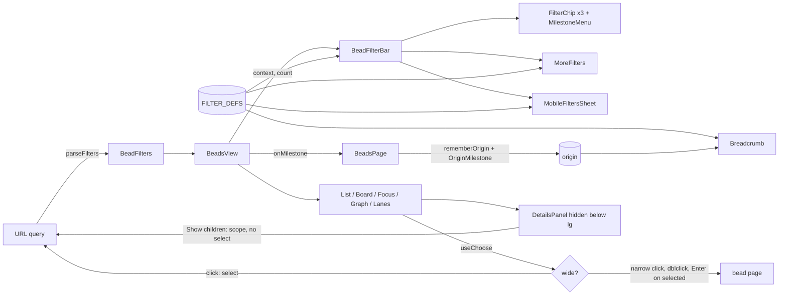

# Plan: Beads views

Epic: gin-console-rm-beads-views
Spec: `01-proposal.md`, `02-spec-delta.md`, `03-design.md` and `05-tests.md` in this folder (8 ADDED: REQ-UI-142 to REQ-UI-149; 11 MODIFIED: REQ-UI-037, -046, -051, -053, -072, -078, -084, -104, -106, -140, REQ-MILESTONE-UI-018; none REMOVED).

## Goal
The Beads page gets a one-line filter bar. The current milestone and every chosen filter show as removable chips, the other filters sit under "More filters", and "Clear filters" brings back the current milestone. All five views (List, Board, Focus, Graph, Lanes) follow one click rule and show the same details panel from 1024px, Board and Focus included. In Graph and Lanes, "Show children" in the panel replaces the double click that entered a child's scope. There is no backend or API change.

Done when:
- Every scenario of the 8 added and 11 modified REQs has a test that names its REQ.
- `gin-qa cases check --change gin-console-rm-beads-views` prints `ok`, and a full `gin-qa e2e run ui milestone-ui` passes.
- TC-1 (`05-tests.md`) passes on the deployed console at 1440, 1024 and 390px in the light and the dark theme.

## Architecture
Everything stays in the frontend's `beads` context (ADR 0001), as described in `03-design.md` `## Architecture`. The URL is still the one source of the filters, the view, the selection and the scope, and no URL key is added. Every control calls the `onChange` that `BeadsPage`, `MilestonePage` and `EpicPage` already pass to `BeadsView`.

- **Filters:**
  - `filterDefs.ts` holds `FILTER_DEFS`, the one list behind the bar, "More filters", the sheet and every count (`activeFilters`, `moreCount`, `clearFilters`).
  - The bar is built from `FilterChip`, `MilestoneMenu`, `MoreFilters` and `MultiSelectList`. On a phone the bar shows `MobileFiltersSheet`.
  - The breadcrumb counts filters with `activeFilters` too. To do so, the remembered Beads place carries the milestone in effect (`OriginMilestone` in `app/origin.ts`).
- **Selection:**
  - `useChoose.ts` holds the one click rule: click, double click, `Enter`.
  - `useCardChoice.ts` applies it to the Board and Focus cards, adding their tab stop and their closing.
  - The Graph node, the canvases and the List tree take a `Choose` instead of their own handlers.
- **Panel:**
  - `DetailsPanel` is hidden below 1024px in every view.
  - It takes `graphLink` and `onShowChildren`. The embedded `BeadDetailPage` draws "Show children" next to "Open page" and leaves out "View in graph" when `graphLink` is false.



## Tech Stack
React 19, TypeScript (strict, `noUnusedLocals`, `noUnusedParameters`), Tailwind 4, `@base-ui/react` (Popover, Dialog), lucide-react, vitest 5 with Testing Library and user-event (two projects: `unit` on vmThreads and `time-zone` on forks for `*.tz.test.ts`), ESLint with `typescript-eslint` recommendedTypeChecked and `eslint-plugin-react-hooks` 7, Playwright 1.64 with gin-qa for e2e. The backend (FastAPI, pytest, ruff, mypy) is untouched.

## Global Constraints
User decisions 2026-11-23, verbatim from `01-proposal.md`:
- From 768px the bar reads: the search box with a visible `/` key hint, the filters Milestone, Status and Assignee, "More filters" with its count, then the count "N of M" and "Show closed". From 1024px everything before the count stays on one line; at 1440px the whole bar does.
- A bar filter without a value is a button with its name; with a value it is a chip "<name> <values> ×" in the identity style. Its body opens a popover menu and its "×" removes it. The current milestone shows as a chip, and its "×" sets `milestone=all`. The native milestone select becomes a popover menu with the same choices.
- "More filters" holds Priority, Labels with Any/All, Type, Kind, and Capability and Sprint while they exist. Its count is the number of active filters inside it, hidden at 0.
- "Clear filters" shows only while a filter differs from its default. It removes every filter and the search and returns to the current milestone, and leaves "Show closed", view, group, selection and scope alone.
- Below 768px: the search box and a button "Filters" with the count of active filters, the milestone counted only when it is not the current one; its sheet lists Milestone, Status, Assignee, the More filters group and "Clear filters". No chips and no `/` hint.
- A page that fixes the milestone (the Beads tab of a milestone page, the Graph and Lanes tabs of an epic page) shows no Milestone filter, and its "Clear filters" leaves the milestone.
- One click rule in the List, Board, Focus, Graph and Lanes views on those three pages. From 1024px a click selects and shows the details panel; below 1024px it opens the bead page. The title link, a double click, and `Enter` on the selected item open the bead page. Controls inside an item keep their own action.
- The arrow keys move the focus as today; Board and Focus cards take the focus themselves. `Enter` selects an item that is not selected (below 1024px it opens the page), and Escape closes the panel and returns the focus to the item.
- A double click in Graph and Lanes no longer enters a child scope. The panel of a bead with children offers "Show children", which sets `scope` and clears `select`. On a phone the way down is the bead page.
- Every view shows the same details panel as a side column from 1024px: three fifths and two fifths for the List, two thirds and one third for the others. No view shows it below 1024px. `select` is kept across views, with the note "Not in the current list" when the view does not draw the bead.
- Errors behave as today: "Milestone…" while milestones load, the error in the menu when they fail, a bead error inside the panel, unknown URL values ignored.
- Frontend only, with no API change and no new URL key. One list of filter definitions drives the bar, "More filters", the sheet and every count.

## Route Rubric
- Choose the weakest model that can do the work.
- Raise the model for broad context or design judgement.
- Raise the effort for intrinsic difficulty: intricate logic, many edge cases, or long chains of steps.

| Kind of work | Model | Effort |
|---|---|---|
| Mechanical edits, documentation, boilerplate | weakest | `low` |
| Bounded implementation with a clear spec | middle | `medium` |
| Cross-module change, security, migration, concurrency | strongest | `high` |

Unclear requirements never raise the model or effort.

## Requirement Analysis
- **Problem statement:** the filters of the Beads page take about 300px and wrap onto several lines. "Clear filters" is always shown. Each view reacts to a click in its own way:
  - From 1024px, `Enter` in the List never opens the page.
  - Board and Focus cards react only through their title link and have no panel.
  - In Graph and Lanes, a click selects at every width, and a double click changes the scope.
  - The `/` shortcut has no visible hint.
- **Success criteria:**
  - Everything in the Goal.
  - `pnpm -C frontend test --run`, `typecheck`, `lint` and `build` pass. The pre-commit hook's `uv run --directory backend pytest`, `ruff check .` and `mypy` still pass.
  - `gin specs lint --change gin-console-rm-beads-views --against master` prints `ok`, and `gin specs trace --change gin-console-rm-beads-views` lists no missing REQ (under `standard` rigor a missing REQ stops ship).
  - `grep -rn 'MultiSelectPopover\|LabelsPopover\|from "./Breadcrumb"' frontend/src` finds only `BeadDetailPage.tsx` and `OldGraphLink.tsx` importing `Breadcrumb`.
- **Constraints:** the Global Constraints above. Read-only console, no new dependency, Linux/macOS/Windows unchanged.
- **Non-goals** (from the proposal):
  - Visual tokens (gin-console-rm-strung) and the shared navigation (gin-console-rm-nav-shell).
  - The matching rules of the filters (REQ-UI-025, -043, -082, -083, -085, -108) and the filters of My Tasks.
  - Any backend or API change and any new URL key.
  - The layout of the bead page and the epic page.

## Approach Options
### Option 1: The six tracks of the brief
- **Summary:**
  1. Filter definitions and counts.
  2. The bar.
  3. The click rule.
  4. The panel and Show children.
  5. QA.
  6. TC-1.
- **Pros:**
  - Each track has its own test cycle, and a reviewer can reject it alone.
  - The click rule, which touches five views and three canvases, goes to the strongest route.
- **Cons:**
  - Track 2 is large: the bar, the chips, More filters, the milestone menu, the sheet and many test updates.
  - Tracks 3 and 4 both edit `BoardView`, `FocusView`, `GraphView` and `LanesView`.

### Option 2: Split Track 2 into the bar and the sheet
- **Summary:** the same tracks, with the phone sheet as its own track after the bar.
- **Pros:** smaller diffs to review.
- **Cons:**
  - The sheet and the bar share `FILTER_DEFS`, `MilestoneMenu`, `COUNT_PILL` and the props change of `BeadFilterBar` (`context` replaces `milestone`/`hideMilestone`). Splitting leaves one track with a sheet whose props no longer match its caller.
  - One more handoff in a single lane.

### Recommended Approach
- **Selected option:** Option 1, with these adjustments that the code called for:
  - **Extra Requirements lines:**
    - Track 1 adds REQ-UI-145 and REQ-UI-084, because its `moreCount` and `activeFilters` tests name them.
    - Track 2 adds REQ-UI-143, because the bar shows or hides "Clear filters".
    - Track 3 adds REQ-UI-148 for the wash and bar of the selected card and node.
    - Track 4 adds REQ-UI-106 for the scenario "Show children and back".
  - **New files:**
    - `MilestoneMenu.tsx`: the milestone radio menu, shared by the chip and the sheet.
    - `useCardChoice.ts`: the click rule, tab stop and closing shared by Board and Focus.
  - **Replaced popovers:** `MultiSelectPopover.tsx` and `LabelsPopover.tsx` become `MultiSelectList.tsx` and `LabelMode.tsx`. Their popover wrappers would be orphaned, because the chip and "More filters" hold the lists themselves.
  - **One home for the panel rule:** `DetailsPanel` itself carries `hidden lg:block` (REQ-UI-148), and its `className` prop goes.
- **Rationale:** the brief's split matches the review units; the adjustments keep each file single-purpose and remove what the change orphans.

## Scope
- **In scope:**
  - The 19 REQs of `02-spec-delta.md`.
  - The README feature line.
  - The tests named in `03-design.md` `## Testing`.
  - gin-qa cases and e2e specs of `ui` and `milestone-ui`.
  - TC-1.
- **Out of scope:** the non-goals above. The living diagrams and use cases were written in discuss and are not edited here. The roadmap entry is not edited either.

## Execution Strategy

```yaml
execution_strategy:
  mode: direct
  workers:
    mode: sequential
  rationale: One lane (roadmap AI capacity 1); the tracks share BeadsView.tsx, the five views, beadFixtures.ts and the e2e stubs, so they run one after another on feat/beads-views.
```

## Tasks

### Track 1: Filter definitions and counts
- **Dependencies**: none
- **Requirements**: REQ-UI-143, REQ-UI-072, REQ-UI-145, REQ-UI-084
- **Files**:
  - Create `frontend/src/features/beads/filterDefs.ts`
  - Test `frontend/src/features/beads/filterDefs.test.ts`
  - Modify `frontend/src/features/beads/filters.ts:5-6` (add `VIEW_TITLES`)
  - Modify `frontend/src/features/beads/ViewTabs.tsx:4,18` (use `VIEW_TITLES`)
  - Modify `frontend/src/app/origin.ts:6-10,34-60,76-81` (`OriginMilestone`, `Origin.milestone`, `rememberOrigin` sixth parameter)
  - Test `frontend/src/app/origin.test.ts:4,53-63` (`milestone: null` in `EMPTY` and the two literal origins; two new tests)
  - Modify `frontend/src/features/beads/Breadcrumb.tsx:1-57` (no local `activeFilters`; `contextOf`; `VIEW_TITLES`)
  - Test `frontend/src/features/beads/Breadcrumb.test.tsx`
  - Modify `frontend/src/features/beads/MobileFiltersSheet.tsx:3,25` (import `activeFilters` from `filterDefs` with a context)
  - Modify `frontend/src/features/beads/BeadsView.tsx:1,26-38,51` (`onMilestone`)
  - Modify `frontend/src/features/beads/BeadsPage.tsx:1,11,56-59,82` (remember the milestone with the place)
  - Test `frontend/src/features/beads/BeadsPage.test.tsx` (the `milestone filter` block, line 783 onward)
- **Interfaces**:
  - Produces `frontend/src/features/beads/filterDefs.ts`:
    ```ts
    export type FilterKey = "milestone" | "status" | "assignee" | "priority" | "label" | "type" | "kind" | "capability" | "sprint";
    export type FilterContext = { fixedMilestone: boolean; milestone: MilestoneInEffect; byDefault: MilestoneInEffect };
    export type FilterDef = {
      key: FilterKey;
      label: string;
      place: "bar" | "more";
      isActive: (filters: BeadFilters, context: FilterContext) => boolean;
      clear: Partial<BeadFilters>;
      offered: (options: BeadOptions) => boolean;
    };
    export const FILTER_DEFS: readonly FilterDef[];
    export function activeFilters(filters: BeadFilters, context: FilterContext): number;
    export function moreCount(filters: BeadFilters, context: FilterContext, options: BeadOptions): number;
    export function clearFilters(filters: BeadFilters): BeadFilters;
    ```
  - Produces `filters.ts`: `export const VIEW_TITLES: Record<View, string>`.
  - Produces `app/origin.ts`:
    - `export type OriginMilestone = { inEffect: string; byDefault: string }`
    - `Origin` gains `milestone: OriginMilestone | null`
    - `rememberOrigin(kind: OriginKind, path: string, search: string, project: string, label: string | null = null, milestone: OriginMilestone | null = null): void`
  - Produces `BeadsView` prop `onMilestone?: (milestone: OriginMilestone) => void`.
  - Removes the export `activeFilters` from `Breadcrumb.tsx`.
  - Consumes `milestoneInEffect` (`milestoneChoice.ts`) and `BeadFilters`, `BeadOptions` (`filters.ts`).
- **Provider role**: `frontend`
- **Model:** `sonnet`
- **Effort:** `medium`
- **Why:** pure functions with a written truth table, plus one new field carried through the remembered place; bounded and fully specified.
- **Acceptance criteria**:
  - `filterDefs.test.ts` covers, each test named with its REQ:
    - every REQ-UI-143 rule: the search, each definition, Milestone only against the milestone in effect without `milestone`, never when fixed, the Labels mode alone not active, Show closed not a filter, unknown `kind` and `label_mode`;
    - `clearFilters`: removed and kept keys, and the scenario URL `?project=example&closed=1&view=board&select=ex-e3`;
    - `moreCount` (REQ-UI-145) and the sheet count (REQ-UI-084).
  - The breadcrumb reads:
    - "Beads › Board, 2 filters" for `?project=a&view=board&status=open&q=fix`;
    - "Checkout v2 › Board, 1 filter" from a milestone page;
    - "Beads › Lanes" for `view=lanes`;
    - "Beads › List, 2 filters" for `closed=1&milestone=all&kind=technical` with a current milestone (see Notes: the delta's `kind=epic` is a spec problem).
    - It does not count Show closed.
  - After the Beads page loads with `milestone=all` and current milestone `m2`, `getOrigin().milestone` equals `{ inEffect: "all", byDefault: "m2" }`.
  - `pnpm -C frontend test --run`, `typecheck` and `lint` pass.
- **Estimated complexity**: low

Steps:
1. Write `frontend/src/features/beads/filterDefs.test.ts`:
   ```ts
   import { describe, expect, it } from "vitest";
   import { bead } from "./beadFixtures";
   import { activeFilters, clearFilters, FILTER_DEFS, moreCount, type FilterContext } from "./filterDefs";
   import { filtersToSearch, optionsOf, parseFilters } from "./filters";

   const current: FilterContext = { fixedMilestone: false, milestone: "m2", byDefault: "m2" };
   const fixed: FilterContext = { fixedMilestone: true, milestone: "m2", byDefault: "all" };
   const f = (search: string) => parseFilters(search);
   const plain = optionsOf([bead("a")]);
   const rich = optionsOf([bead("a", { capabilities: ["ui"], labels: ["sprint:1"] })]);

   describe("filterDefs", () => {
     it("REQ-UI-142 REQ-UI-145 Milestone, Status and Assignee in the bar, the rest in More filters in their order", () => {
       expect(FILTER_DEFS.map((d) => `${d.place}:${d.label}`)).toEqual([
         "bar:Milestone", "bar:Status", "bar:Assignee",
         "more:Priority", "more:Labels", "more:Type", "more:Kind", "more:Capability", "more:Sprint",
       ]);
     });

     it("REQ-UI-143 Nothing to clear: the current milestone and no other filter", () => {
       expect(activeFilters(f("?project=example"), current)).toBe(0);
     });

     it("REQ-UI-143 A search is a filter, spaces alone are not", () => {
       expect(activeFilters(f("?q=pay"), current)).toBe(1);
       expect(activeFilters(f("?q=%20%20"), current)).toBe(0);
     });

     it("REQ-UI-143 each filter counts once while it has a value", () => {
       expect(activeFilters(f("?status=open,closed&assignee=alice&priority=1&label=ui&type=bug&kind=technical&capability=ui&sprint=s1"), current)).toBe(8);
     });

     it("REQ-UI-143 the Labels mode alone is not a filter and Show closed never is", () => {
       expect(activeFilters(f("?label_mode=all&closed=1"), current)).toBe(0);
     });

     it("REQ-UI-143 Current milestone named in the URL; Milestone is active only when it differs from the default", () => {
       expect(activeFilters(f("?milestone=m2"), current)).toBe(0);
       expect(activeFilters(f("?milestone=all"), { ...current, milestone: "all" })).toBe(1);
       expect(activeFilters(f("?milestone=all"), { fixedMilestone: false, milestone: "all", byDefault: "all" })).toBe(0);
     });

     it("REQ-UI-143 Fixed milestone: Milestone is never active", () => {
       expect(activeFilters(f("?status=open"), fixed)).toBe(1);
     });

     it("REQ-UI-143 Unknown values: an unknown kind and label_mode are ignored", () => {
       const filters = f("?project=example&kind=epicish&label_mode=some");
       expect(activeFilters(filters, current)).toBe(0);
       expect(moreCount(filters, current, plain)).toBe(0);
     });

     it("REQ-UI-143 Back to the current milestone: clearFilters removes the search and the filters and keeps the rest", () => {
       const filters = f("?project=example&milestone=all&q=pay&status=open&priority=1&label=ui&label_mode=all&closed=1&view=board&select=ex-e3");
       expect(filtersToSearch(clearFilters(filters))).toBe("?project=example&closed=1&view=board&select=ex-e3");
       const kept = f("?project=p&type=bug&kind=parity&capability=ui&assignee=me&sprint=none&closed=1&view=focus&group=assignee&finished=1&select=t-1&scope=e1");
       expect(filtersToSearch(clearFilters(kept))).toBe("?project=p&closed=1&view=focus&group=assignee&finished=1&select=t-1&scope=e1");
     });

     it("REQ-UI-145 Count of active filters inside More filters, and none for the Labels mode alone", () => {
       expect(moreCount(f("?priority=1&label=ui&label_mode=all&kind=technical&status=open"), current, plain)).toBe(3);
       expect(moreCount(f("?label_mode=all"), current, plain)).toBe(0);
     });

     it("REQ-UI-145 Capability and Sprint count only while More filters offers them", () => {
       expect(moreCount(f("?capability=ui&sprint=1"), current, rich)).toBe(2);
       expect(moreCount(f("?capability=ui&sprint=1"), current, plain)).toBe(0);
     });

     it("REQ-UI-084 the Filters count leaves out the current milestone and counts another choice", () => {
       expect(activeFilters(f("?status=open"), current)).toBe(1);
       expect(activeFilters(f("?milestone=all&priority=1"), { ...current, milestone: "all" })).toBe(2);
     });
   });
   ```
   Run `pnpm -C frontend test --run src/features/beads/filterDefs.test.ts`. Expected: fails with `Failed to resolve import "./filterDefs"`.
2. Create `frontend/src/features/beads/filterDefs.ts`:
   ```ts
   import type { BeadFilters, BeadOptions } from "./filters";
   import type { MilestoneInEffect } from "./milestoneChoice";

   export type FilterKey = "milestone" | "status" | "assignee" | "priority" | "label" | "type" | "kind" | "capability" | "sprint";

   /** What the page's milestone means for the filters (REQ-UI-143). */
   export type FilterContext = {
     /** A milestone page's Beads tab or an epic page's tab fixes the milestone: no Milestone filter (REQ-UI-142). */
     fixedMilestone: boolean;
     /** The milestone in effect (REQ-UI-104). */
     milestone: MilestoneInEffect;
     /** The milestone in effect when the URL has no `milestone`: the current one, else `all`. */
     byDefault: MilestoneInEffect;
   };

   /** One filter of the bead filter bar, its "More filters" and its sheet (REQ-UI-142 to REQ-UI-145, REQ-UI-084). */
   export type FilterDef = {
     key: FilterKey;
     /** Its name on the button, the chip, the popover section and the sheet. */
     label: string;
     place: "bar" | "more";
     /** REQ-UI-143: the value differs from the default. */
     isActive: (filters: BeadFilters, context: FilterContext) => boolean;
     /** The default value, which "Clear filters" writes back. */
     clear: Partial<BeadFilters>;
     /** Offered in "More filters" and the sheet only while the loaded beads give a choice (REQ-UI-145). */
     offered: (options: BeadOptions) => boolean;
   };

   const always = () => true;

   export const FILTER_DEFS: readonly FilterDef[] = [
     { key: "milestone", label: "Milestone", place: "bar", isActive: (_filters, c) => !c.fixedMilestone && c.milestone !== c.byDefault, clear: { milestone: "" }, offered: always },
     { key: "status", label: "Status", place: "bar", isActive: (f) => f.status.length > 0, clear: { status: [] }, offered: always },
     { key: "assignee", label: "Assignee", place: "bar", isActive: (f) => f.assignee.length > 0, clear: { assignee: [] }, offered: always },
     { key: "priority", label: "Priority", place: "more", isActive: (f) => f.priority.length > 0, clear: { priority: [] }, offered: always },
     { key: "label", label: "Labels", place: "more", isActive: (f) => f.label.length > 0, clear: { label: [], labelMode: "any" }, offered: always },
     { key: "type", label: "Type", place: "more", isActive: (f) => f.type !== "", clear: { type: "" }, offered: always },
     { key: "kind", label: "Kind", place: "more", isActive: (f) => f.kind !== "", clear: { kind: "" }, offered: always },
     { key: "capability", label: "Capability", place: "more", isActive: (f) => f.capability.length > 0, clear: { capability: [] }, offered: (o) => o.capabilities.length > 0 },
     { key: "sprint", label: "Sprint", place: "more", isActive: (f) => f.sprint !== "", clear: { sprint: "" }, offered: (o) => o.sprints.length > 0 },
   ];

   /** REQ-UI-143: the search and the active filters; "Clear filters" shows above 0, and "Filters" (REQ-UI-084) and the breadcrumb (REQ-UI-072) show the number. */
   export function activeFilters(filters: BeadFilters, context: FilterContext): number {
     return (filters.q.trim() !== "" ? 1 : 0) + FILTER_DEFS.filter((def) => def.isActive(filters, context)).length;
   }

   /** REQ-UI-145: the active filters inside "More filters". */
   export function moreCount(filters: BeadFilters, context: FilterContext, options: BeadOptions): number {
     return FILTER_DEFS.filter((def) => def.place === "more" && def.offered(options) && def.isActive(filters, context)).length;
   }

   /** REQ-UI-143: the search and every filter back to their default, so the current milestone is in effect again; Show closed, view, group, finished, selection and scope stay. */
   export function clearFilters(filters: BeadFilters): BeadFilters {
     return FILTER_DEFS.reduce<BeadFilters>((next, def) => ({ ...next, ...def.clear }), { ...filters, q: "" });
   }
   ```
   Run the same command. Expected: `Test Files  1 passed (1)`.
3. In `filters.ts`, under `export type View`, add:
   ```ts
   /** The name of each view on its tab and in the breadcrumb (REQ-UI-030, REQ-UI-072). */
   export const VIEW_TITLES: Record<View, string> = { list: "List", board: "Board", focus: "Focus", graph: "Graph", lanes: "Lanes" };
   ```
   In `ViewTabs.tsx`:
   - delete `const TITLES = …`;
   - import `VIEW_TITLES` from `./filters`;
   - render `{VIEW_TITLES[view]}`.
4. Origin. First update `origin.test.ts`:
   - add `milestone: null` to `EMPTY` and to the two literal objects of "an old value without a kind…" and "a stored value with a kind…";
   - add:
   ```ts
   it("REQ-UI-072 a Beads place keeps the milestone its page had in effect; another place has none", () => {
     rememberOrigin("beads", "/beads", "?project=a&milestone=all", "a", null, { inEffect: "all", byDefault: "m2" });
     expect(getOrigin().milestone).toEqual({ inEffect: "all", byDefault: "m2" });
     rememberOrigin("my-tasks", "/my-tasks", "?project=a", "a");
     expect(getOrigin().milestone).toBeNull();
   });

   it("REQ-UI-072 a damaged stored milestone reads as none", () => {
     window.sessionStorage.setItem(RETURN_KEY, JSON.stringify({ kind: "beads", path: "/beads", search: "?project=a", project: "a", label: null, milestone: { inEffect: 3 }, open: {} }));
     expect(getOrigin().milestone).toBeNull();
   });
   ```
   Run `pnpm -C frontend test --run src/app/origin.test.ts`. Expected: the new tests and the `toEqual` tests fail.

   Then change `origin.ts`:
   ```ts
   /** The milestone in effect on a remembered Beads place, and the one in effect without `milestone` in its URL (REQ-UI-072, REQ-UI-143). */
   export type OriginMilestone = { inEffect: string; byDefault: string };
   export type Origin = { kind: OriginKind; path: string; search: string; project: string | null; label: string | null; milestone: OriginMilestone | null; open: Record<string, string[]> };

   const empty = (): Origin => ({ kind: "beads", path: "/beads", search: "", project: null, label: null, milestone: null, open: {} });

   function milestoneOf(value: unknown): OriginMilestone | null {
     if (typeof value !== "object" || value === null) return null;
     const inEffect: unknown = Reflect.get(value, "inEffect");
     const byDefault: unknown = Reflect.get(value, "byDefault");
     return typeof inEffect === "string" && typeof byDefault === "string" ? { inEffect, byDefault } : null;
   }
   ```
   In `parse`, add `milestone: milestoneOf(Reflect.get(value, "milestone")),` to the returned object. Replace `rememberOrigin` with:
   ```ts
   export function rememberOrigin(kind: OriginKind, path: string, search: string, project: string, label: string | null = null, milestone: OriginMilestone | null = null): void {
     const now = getOrigin();
     const sameMilestone = now.milestone?.inEffect === milestone?.inEffect && now.milestone?.byDefault === milestone?.byDefault;
     if (now.kind !== kind || now.path !== path || now.search !== search || now.project !== project || now.label !== label || !sameMilestone) {
       save({ ...now, kind, path, search, project, label, milestone });
     }
   }
   ```
   Run the origin tests. Expected: pass.
5. Breadcrumb. First update `Breadcrumb.test.tsx`:
   - replace "REQ-UI-072 counts Show closed as a filter and says one filter in the singular" with the tests below;
   - add `import type { OriginMilestone } from "@/app/origin";`.
   ```ts
   const rememberBeads = (search: string, milestone: OriginMilestone) => rememberOrigin("beads", "/beads", search, "a", null, milestone);

   it("REQ-UI-072 Show closed and the milestone: Show closed is not counted, a milestone other than the current one is", () => {
     rememberBeads("?project=a&view=list&closed=1&milestone=all&kind=technical", { inEffect: "all", byDefault: "m2" });
     render(<Breadcrumb project="a" id="a-1" parent={null} />);
     expect(crumb().getByRole("link", { name: "Beads › List, 2 filters" })).toBeInTheDocument();
   });

   it("REQ-UI-072 one filter in the singular, Show closed left out", () => {
     rememberSearch("?project=a&view=list&closed=1&status=open");
     render(<Breadcrumb project="a" id="a-1" parent={null} />);
     expect(crumb().getByRole("link", { name: "Beads › List, 1 filter" })).toBeInTheDocument();
   });

   it("REQ-UI-072 REQ-UI-143 the current milestone named in the URL is not a filter", () => {
     rememberBeads("?project=a&milestone=m2", { inEffect: "m2", byDefault: "m2" });
     render(<Breadcrumb project="a" id="a-1" parent={null} />);
     expect(crumb().getByRole("link", { name: "Beads › List" })).toBeInTheDocument();
   });

   it("REQ-UI-072 a Beads place remembered without its milestone counts no milestone", () => {
     rememberSearch("?project=a&milestone=all");
     render(<Breadcrumb project="a" id="a-1" parent={null} />);
     expect(crumb().getByRole("link", { name: "Beads › List" })).toBeInTheDocument();
   });

   it("REQ-UI-072 the Lanes view is named Lanes", () => {
     rememberSearch("?project=a&view=lanes&scope=e-1");
     render(<Breadcrumb project="a" id="a-1" parent={null} />);
     expect(crumb().getByRole("link", { name: "Beads › Lanes" })).toBeInTheDocument();
   });
   ```
   Run `pnpm -C frontend test --run src/features/beads/Breadcrumb.test.tsx`. Expected: the first, third and fifth new tests fail.

   Then in `Breadcrumb.tsx`:
   - delete `VIEW_NAME` and the local `activeFilters`;
   - import `activeFilters` and `type FilterContext` from `./filterDefs`, and `VIEW_TITLES` from `./filters`;
   - add:
   ```ts
   /** A milestone page fixes its milestone; a Beads place counts its milestone as its page saw it, and none when it was not told (REQ-UI-072, REQ-UI-143). */
   function contextOf(origin: Origin): FilterContext {
     return origin.kind === "beads" && origin.milestone !== null
       ? { fixedMilestone: false, milestone: origin.milestone.inEffect, byDefault: origin.milestone.byDefault }
       : { fixedMilestone: true, milestone: "all", byDefault: "all" };
   }

   const viewAndFilters = (filters: BeadFilters, context: FilterContext): string => {
     const count = activeFilters(filters, context);
     return `${VIEW_TITLES[filters.view]}${count > 0 ? `, ${count} filter${count === 1 ? "" : "s"}` : ""}`;
   };
   ```
   In `firstLink`, call `viewAndFilters(filters, contextOf(origin))` in the `beads` case and `viewAndFilters(parseFilters(origin.search), contextOf(origin))` in the `milestone` case. Run the Breadcrumb tests. Expected: pass.
6. In `MobileFiltersSheet.tsx`, replace `import { activeFilters } from "./Breadcrumb";` with `import { activeFilters } from "./filterDefs";`. Import `milestoneInEffect` from `./milestoneChoice` next to the types. Set:
   ```ts
   const activeCount = activeFilters(filters, { fixedMilestone: hideMilestone, milestone, byDefault: milestoneInEffect("", milestones) });
   ```
7. Remember the milestone with the place. First add to the `milestone filter` block of `BeadsPage.test.tsx` (import `getOrigin` from `@/app/origin`):
   ```ts
   it("REQ-UI-072 the remembered Beads place carries the milestone in effect and the current one", async () => {
     window.history.replaceState(null, "", "/beads?project=alpha&milestone=all");
     withMilestones("m2");
     render(<BeadsPage />);
     await screen.findByText("Epic loose");
     await waitFor(() => expect(getOrigin().milestone).toEqual({ inEffect: "all", byDefault: "m2" }));
   });
   ```
   Run `pnpm -C frontend test --run src/features/beads/BeadsPage.test.tsx -t "carries the milestone"`. Expected: fails (`milestone` is `null`).

   Then in `BeadsView.tsx`:
   - import `useEffect` and `type OriginMilestone` from `@/app/origin`;
   - add the prop below, documented as `/** The Beads page remembers the milestone in effect with its place (REQ-UI-072). */`:
     ```ts
     onMilestone?: (milestone: OriginMilestone) => void;
     ```
   - after `const closedMilestone = …`, add:
   ```ts
   const byDefault = milestoneInEffect("", milestones);
   useEffect(() => {
     onMilestone?.({ inEffect: milestone, byDefault });
   }, [onMilestone, milestone, byDefault]);
   ```
   In `BeadsPage.tsx`:
   - add `const [milestone, setMilestone] = useState<OriginMilestone | null>(null);`;
   - change the origin effect to `rememberOrigin("beads", "/beads", filtersToSearch({ ...parseFilters(search), project: selected }), selected, null, milestone)` with deps `[search, selected, milestone]`;
   - pass `onMilestone={setMilestone}` to `BeadsView`.

   Run the test again. Expected: pass.
8. Run `pnpm -C frontend test --run`, `pnpm -C frontend typecheck` and `pnpm -C frontend lint`. Expected: all pass (`Test Files  … passed`, no tsc output, no ESLint problems).
9. Commit (the hook runs the backend and frontend checks and can take more than 120 s; run it in the background): `git add frontend/src && git commit -m "feat(ui): filter definitions and one active-filter count (gin-console-rm-beads-views)"`

### Track 2: One-line filter bar
- **Dependencies**: Track 1
- **Requirements**: REQ-UI-142, REQ-UI-143, REQ-UI-144, REQ-UI-145, REQ-UI-146, REQ-UI-084, REQ-UI-104, REQ-UI-140, REQ-MILESTONE-UI-018
- **Files**:
  - Create `frontend/src/features/beads/FilterChip.tsx`
  - Test `frontend/src/features/beads/FilterChip.test.tsx`
  - Create `frontend/src/features/beads/MoreFilters.tsx`
  - Test `frontend/src/features/beads/MoreFilters.test.tsx`
  - Create `frontend/src/features/beads/MilestoneMenu.tsx`
  - Modify `frontend/src/features/beads/milestoneChoice.ts` (add `MilestoneGroup`, `milestoneGroups`, `milestoneValue` after line 27)
  - Test `frontend/src/features/beads/milestoneChoice.test.ts`
  - Modify `frontend/src/features/beads/MilestoneFilter.tsx:1-61` (groups from `milestoneGroups`; stays a native select for My Tasks)
  - Delete `frontend/src/features/beads/MultiSelectPopover.tsx`, Create `frontend/src/features/beads/MultiSelectList.tsx` (its list without the popover)
  - Delete `frontend/src/features/beads/LabelsPopover.tsx`, Create `frontend/src/features/beads/LabelMode.tsx` (its Any/All header)
  - Delete `frontend/src/features/beads/MultiSelectPopover.test.tsx`, Create `frontend/src/features/beads/MultiSelectList.test.tsx` (its MultiSelectPopover and LabelsPopover cases on the new components; its MobileFiltersSheet cases move to `MobileFiltersSheet.test.tsx`)
  - Modify `frontend/src/features/beads/FilterSelect.tsx:13-22` (the label becomes `aria-label`; no visible text)
  - Modify `frontend/src/features/beads/BeadFilterBar.tsx:1-152` (rebuilt)
  - Test `frontend/src/features/beads/BeadFilterBar.test.tsx`
  - Modify `frontend/src/features/beads/MobileFiltersSheet.tsx:1-356` (sections from `FILTER_DEFS`, `context`, count pill, no Show closed, "Clear filters")
  - Test `frontend/src/features/beads/MobileFiltersSheet.test.tsx`
  - Modify `frontend/src/features/beads/BeadsView.tsx:248-256` (`context` and `count` to the bar; no count line)
  - Test `frontend/src/features/beads/BeadsPage.test.tsx` (Clear filters test near line 520, `milestone filter` block 783-950, `kind and capability filters` 951-1017, every `checkbox` named "Show closed")
  - Test `frontend/src/features/beads/BoardView.test.tsx:222-320` (Assignee and Sprint now in the chip and More filters; Show closed is a switch)
  - Test `frontend/src/features/beads/ListView.test.tsx` (Show closed is a switch)
  - Test `frontend/src/features/beads/BeadsViewFixed.test.tsx` (no count on an epic tab)
  - Test `frontend/src/features/milestones/MilestonePage.test.tsx` (Clear filters keeps the milestone)
  - Modify `README.md:9`
- **Interfaces**:
  - Produces `FilterChip.tsx`:
    - `export const COUNT_PILL: string`
    - `export function FilterChip(props: { label: string; values: readonly string[]; loading?: boolean; onRemove: () => void; children: ReactNode })`
  - Produces `MoreFilters.tsx`: `export function MoreFilters(props: { filters: BeadFilters; options: BeadOptions; context: FilterContext; onChange: (patch: Partial<BeadFilters>) => void })`.
  - Produces `MilestoneMenu.tsx`: `export function MilestoneMenu(props: { state: MilestonesState; value: MilestoneInEffect; onChange: (value: MilestoneInEffect) => void })`.
  - Produces `milestoneChoice.ts`:
    - `export type MilestoneGroup = { label: "Active" | "Planned" | "Closed"; items: MilestoneOption[] }`
    - `export function milestoneGroups(milestones: readonly MilestoneOption[]): MilestoneGroup[]`
    - `export function milestoneValue(choice: MilestoneInEffect, state: MilestonesState): string | null`
  - Produces `MultiSelectList.tsx`: `export function MultiSelectList(props: { values: string[]; options: readonly { value: string; label: string }[]; onChange: (next: string[]) => void })`.
  - Produces `LabelMode.tsx`: `export function LabelMode(props: { mode: "any" | "all"; onChange: (next: "any" | "all") => void })`.
  - Changes `BeadFilterBar` props to `{ filters: BeadFilters; options: BeadOptions; milestones: MilestonesState; context: FilterContext; count: string | null; onChange: (next: BeadFilters) => void }`. `milestone` and `hideMilestone` are gone.
  - Changes `MobileFiltersSheet` props to `{ filters; options; milestones: MilestonesState; context: FilterContext; onChange: (patch: Partial<BeadFilters>) => void; onClear: () => void }`.
  - Consumes from Track 1: `FILTER_DEFS`, `FilterContext`, `FilterKey`, `FilterDef`, `activeFilters`, `moreCount`, `clearFilters`.
- **Provider role**: `frontend`
- **Model:** `sonnet`
- **Effort:** `medium`
- **Why:** new presentational components over the Track 1 functions, with every label, order and count written in the scenarios; the volume is in updating existing tests, not in judgement.
- **Acceptance criteria**:
  - REQ-UI-142 order, fixed milestone and epic tab (no count) tests pass. REQ-UI-146: a `kbd` "/" with `hidden md:block`, and the input has `md:pr-8` and `aria-keyshortcuts="/"`.
  - REQ-UI-144:
    - a button without a value;
    - the chip "Status open, in_progress" in the identity style, with a `truncate` value and the full text as `title`;
    - the body opens the menu;
    - "Remove Status filter" keeps `assignee`;
    - the Milestone chip "Milestone Checkout v2" and its "×" giving `milestone=all`;
    - the menu lists All, No milestone, Active, Planned, Closed.
  - REQ-UI-145:
    - order, with and without Capability and Sprint;
    - "More filters 3";
    - no count for `label_mode=all` alone.
  - REQ-UI-140: the count is in `COUNT_PILL`.
  - REQ-UI-084:
    - "Filters 1" and "Filters 2";
    - the sheet sections in `FILTER_DEFS` order;
    - no Show closed in the sheet;
    - "Clear filters" only while active.
  - REQ-UI-104 "Milestone…" while loading, and "Milestones unavailable" in the menu.
  - REQ-UI-143 "Clear filters" appears only while active and writes the scenario URL. REQ-MILESTONE-UI-018: Clear filters on `/milestones/alpha/m2?tab=beads&view=board&status=open` gives `/milestones/alpha/m2?tab=beads&view=board`.
  - My Tasks keeps its native Milestone select (`MilestoneFilter.test.tsx` unchanged and passing).
  - `pnpm -C frontend test --run`, `typecheck`, `lint` and `build` pass.
- **Estimated complexity**: high

Steps:
1. Milestone groups and value. Add to `milestoneChoice.test.ts` (import `milestoneGroups` and `milestoneValue`):
   ```ts
   it("REQ-UI-104 groups: Active, Planned by start, Closed by latest end, empty groups left out", () => {
     const m = (id: string, status: MilestoneOption["status"], start: string, end: string): MilestoneOption => ({ id, title: id, status, start, end });
     const groups = milestoneGroups([m("c1", "closed", "2026-01-01", "2026-02-01"), m("c2", "closed", "2026-03-01", "2026-04-01"), m("p2", "planned", "2026-08-01", "2026-09-01"), m("p1", "scheduled", "2026-07-01", "2026-08-01")]);
     expect(groups.map((g) => [g.label, g.items.map((i) => i.id)])).toEqual([["Planned", ["p1", "p2"]], ["Closed", ["c2", "c1"]]]);
   });
   it("REQ-UI-144 the Milestone chip value: none for All, No milestone, else the title", () => {
     expect(milestoneValue("all", ok("m2"))).toBeNull();
     expect(milestoneValue("none", ok("m2"))).toBe("No milestone");
     expect(milestoneValue("m2", ok("m2"))).toBe("m2");
   });
   ```
   Run `pnpm -C frontend test --run src/features/beads/milestoneChoice.test.ts`. Expected: fails (no export).

   Then add to `milestoneChoice.ts` (import `type MilestoneOption` from `./api`):
   ```ts
   export type MilestoneGroup = { label: "Active" | "Planned" | "Closed"; items: MilestoneOption[] };

   const byStart = (a: MilestoneOption, b: MilestoneOption) => (a.start ?? "").localeCompare(b.start ?? "");
   const byLatestEnd = (a: MilestoneOption, b: MilestoneOption) => (b.end ?? "").localeCompare(a.end ?? "");

   /** REQ-UI-104: Active, Planned (`scheduled` and `planned`, by start) and Closed (latest end first); empty groups are left out. */
   export function milestoneGroups(milestones: readonly MilestoneOption[]): MilestoneGroup[] {
     const groups: MilestoneGroup[] = [
       { label: "Active", items: milestones.filter((m) => m.status === "active") },
       { label: "Planned", items: milestones.filter((m) => m.status === "scheduled" || m.status === "planned").sort(byStart) },
       { label: "Closed", items: milestones.filter((m) => m.status === "closed").sort(byLatestEnd) },
     ];
     return groups.filter((group) => group.items.length > 0);
   }

   /** REQ-UI-144: the value shown on the Milestone chip; null while "All" is in effect, which shows the button "Milestone". */
   export function milestoneValue(choice: MilestoneInEffect, state: MilestonesState): string | null {
     if (choice === "all") return null;
     if (choice === "none") return "No milestone";
     const found = state.status === "ok" ? state.data.milestones.find((m) => m.id === choice) : undefined;
     return found?.title ?? choice;
   }
   ```
   In `MilestoneFilter.tsx`, delete `byStart` and `byLatestEnd`, and replace the three `<Group …>` lines with `{milestoneGroups(milestones).map((g) => <Group key={g.label} label={g.label} items={g.items} />)}`. Run the milestoneChoice and `MilestoneFilter.test.tsx` tests. Expected: pass.
2. Lists without popovers.
   - Create `MultiSelectList.tsx` exporting `MultiSelectList`. Its body is the content of the old `Popover.Popup`, without `header`: the "Select all"/"Clear" row and the checkbox list, unchanged.
   - Create `LabelMode.tsx` exporting `LabelMode({ mode, onChange })`. Its body is the old `header` of `LabelsPopover`: the "Match:" span and the Any/All `aria-pressed` buttons calling `onChange`.
   - Delete `MultiSelectPopover.tsx` and `LabelsPopover.tsx`.
   - Change `FilterSelect.tsx` to return only `<select aria-label={label} value={value} onChange={…} className="h-8 w-full rounded border bg-background px-2 text-13">…</select>`, with the same options.
   - Move `MultiSelectPopover.test.tsx` to `MultiSelectList.test.tsx`:
     - "REQ-UI-084 toggles items, selects all, and clears selections" renders `<MultiSelectList values={["open"]} options={options} onChange={onChange} />` without opening anything;
     - "REQ-UI-085 offers Any and All…" renders `<LabelMode mode="any" onChange={onChange} />`;
     - drop "renders button with count badge", which `MoreFilters.test.tsx` replaces;
     - move the `MobileFiltersSheet` describe into `MobileFiltersSheet.test.tsx` (step 6).
3. Chip and menu.
   - Write `FilterChip.test.tsx`:
     - "REQ-UI-144 Button without a value": `render(<FilterChip label="Status" values={[]} onRemove={vi.fn()}><p>menu body</p></FilterChip>)`. Expect a button named "Status" and no button named "Remove Status filter".
     - "REQ-UI-144 REQ-UI-107 Chip with values": with `values={["open", "in_progress"]}`, the button "Status open, in_progress" has `title` "Status open, in_progress". Its value span `toHaveClass("truncate", "min-w-0")`, and its `parentElement` `toHaveClass("bg-identity-wash")`. "menu body" is absent until a click on the body, then present.
     - "REQ-UI-144 Remove one filter": a click on "Remove Status filter" calls `onRemove` once and opens no menu.
     - "REQ-UI-104 Milestones loading": `loading` with no value shows a button named "Milestone…".
   - Run `pnpm -C frontend test --run src/features/beads/FilterChip.test.tsx`. Expected: fails (no module).
   - Create `FilterChip.tsx`:
   ```tsx
   import { Popover } from "@base-ui/react/popover";
   import { ChevronDown, X } from "lucide-react";
   import type { ReactNode } from "react";
   import { cn } from "@/lib/utils";

   /** REQ-UI-140: the count pill of a filter control ("More filters", "Filters"). */
   export const COUNT_PILL = "rounded bg-identity-wash px-1.5 py-0.5 text-xs font-semibold text-identity";

   /** REQ-UI-144: a bar filter. Without a value the button "<label>"; with one the chip "<label> <values> ×" in the identity style. */
   export function FilterChip({
     label,
     values,
     loading = false,
     onRemove,
     children,
   }: {
     label: string;
     /** The chosen values as the menu names them; none shows the button. */
     values: readonly string[];
     /** The choices are loading: the button reads "<label>…" (REQ-UI-104). */
     loading?: boolean;
     /** The "×": removes this filter's value only. */
     onRemove: () => void;
     /** The filter's menu. */
     children: ReactNode;
   }) {
     const text = values.join(", ");
     const chosen = values.length > 0;
     const name = chosen ? `${label} ${text}` : loading ? `${label}…` : label;
     return (
       <span className={cn("inline-flex h-8 min-w-0 shrink items-center rounded-md border text-13", chosen ? "border-identity/45 bg-identity-wash" : "shrink-0 bg-background")}>
         <Popover.Root>
           <Popover.Trigger
             aria-label={name}
             title={chosen ? name : undefined}
             className="inline-flex h-full min-w-0 cursor-pointer items-center gap-1.5 rounded-md px-2.5 font-medium hover:bg-muted/50 focus:outline-none focus-visible:ring-1 focus-visible:ring-ring"
           >
             <span className={cn("shrink-0", chosen && "font-normal text-muted-foreground")}>{chosen ? label : name}</span>
             {chosen ? <span className="min-w-0 truncate">{text}</span> : <ChevronDown aria-hidden className="size-3.5 shrink-0 opacity-60" />}
           </Popover.Trigger>
           <Popover.Portal>
             <Popover.Positioner sideOffset={4} align="start" className="z-50">
               <Popover.Popup aria-label={label} className="min-w-48 max-w-72 rounded-md border bg-popover p-2 text-popover-foreground shadow-md outline-none">
                 {children}
               </Popover.Popup>
             </Popover.Positioner>
           </Popover.Portal>
         </Popover.Root>
         {chosen && (
           <button type="button" aria-label={`Remove ${label} filter`} onClick={onRemove} className="mr-1 inline-flex size-6 shrink-0 cursor-pointer items-center justify-center rounded text-identity hover:bg-identity/10">
             <X aria-hidden className="size-3.5" />
           </button>
         )}
       </span>
     );
   }
   ```
   - Create `MilestoneMenu.tsx`:
   ```tsx
   import { useId } from "react";
   import { milestoneGroups, type MilestoneInEffect, type MilestonesState } from "./milestoneChoice";

   /** REQ-UI-104: All, No milestone, then the Active, Planned and Closed groups, one choice at a time. */
   export function MilestoneMenu({ state, value, onChange }: { state: MilestonesState; value: MilestoneInEffect; onChange: (value: MilestoneInEffect) => void }) {
     const name = useId();
     if (state.status === "error") return <p className="p-2 text-13 text-muted-foreground">Milestones unavailable</p>;
     if (state.status === "loading") return <p className="p-2 text-13 text-muted-foreground">Loading milestones…</p>;
     const choice = (id: string, title: string) => (
       <label key={id} className="flex cursor-pointer select-none items-center gap-2 rounded px-2 py-1 text-13 hover:bg-muted">
         <input type="radio" name={name} checked={value === id} onChange={() => onChange(id)} />
         <span className="truncate" title={title}>{title}</span>
       </label>
     );
     return (
       <div role="radiogroup" aria-label="Milestone" className="flex max-h-72 flex-col gap-0.5 overflow-y-auto">
         {choice("all", "All")}
         {choice("none", "No milestone")}
         {milestoneGroups(state.data.milestones).map((group) => (
           <div key={group.label} role="group" aria-label={group.label} className="mt-1 flex flex-col gap-0.5">
             <span aria-hidden className="px-2 text-xs font-medium text-muted-foreground">{group.label}</span>
             {group.items.map((m) => choice(m.id, m.title))}
           </div>
         ))}
       </div>
     );
   }
   ```
   - Run the FilterChip tests. Expected: pass.
4. More filters.
   - Write `MoreFilters.test.tsx` with:
     - `const ctx: FilterContext = { fixedMilestone: false, milestone: "all", byDefault: "all" }`;
     - `const rich = optionsOf([bead("a", { capabilities: ["ui"], labels: ["sprint:1", "ui"], priority: 1 })])` and `const plain = optionsOf([bead("a", { labels: ["ui"], priority: 1 })])`;
     - `const sections = () => Array.from(document.querySelectorAll("[data-filter]")).map((s) => s.getAttribute("data-filter"))`.
   - The tests:
     - "REQ-UI-145 Contents": after a click on "More filters", `sections()` equals `["priority", "label", "type", "kind", "capability", "sprint"]`.
     - "REQ-UI-145 No capability and no sprint": with `plain`, `["priority", "label", "type", "kind"]`.
     - "REQ-UI-145 Count of active filters inside": with `?priority=1&label=ui&label_mode=all&kind=technical&status=open`, there is a button "More filters 3", and its `getByText("3")` `toHaveClass("bg-identity-wash", "text-identity")` (REQ-UI-140).
     - "REQ-UI-145 No count": with `?label_mode=all`, the button is named "More filters" and `queryByText("0")` is null.
     - "REQ-UI-145 choosing P1 writes priority": the checkbox "P1" calls `onChange` with `{ priority: ["1"] }`.
     - "REQ-UI-108 Kind is a select in More filters": `selectOptions(getByRole("combobox", { name: "Kind" }), "technical")` calls `onChange` with `{ kind: "technical" }`.
   - Run it. Expected: fails (no module).
   - Create `MoreFilters.tsx`:
   ```tsx
   import { Popover } from "@base-ui/react/popover";
   import { ChevronDown } from "lucide-react";
   import { COUNT_PILL } from "./FilterChip";
   import { FilterSelect } from "./FilterSelect";
   import { FILTER_DEFS, moreCount, type FilterContext, type FilterKey } from "./filterDefs";
   import { KIND_OPTIONS, type BeadFilters, type BeadOptions } from "./filters";
   import { LabelMode } from "./LabelMode";
   import { MultiSelectList } from "./MultiSelectList";

   const same = (value: string) => ({ value, label: value });

   /** REQ-UI-145: Priority, Labels, Type, Kind, and Capability and Sprint while offered, in one popover with the count of its active filters. */
   export function MoreFilters({ filters, options, context, onChange }: { filters: BeadFilters; options: BeadOptions; context: FilterContext; onChange: (patch: Partial<BeadFilters>) => void }) {
     const count = moreCount(filters, context, options);
     const control = (key: FilterKey) => {
       switch (key) {
         case "priority":
           return <MultiSelectList values={filters.priority} options={options.priorities.map((p) => ({ value: String(p), label: `P${p}` }))} onChange={(priority) => onChange({ priority })} />;
         case "label":
           return (
             <>
               <LabelMode mode={filters.labelMode} onChange={(labelMode) => onChange({ labelMode })} />
               <MultiSelectList values={filters.label} options={options.labels.map(same)} onChange={(label) => onChange({ label })} />
             </>
           );
         case "type":
           return <FilterSelect label="Type" value={filters.type} options={options.types.map(same)} onChange={(type) => onChange({ type })} />;
         case "kind":
           return <FilterSelect label="Kind" value={filters.kind} options={KIND_OPTIONS} onChange={(kind) => onChange({ kind: KIND_OPTIONS.find((o) => o.value === kind)?.value ?? "" })} />;
         case "capability":
           return <MultiSelectList values={filters.capability} options={options.capabilities.map(same)} onChange={(capability) => onChange({ capability })} />;
         case "sprint":
           return <FilterSelect label="Sprint" value={filters.sprint} options={[{ value: "none", label: "No sprint" }, ...options.sprints.map(same)]} onChange={(sprint) => onChange({ sprint })} />;
         default:
           return null;
       }
     };
     return (
       <Popover.Root>
         <Popover.Trigger aria-label={count > 0 ? `More filters ${count}` : "More filters"} className="inline-flex h-8 shrink-0 cursor-pointer items-center gap-1.5 rounded-md border bg-background px-2.5 text-13 font-medium hover:bg-muted/50 focus:outline-none focus-visible:ring-1 focus-visible:ring-ring">
           <span>More filters</span>
           {count > 0 && <span className={COUNT_PILL}>{count}</span>}
           <ChevronDown aria-hidden className="size-3.5 opacity-60" />
         </Popover.Trigger>
         <Popover.Portal>
           <Popover.Positioner sideOffset={4} align="start" className="z-50">
             <Popover.Popup aria-label="More filters" className="flex max-h-[70dvh] w-72 flex-col gap-3 overflow-y-auto rounded-md border bg-popover p-3 text-popover-foreground shadow-md outline-none">
               {FILTER_DEFS.filter((def) => def.place === "more" && def.offered(options)).map((def) => (
                 <section key={def.key} data-filter={def.key} aria-label={def.label} className="flex flex-col gap-1.5">
                   <h3 className="text-13 font-medium text-muted-foreground">{def.label}</h3>
                   {control(def.key)}
                 </section>
               ))}
             </Popover.Popup>
           </Popover.Positioner>
         </Popover.Portal>
       </Popover.Root>
     );
   }
   ```
   - Run it. Expected: pass.
5. The bar.
   - Replace `BeadFilterBar.test.tsx` with tests built on `bar(search, context, count, state)`. That helper renders `BeadFilterBar` with these values:
     - options: `optionsOf([bead("a", { status: "open" }), bead("b", { status: "in_progress", assignee: "alice" })])`;
     - milestones: `{ status: "ok", data: projectMilestones([milestoneOption("ex-m2", "active", { title: "Checkout v2" }), milestoneOption("ex-m3", "planned", { title: "Payments", start: "2026-12-01" }), milestoneOption("ex-m1", "closed", { title: "Launch", end: "2026-10-01" })], "ex-m2") }`;
     - context `current = { fixedMilestone: false, milestone: "ex-m2", byDefault: "ex-m2" }`;
     - count `"2 of 5"`.
   - The tests:
     - "REQ-UI-142 Order on a wide window": the elements below follow one another (`a.compareDocumentPosition(b) & Node.DOCUMENT_POSITION_FOLLOWING`), and there is no button "Clear filters". The elements: the searchbox "Search", the buttons "Milestone Checkout v2", "Status", "Assignee" and "More filters", the text "2 of 5", and the switch "Show closed".
     - "REQ-UI-142 REQ-MILESTONE-UI-018 Fixed milestone": with `{ ...current, fixedMilestone: true }` and `?status=open`, no button matches `/^Milestone/`, and the button "Status open" exists.
     - "REQ-UI-142 Tab of an epic page": with a fixed context and `count` null, no text matches `/ of /`, there is no Milestone, and the switch "Show closed" is there.
     - "REQ-UI-146 Hint": `container.querySelector("kbd")` has text "/" and classes `hidden md:block`. The searchbox has class `md:pr-8` and `aria-keyshortcuts` "/".
     - "REQ-UI-143 Clear filters": the context has `milestone: "all"` and the URL is `?project=example&milestone=all&q=pay&status=open&closed=1&view=board&select=ex-e3`. A click calls `onChange` with `parseFilters("?project=example&closed=1&view=board&select=ex-e3")`.
     - "REQ-UI-144 Remove one filter": with `?status=open&assignee=alice`, "Remove Status filter" calls `onChange` with `objectContaining({ status: [], assignee: ["alice"] })`.
     - "REQ-UI-144 Current milestone as a chip": "Remove Milestone filter" calls `onChange` with `objectContaining({ milestone: "all" })`.
     - "REQ-UI-144 REQ-UI-104 Milestone menu": a click on "Milestone Checkout v2" shows the radios. Their `closest("label")` texts are `["All", "No milestone", "Checkout v2", "Payments", "Launch"]`. The groups are `["Active", "Planned", "Closed"]`. "Checkout v2" is checked. A click on "Payments" calls `onChange` with `objectContaining({ milestone: "ex-m3" })`.
     - "REQ-UI-104 Milestones loading": state `{ status: "loading" }` gives a button "Milestone…".
     - "REQ-UI-104 Milestones unavailable": with state `{ status: "error" }`, a click on "Milestone" shows the text "Milestones unavailable".
     - "REQ-UI-140 Controls keep their pills": with `?status=open&priority=1`, the `parentElement` of the button "Status open" has `bg-identity-wash`, and "More filters 1" holds a "1" with `bg-identity-wash text-identity`.
   - Run `pnpm -C frontend test --run src/features/beads/BeadFilterBar.test.tsx`. Expected: fails (old props).
   - Rewrite `BeadFilterBar.tsx`:
   ```tsx
   import { Button } from "@/components/ui/button";
   import { FilterChip } from "./FilterChip";
   import { activeFilters, clearFilters, FILTER_DEFS, type FilterContext, type FilterDef } from "./filterDefs";
   import { assigneeLabel, type BeadFilters, type BeadOptions } from "./filters";
   import { MilestoneMenu } from "./MilestoneMenu";
   import { milestoneValue, type MilestonesState } from "./milestoneChoice";
   import { MobileFiltersSheet } from "./MobileFiltersSheet";
   import { MoreFilters } from "./MoreFilters";
   import { MultiSelectList } from "./MultiSelectList";

   const same = (value: string) => ({ value, label: value });

   /** REQ-UI-142: the search with its `/` hint, Milestone, Status and Assignee, More filters, Clear filters, then the count and Show closed; below 768px the search and Filters (REQ-UI-084). */
   export function BeadFilterBar({
     filters,
     options,
     milestones,
     context,
     count,
     onChange,
   }: {
     filters: BeadFilters;
     options: BeadOptions;
     milestones: MilestonesState;
     context: FilterContext;
     /** "N of M" (REQ-UI-024); null on an epic page's tab, which shows no count. */
     count: string | null;
     onChange: (next: BeadFilters) => void;
   }) {
     const set = (patch: Partial<BeadFilters>) => onChange({ ...filters, ...patch });
     const clear = () => onChange(clearFilters(filters));
     const active = activeFilters(filters, context) > 0;

     const chip = (def: FilterDef) => {
       switch (def.key) {
         case "milestone": {
           const value = milestoneValue(context.milestone, milestones);
           return (
             <FilterChip key={def.key} label={def.label} values={value === null ? [] : [value]} loading={milestones.status === "loading"} onRemove={() => set({ milestone: "all" })}>
               <MilestoneMenu state={milestones} value={context.milestone} onChange={(milestone) => set({ milestone })} />
             </FilterChip>
           );
         }
         case "status":
           return (
             <FilterChip key={def.key} label={def.label} values={filters.status} onRemove={() => set(def.clear)}>
               <MultiSelectList values={filters.status} options={options.statuses.map(same)} onChange={(status) => set({ status })} />
             </FilterChip>
           );
         case "assignee":
           return (
             <FilterChip key={def.key} label={def.label} values={filters.assignee.map(assigneeLabel)} onRemove={() => set(def.clear)}>
               <MultiSelectList values={filters.assignee} options={options.assignees.map((a) => ({ value: a, label: assigneeLabel(a) }))} onChange={(assignee) => set({ assignee })} />
             </FilterChip>
           );
         default:
           return null;
       }
     };

     return (
       <div className="flex flex-wrap items-center gap-x-4 gap-y-2">
         <div className="flex min-w-0 basis-full items-center gap-2 md:basis-auto md:flex-auto md:flex-wrap lg:flex-nowrap">
           <div className="relative min-w-40 flex-1 md:max-w-64">
             <input
               id="bead-search"
               aria-label="Search"
               aria-keyshortcuts="/"
               type="search"
               placeholder="Search id, title, label"
               value={filters.q}
               onChange={(event) => set({ q: event.target.value })}
               className="h-8 w-full rounded border bg-background px-2.5 text-13 md:pr-8"
             />
             <kbd aria-hidden className="pointer-events-none absolute right-2 top-1/2 hidden -translate-y-1/2 rounded border px-1.5 font-mono text-xs text-muted-foreground md:block">
               /
             </kbd>
           </div>
           <div className="md:hidden">
             <MobileFiltersSheet filters={filters} options={options} milestones={milestones} context={context} onChange={set} onClear={clear} />
           </div>
           <div className="hidden min-w-0 items-center gap-2 md:flex md:flex-wrap lg:flex-nowrap">
             {FILTER_DEFS.filter((def) => def.place === "bar" && !(def.key === "milestone" && context.fixedMilestone)).map(chip)}
             <MoreFilters filters={filters} options={options} context={context} onChange={set} />
             {active && (
               <Button variant="ghost" size="sm" className="h-8 shrink-0" onClick={clear}>
                 Clear filters
               </Button>
             )}
           </div>
         </div>
         <div className="flex shrink-0 items-center gap-3 text-sm">
           {count !== null && <span className="text-muted-foreground">{count}</span>}
           <label className="flex cursor-pointer select-none items-center gap-1.5 text-13">
             <input type="checkbox" role="switch" checked={filters.closed} onChange={(event) => set({ closed: event.target.checked })} />
             Show closed
           </label>
         </div>
       </div>
     );
   }
   ```
   - In `BeadsView.tsx`, import `type FilterContext` from `./filterDefs` and build the context next to `byDefault`:
     ```ts
     const context: FilterContext = { fixedMilestone: fixedMilestone !== undefined || fixed !== undefined, milestone, byDefault };
     ```
     Pass `context={context}` and `count={fixed === undefined ? `${shown.length} of ${beads.length}` : null}` to `BeadFilterBar`, and delete the separate `<p className="text-sm text-muted-foreground">` count line.
   - Run the bar tests. Expected: pass.
6. The sheet.
   - Move the `MobileFiltersSheet` describe of the old `MultiSelectPopover.test.tsx` into `MobileFiltersSheet.test.tsx`, with props `context={{ fixedMilestone: false, milestone: "all", byDefault: "all" }}` instead of `milestone`, and "Clear all" renamed "Clear filters". Keep the REQ-UI-139 test with the same props.
   - Add these tests, with `current = { fixedMilestone: false, milestone: "m2", byDefault: "m2" }` and options from `bead("a", { capabilities: ["ui"], labels: ["sprint:1"] })`:
     - "REQ-UI-084 Phone bar": `?status=open` gives a button "Filters 1".
     - "REQ-UI-084 Milestone counted only when changed": `?milestone=all&priority=1` with `{ ...current, milestone: "all" }` gives "Filters 2".
     - "REQ-UI-084 Sheet": after opening, the `[data-filter]` keys are `["milestone", "status", "assignee", "priority", "label", "type", "kind", "capability", "sprint"]`. There is no checkbox or switch "Show closed". "Clear filters" calls `onClear`.
     - "REQ-UI-084 REQ-MILESTONE-UI-018 fixed milestone": a fixed context with no filter has no `[data-filter="milestone"]` and no "Clear filters".
   - Run. Expected: fails.
   - Change `MobileFiltersSheet.tsx`:
     - props `{ filters, options, milestones, context, onChange, onClear }`;
     - `const activeCount = activeFilters(filters, context)`;
     - the trigger pill uses `COUNT_PILL`;
     - the body maps `FILTER_DEFS.filter((def) => def.offered(options) && !(def.key === "milestone" && context.fixedMilestone))`, each as `<div key={def.key} data-filter={def.key} role="group" aria-label={def.label}><div className="mb-2 text-13 font-medium text-muted-foreground">{def.label}</div>{section(def)}</div>`.
   - `section(def)` is a `switch` on `def.key`:
     - `milestone` returns `<MilestoneMenu state={milestones} value={context.milestone} onChange={(milestone) => onChange({ milestone })} />`;
     - every other key returns the button row (`<div className="flex flex-wrap gap-1.5 …">`) of the old block with the same name, moved unchanged. For `label`, that is the old Any/All buttons followed by the label buttons.
   - Also:
     - delete the old Milestone `MilestoneFilter` line, the outer `role="group"` wrappers of Kind and Capability (the new wrapper gives them), and the "Show closed" block;
     - replace the footer's first child with `{activeCount > 0 ? <button type="button" onClick={onClear} className="cursor-pointer text-sm font-medium text-muted-foreground hover:text-foreground">Clear filters</button> : <span />}`.
   - Run. Expected: pass.
7. Page-level tests and README.
   - Update `BeadsPage.test.tsx`:
     - **Status and Priority test (near line 520):** open "Status", check "open", and close it with the button "Status open". Then open "More filters", check "P1", and close it with "More filters 1". After "Clear filters", expect the buttons "Status" and "More filters".
     - **`milestone filter` block:**
       - `getByLabelText("Milestone")).toHaveValue("m2")` becomes `getByRole("button", { name: "Milestone Milestone m2" })`.
       - Each `selectOptions(getByLabelText("Milestone"), X)` becomes a click on the Milestone button, then a click on the radio named "All", "No milestone" or "Milestone m1".
       - "no current milestone shows All" expects the button "Milestone".
       - "milestones unavailable" clicks "Milestone" and expects the text "Milestones unavailable".
     - **Kind and capability:** the tests open "More filters" before using "Kind" or "Capability".
     - **Show closed:** every `getByRole("checkbox", { name: "Show closed" })` becomes `getByRole("switch", { name: "Show closed" })`. Use the same switch query in `BoardView.test.tsx` and `ListView.test.tsx`.
     - **New Clear filters tests:** "REQ-UI-143 Nothing to clear": with `withMilestones("m2")` there is no button "Clear filters". "REQ-UI-143 A search is a filter": typing "pay" shows it.
   - Update `BoardView.test.tsx:222-320`:
     - Assignee through the chip;
     - Sprint through "More filters" and `getByRole("combobox", { name: "Sprint" })`;
     - "REQ-UI-083 hides Sprint control…" opens "More filters" and expects no combobox "Sprint".
   - Add to `MilestonePage.test.tsx`:
   ```ts
   it("REQ-MILESTONE-UI-018 REQ-UI-143 Clear filters keeps the milestone", async () => {
     openBeads("?tab=beads&view=board&status=open");
     await userEvent.click(await screen.findByRole("button", { name: "Clear filters" }));
     expect(window.location.pathname + window.location.search).toBe("/milestones/alpha/m2?tab=beads&view=board");
   });
   ```
   - In `README.md` line 9, replace "with multi-select filtering across status, issue type, priority, assignee, sprint, and labels." with "with a one-line filter bar: the milestone, status and assignee as removable chips, and priority, labels, type, kind, capability and sprint under More filters."
   - Run `pnpm -C frontend test --run`. Expected: all pass. Fix any remaining test that finds a filter control by the old structure: `grep -rn 'name: "Priority"\|name: "Labels\|getByLabelText("Type")\|getByLabelText("Kind")\|getByLabelText("Sprint")' frontend/src`.
8. Run `pnpm -C frontend typecheck`, `pnpm -C frontend lint`, `pnpm -C frontend build` (in the background; together they can pass 120 s). Expected: no errors. `grep -rn 'MultiSelectPopover\|LabelsPopover' frontend/src` prints nothing.
9. Commit (hook in the background): `git add -A frontend/src README.md && git commit -m "feat(ui): one-line filter bar with chips and More filters (gin-console-rm-beads-views)"`

### Track 3: One click rule
- **Dependencies**: Track 2
- **Requirements**: REQ-UI-147, REQ-UI-037, REQ-UI-046, REQ-UI-051, REQ-UI-106, REQ-UI-148
- **Files**:
  - Create `frontend/src/features/beads/useChoose.ts`
  - Test `frontend/src/features/beads/useChoose.test.tsx`
  - Create `frontend/src/features/beads/useCardChoice.ts`
  - Modify `frontend/src/features/beads/treeKeys.ts:86-139` (`enter` in place of `select`)
  - Modify `frontend/src/features/beads/ListView.tsx:1-15,31,71-75,117-133` (`useChoose`; no `wide`, `navigate`, `useWide`)
  - Modify `frontend/src/features/beads/ListRow.tsx:181-236` (`onClick`; no `onSelect`, no `onOpen`: the double click belongs to `useChoose`)
  - Modify `frontend/src/features/beads/BeadCard.tsx:1-39` (`CardChoice`; the card is the focus target)
  - Modify `frontend/src/features/beads/BoardColumn.tsx:8-53`, `frontend/src/features/beads/ClosedColumn.tsx:7-35` (`choice` prop)
  - Modify `frontend/src/features/beads/BoardView.tsx:1-33`, `frontend/src/features/beads/FocusView.tsx:1-57` (`onChange`, `useCardChoice`)
  - Modify `frontend/src/features/beads/useCardKeys.ts:6-52` (arrows between `[data-card]`; not inside the details panel)
  - Modify `frontend/src/features/beads/GraphNode.tsx:12-55` (`choose`; wash and 3px bar)
  - Modify `frontend/src/features/beads/GraphCanvas.tsx:14-28,100-110`, `frontend/src/features/beads/LaneGraphCanvas.tsx:15-32,97-108`, `frontend/src/features/beads/LanesCanvas.tsx:29-45,133-144` (`choose`)
  - Modify `frontend/src/features/beads/GraphView.tsx:1-16,69-74,94-96`, `frontend/src/features/beads/LanesView.tsx:1-15,79-91` (`useChoose`; a double click never changes the scope)
  - Modify `frontend/src/features/beads/BeadsView.tsx:279` (`onChange` to `BoardView`)
  - Modify `frontend/src/features/beads/beadFixtures.ts` (`fakeChoose`, `cardChoice`)
  - Test `frontend/src/features/beads/ListKeys.test.tsx`, `frontend/src/features/beads/ListView.test.tsx`, `frontend/src/features/beads/BeadCard.test.tsx`, `frontend/src/features/beads/BoardColumn.test.tsx`, `frontend/src/features/beads/BoardView.test.tsx`, `frontend/src/features/beads/FocusView.test.tsx:202-253`, `frontend/src/features/beads/GraphNode.test.tsx`, `frontend/src/features/beads/GraphCanvas.test.tsx:18-31,148-156`, `frontend/src/features/beads/LaneGraphCanvas.test.tsx:12,43-64`, `frontend/src/features/beads/LanesCanvas.test.tsx:14`, `frontend/src/features/beads/GraphView.test.tsx:78-96`, `frontend/src/features/beads/LanesView.test.tsx:103-140`
- **Interfaces**:
  - Produces `useChoose.ts`:
    ```ts
    export type Choose = {
      click: (id: string) => void;
      open: (id: string) => void;
      enter: (id: string) => void;
      onKey: (event: KeyboardEvent<HTMLElement>, id: string) => void;
    };
    export function useChoose(args: { project: string; selected: string; select: (id: string) => void }): Choose;
    ```
  - Produces `BeadCard.tsx`:
    - `export type CardChoice = { selected: string; tabStop: string; choose: Choose; onEscape: () => void }`
    - `BeadCard({ project, bead, choice }: { project: string; bead: BeadSummary; choice: CardChoice })`
  - Produces `useCardChoice.ts`: `export function useCardChoice(args: { project: string; filters: BeadFilters; drawn: readonly string[]; onChange: (next: BeadFilters) => void }): { choice: CardChoice; close: () => void }`.
  - Changes:
    - `treeKeyDown(event, actions: { toggle: (id: string, open: boolean) => void; enter: (id: string) => void; clear?: () => void })`.
    - `ListRow` props `onClick: (id: string) => void` (no `onSelect`, no `onOpen`).
    - `BoardColumn` and `ClosedColumn` add `choice: CardChoice`.
    - `BoardView({ project, beads, filters, onChange })`.
    - `GraphNodeButton({ node, at, selected, dimmed, tabStop, choose: Choose, showLane? })`.
    - `GraphCanvas({ graph, selected, tabStop, choose, onEscape })`.
    - `LaneGraphCanvas({ graph, beads, selected, tabStop, choose, onEscape })`.
    - `LanesCanvas({ board, beads, selected, tabStop, choose, onSelect, onEscape })`, where `onSelect` is the arrow-key selection of REQ-UI-114.
  - Produces test helpers in `beadFixtures.ts`:
    - `fakeChoose(): Choose & { click: Mock; open: Mock; enter: Mock }`
    - `cardChoice(over?: Partial<CardChoice>): CardChoice`
  - Consumes `useWide` (`useWide.ts`) and `navigate` (`app/route.ts`).
  - Double click (decided at plan approval, 2026-11-23): no item has an `onDoubleClick` handler. `useChoose` remembers the item of the last `click` and listens for `dblclick` on `document` in the capture phase; a `dblclick` within `DOUBLE_CLICK_MS` (500) of that click opens the remembered item. The first click of a double click selects and opens the panel, which can move the item (a Board or Focus card wraps once the columns take two thirds; a List row narrows), so the second click may land on another element; the remembered item still opens.
- **Provider role**: `frontend`
- **Model:** `opus`
- **Effort:** `high`
- **Why:** cross-module: five views, three canvases, the List tree keys, the card keys and Back restoration share one rule. Each has its own keyboard and focus handling, and a mistake shows as a double navigation or a lost focus.
- **Acceptance criteria**:
  - `useChoose.test.tsx` covers REQ-UI-147 rows:
    - a wide click selects;
    - a click on the selected item writes nothing;
    - a narrow click opens;
    - open adds one history entry;
    - a `dblclick` anywhere within 500 ms of a click opens the clicked item, even when it lands on another element (the layout moved);
    - a `dblclick` later than 500 ms after the click, or with no click before it, opens nothing;
    - Enter twice selects, then opens;
    - Enter on a phone opens.
  - Board (BeadsPage integration):
    - a card click outside the title gives `select=t-1` with no new history entry, `aria-current="true"`, `bg-identity-wash` and `shadow-[inset_3px_0_0_var(--identity)]`;
    - arrows move the focus between the `[data-card]` elements themselves;
    - Enter selects, then opens;
    - Escape removes `select` and keeps the card focused;
    - on a phone Enter and a click open the page;
    - the title link opens the page at every width;
    - one card has `tabIndex` 0.
  - Focus: a tap opens the page at 390px (REQ-UI-147 "Phone"), and the card has `data-id`, so Back focuses it (REQ-UI-127).
  - List:
    - "REQ-UI-046 Enter twice", "Open with Enter" and "Enter on a phone" pass;
    - a double click on a row opens;
    - the open/close control opens the branch with no `select` and no navigation;
    - "REQ-UI-037 Search shortcut in the List" passes.
  - Graph and Lanes:
    - a double click on a node with children opens its page, and `onChange` is never called with a `scope`;
    - Enter on a selected node opens;
    - the Lanes arrows still select (REQ-UI-114);
    - the selected node has the wash and the 3px bar, not `ring-2` (REQ-UI-148 "Selected node").
  - `pnpm -C frontend test --run`, `typecheck` and `lint` pass.
- **Estimated complexity**: high

Steps:
1. Write `useChoose.test.tsx`:
   ```tsx
   import { act, cleanup, renderHook } from "@testing-library/react";
   import { afterEach, beforeEach, describe, expect, it, vi } from "vitest";
   import { useChoose } from "./useChoose";

   const narrow = () => vi.stubGlobal("matchMedia", () => ({ matches: false, addEventListener() {}, removeEventListener() {} }));

   beforeEach(() => window.history.replaceState(null, "", "/beads?project=p"));
   afterEach(() => {
     cleanup();
     vi.unstubAllGlobals();
   });

   describe("useChoose", () => {
     it("REQ-UI-147 Select a card: from 1024px a click selects", () => {
       const select = vi.fn();
       const { result } = renderHook(() => useChoose({ project: "p", selected: "", select }));
       act(() => result.current.click("t-1"));
       expect(select).toHaveBeenCalledWith("t-1");
       expect(window.location.pathname).toBe("/beads");
     });

     it("REQ-UI-147 Click the selected item: it stays selected and nothing is written", () => {
       const select = vi.fn();
       const { result } = renderHook(() => useChoose({ project: "p", selected: "t-1", select }));
       act(() => result.current.click("t-1"));
       expect(select).not.toHaveBeenCalled();
       expect(window.location.pathname).toBe("/beads");
     });

     it("REQ-UI-147 Phone: below 1024px a click opens the bead page", () => {
       narrow();
       const select = vi.fn();
       const { result } = renderHook(() => useChoose({ project: "p", selected: "", select }));
       act(() => result.current.click("t 1"));
       expect(select).not.toHaveBeenCalled();
       expect(window.location.pathname).toBe("/beads/p/t%201");
     });

     it("REQ-UI-147 Double click: open goes to the bead page with a history entry", () => {
       const before = window.history.length;
       const { result } = renderHook(() => useChoose({ project: "p", selected: "", select: vi.fn() }));
       act(() => result.current.open("e1"));
       expect(window.location.pathname).toBe("/beads/p/e1");
       expect(window.history.length).toBe(before + 1);
     });

     it("REQ-UI-147 Double click after the panel moved the item: the item of the first click opens", () => {
       const select = vi.fn();
       const { result } = renderHook(() => useChoose({ project: "p", selected: "", select }));
       act(() => result.current.click("t-1"));
       expect(select).toHaveBeenCalledWith("t-1");
       // the second click lands on another element, here the body
       act(() => void document.body.dispatchEvent(new MouseEvent("dblclick", { bubbles: true })));
       expect(window.location.pathname).toBe("/beads/p/t-1");
     });

     it("REQ-UI-147 Double click: a late or lone dblclick opens nothing", () => {
       const now = vi.spyOn(Date, "now").mockReturnValue(1_000);
       const { result } = renderHook(() => useChoose({ project: "p", selected: "", select: vi.fn() }));
       act(() => void document.body.dispatchEvent(new MouseEvent("dblclick", { bubbles: true })));
       expect(window.location.pathname).toBe("/beads");
       act(() => result.current.click("t-1"));
       now.mockReturnValue(1_600);
       act(() => void document.body.dispatchEvent(new MouseEvent("dblclick", { bubbles: true })));
       expect(window.location.pathname).toBe("/beads");
       now.mockRestore();
     });

     it("REQ-UI-147 Enter twice: the first selects, the second opens", () => {
       const select = vi.fn();
       const { result, rerender } = renderHook(({ selected }) => useChoose({ project: "p", selected, select }), { initialProps: { selected: "" } });
       act(() => result.current.enter("t-2"));
       expect(select).toHaveBeenCalledWith("t-2");
       rerender({ selected: "t-2" });
       act(() => result.current.enter("t-2"));
       expect(window.location.pathname).toBe("/beads/p/t-2");
     });

     it("REQ-UI-147 Enter on a phone opens at once", () => {
       narrow();
       const select = vi.fn();
       const { result } = renderHook(() => useChoose({ project: "p", selected: "", select }));
       act(() => result.current.enter("t-1"));
       expect(select).not.toHaveBeenCalled();
       expect(window.location.pathname).toBe("/beads/p/t-1");
     });
   });
   ```
   Run `pnpm -C frontend test --run src/features/beads/useChoose.test.tsx`. Expected: fails (no module).
2. Create `useChoose.ts`:
   ```ts
   import { useCallback, useEffect, useRef, type KeyboardEvent } from "react";
   import { navigate } from "@/app/route";
   import { useWide } from "./useWide";

   const enc = encodeURIComponent;

   /** The longest time between a click and the `dblclick` that opens its item. */
   export const DOUBLE_CLICK_MS = 500;

   /** REQ-UI-147: how a row, card or node of the List, Board, Focus, Graph and Lanes views is selected and opened. */
   export type Choose = {
     /** A click on the item: from 1024px select it (a click on the selected item keeps it), below open its bead page. */
     click: (id: string) => void;
     /** Open the bead page with a history entry; the push remembers the place for Back (REQ-UI-127). */
     open: (id: string) => void;
     /** `Enter` on the item: from 1024px select it while it is not selected, otherwise open it. */
     enter: (id: string) => void;
     /** `Enter` on the focused item itself, without a modifier; keys from controls inside the item are left alone. */
     onKey: (event: KeyboardEvent<HTMLElement>, id: string) => void;
   };

   /** `selected` is the URL's `select`; `select` writes it without a history entry. */
   export function useChoose({ project, selected, select }: { project: string; selected: string; select: (id: string) => void }): Choose {
     const wide = useWide();
     const open = useCallback((id: string) => navigate(`/beads/${enc(project)}/${enc(id)}`), [project]);
     const last = useRef<{ id: string; at: number } | null>(null);
     useEffect(() => {
       // REQ-UI-147 Double click: the first click may open the panel and move the item, so the second click can land
       // on another element; the double click opens the item the first click chose, wherever the second one landed.
       const onDouble = (event: MouseEvent) => {
         const first = last.current;
         last.current = null;
         if (first === null || Date.now() - first.at > DOUBLE_CLICK_MS) return;
         event.stopPropagation();
         open(first.id);
       };
       document.addEventListener("dblclick", onDouble, true);
       return () => document.removeEventListener("dblclick", onDouble, true);
     }, [open]);
     const enter = (id: string) => {
       if (wide && id !== selected) select(id);
       else open(id);
     };
     return {
       click: (id) => {
         last.current = { id, at: Date.now() };
         if (!wide) open(id);
         else if (id !== selected) select(id);
       },
       open,
       enter,
       onKey: (event, id) => {
         if (event.key !== "Enter" || event.target !== event.currentTarget) return;
         if (event.ctrlKey || event.metaKey || event.altKey || event.shiftKey) return;
         event.preventDefault();
         enter(id);
       },
     };
   }
   ```
   Run. Expected: `8 passed`.
3. Add the test helpers to `beadFixtures.ts` (import `type KeyboardEvent` from `react`, `type CardChoice` from `./BeadCard`):
   ```ts
   /** A Choose (REQ-UI-147) for view and canvas tests: calls are recorded, and Enter on the item goes to `enter` as in useChoose. */
   export function fakeChoose() {
     const enter = vi.fn<(id: string) => void>();
     return {
       click: vi.fn<(id: string) => void>(),
       open: vi.fn<(id: string) => void>(),
       enter,
       onKey: (event: KeyboardEvent<HTMLElement>, id: string) => {
         if (event.key !== "Enter" || event.target !== event.currentTarget) return;
         event.preventDefault();
         enter(id);
       },
     };
   }

   export const cardChoice = (over: Partial<CardChoice> = {}): CardChoice => ({ selected: "", tabStop: "", choose: fakeChoose(), onEscape: vi.fn(), ...over });
   ```
4. List.
   - Tests first.
     - In `ListKeys.test.tsx`, replace "REQ-UI-046 select with Enter…" with "REQ-UI-046 REQ-UI-147 Enter twice":
       - the row of `t-2` is focused;
       - the first `{Enter}` gives `select=t-2`;
       - the second gives `window.location.pathname === "/beads/alpha/t-2"`.
     - Add "REQ-UI-046 Enter on a phone": stub `matchMedia` with `matches: false`; Enter on the focused row opens `/beads/alpha/t-1`.
     - Add "REQ-UI-037 Search shortcut in the List": with a row focused, `{/}` focuses the searchbox, and its value stays "".
     - In `ListView.test.tsx`, add "REQ-UI-147 Double click on a row opens the bead page": `userEvent.dblClick` on the treeitem gives `/beads/alpha/t-1`.
     - Add "REQ-UI-147 Open/close control": a click on "Expand e-1" sets `aria-expanded` "true", there is no `select` in the URL, and the path is still `/beads`.
   - Run them. Expected: the Enter and double-click tests fail.
   - In `treeKeys.ts`, rename the action `select` to `enter` (`actions.enter(id)` in the `Enter` case).
   - In `ListView.tsx`:
     - add `const choose = useChoose({ project, selected: filters.select, select: (id) => onChange({ ...filters, select: id }) });`;
     - delete `wide`, the local `choose` and the `navigate` and `useWide` imports;
     - pass `treeKeyDown(event, { toggle, enter: choose.enter, clear: … })`;
     - render `<ListRow … onClick={choose.click} />`.
   - In `ListRow.tsx`:
     - rename the prop `onSelect` to `onClick` and add no double-click handler (`useChoose` opens on `dblclick`); the open/close `button` and the title keep stopping the click, so they never become the remembered item.
   - Run. Expected: pass.
5. Cards.
   - Tests first.
     - In `BeadCard.test.tsx`, render every card with `choice={cardChoice()}`. Add:
       - "REQ-UI-147 a click outside the title calls click, and the title link does not";
       - "REQ-UI-147 Enter on the card goes to enter";
       - "REQ-UI-147 Escape on a selected card calls onEscape";
       - "REQ-UI-148 the selected card has the identity wash and bar and aria-current": `toHaveClass("bg-identity-wash", "shadow-[inset_3px_0_0_var(--identity)]")`;
       - "REQ-UI-147 only the tab stop is in the tab order": `tabIndex` 0 versus -1.
     - In `BoardColumn.test.tsx`, pass `choice={cardChoice()}`.
     - In `BoardView.test.tsx`, add a `describe("REQ-UI-147 click rule on the Board")`. Its stub is `bead("t-1", { title: "Card 1", ready: true })` and `bead("t-2", { title: "Card 2", ready: true })`, and `cardOf = async (title) => (await screen.findByRole("link", { name: title })).closest<HTMLElement>("[data-card]")!`. Its tests:
       - "Select a card and click it again": a click on `within(card).getByText("P2")` gives `select=t-1`, `window.history.length` is unchanged, the card has `aria-current` "true" and the two classes, and a second click keeps `select=t-1`.
       - "REQ-UI-037 Move, select and open": with `document.body.focus()`, `{ArrowDown}` focuses card 1, a second focuses card 2; `{Enter}` gives `select=t-2`; `{Enter}` gives `/beads/alpha/t-2`.
       - "Escape": from `?view=board&select=t-1`, `card.focus()` then `{Escape}` leaves no `select=`, and the card has the focus.
       - "Enter on a phone": stub `matchMedia` false; Enter on the focused card 1 gives `/beads/alpha/t-1`.
       - "Title link": a click on the link "Card 1" opens `/beads/alpha/t-1`.
     - In `FocusView.test.tsx`, rewrite "REQ-UI-037 move and open on Board and Focus" (202-253) the same way with the cards. Add "REQ-UI-147 Phone": in the Focus view at `matches: false`, a click on the card of an `in_progress` bead opens its page, and the card has `data-id`.
   - Run. Expected: fail.
   - Change `BeadCard.tsx` (keep its content; replace the `li` and the title; import `type KeyboardEvent` from `react`, `cn` from `@/lib/utils` and `type Choose` from `./useChoose`):
   ```tsx
   /** What the cards of a Board or Focus view share to follow the click rule (REQ-UI-147). */
   export type CardChoice = {
     /** The selected bead's id, `` for none. */
     selected: string;
     /** The one card in the tab order: the selected one when drawn, else the first. */
     tabStop: string;
     choose: Choose;
     /** Escape while a card is selected: clear the selection and focus that card. */
     onEscape: () => void;
   };

   const stop = (event: { stopPropagation: () => void }) => event.stopPropagation();

   export function BeadCard({ project, bead, choice }: { project: string; bead: BeadSummary; choice: CardChoice }) {
     const short = shortId(bead.id);
     const selected = choice.selected === bead.id;
     const onKeyDown = (event: KeyboardEvent<HTMLLIElement>) => {
       if (event.key === "Escape" && choice.selected !== "" && event.target === event.currentTarget) {
         event.preventDefault();
         choice.onEscape();
       } else {
         choice.choose.onKey(event, bead.id);
       }
     };
     return (
       <li
         data-card
         data-id={bead.id}
         tabIndex={choice.tabStop === bead.id ? 0 : -1}
         aria-current={selected ? "true" : undefined}
         onClick={() => choice.choose.click(bead.id)}
         onKeyDown={onKeyDown}
         className={cn("flex cursor-pointer flex-col gap-1.5 rounded border p-2.5 text-sm", selected ? "bg-identity-wash shadow-[inset_3px_0_0_var(--identity)]" : "bg-card hover:bg-muted/60")}
       >
         {/* the id and priority line, unchanged */}
         <span onClick={stop}>
           <Link to={`/beads/${encodeURIComponent(project)}/${encodeURIComponent(bead.id)}`} className="font-medium wrap-anywhere">
             {bead.title}
           </Link>
         </span>
         {/* the facts line, unchanged */}
       </li>
     );
   }
   ```
   - Create `useCardChoice.ts`:
   ```ts
   import { useEffect, useRef } from "react";
   import type { CardChoice } from "./BeadCard";
   import type { BeadFilters } from "./filters";
   import { useChoose } from "./useChoose";

   /** REQ-UI-147, REQ-UI-148: the click rule, the one tab stop and the closing of the Board and Focus views; `drawn` lists the drawn cards in page order. */
   export function useCardChoice({ project, filters, drawn, onChange }: { project: string; filters: BeadFilters; drawn: readonly string[]; onChange: (next: BeadFilters) => void }): { choice: CardChoice; close: () => void } {
     const selected = filters.select === "none" ? "" : filters.select;
     const choose = useChoose({ project, selected, select: (id) => onChange({ ...filters, select: id }) });
     // closing returns focus to the card that was selected, or to the first card when it is not drawn
     const closed = useRef<string | null>(null);
     useEffect(() => {
       if (selected !== "" || closed.current === null) return;
       const cards = Array.from(document.querySelectorAll<HTMLElement>("[data-card]"));
       (cards.find((card) => card.dataset.id === closed.current) ?? cards[0])?.focus();
       closed.current = null;
     }, [selected]);
     const close = () => {
       closed.current = selected;
       onChange({ ...filters, select: "" });
     };
     const tabStop = drawn.includes(selected) ? selected : (drawn[0] ?? "");
     return { choice: { selected, tabStop, choose, onEscape: close }, close };
   }
   ```
   - `BoardColumn` takes `choice: CardChoice` and renders `<BeadCard key={bead.id} project={project} bead={bead} choice={choice} />`. `ClosedColumn` takes `choice` and passes it on.
   - `BoardView` takes `onChange` and computes:
     ```ts
     const drawn = BOARD_COLUMNS.flatMap(({ key }) => (key === "done" ? columns.done.slice(0, DONE_LIMIT) : columns[key]).map((b) => b.id));
     const { choice } = useCardChoice({ project, filters, drawn, onChange });
     ```
     It passes `choice` to every column.
   - `FocusView` computes `const finished = filters.finished ? closedNewestFirst(beads) : [];` and:
     ```ts
     const drawn = [...rows.flatMap((row) => FOCUS_COLUMNS.flatMap(({ key }) => row.columns[key].map((b) => b.id))), ...finished.slice(0, FINISHED_LIMIT).map((b) => b.id)];
     ```
     It calls the same hook, passes `choice` to every column and `beads={finished}` to `ClosedColumn`.
   - `BeadsView` passes `onChange={onChange}` to `BoardView`.
   - In `useCardKeys.ts`:
     - `cards()` returns `Array.from(document.querySelectorAll<HTMLElement>("[data-card]"))`;
     - `move` finds `list.findIndex((card) => card.contains(document.activeElement))`;
     - after the `/` branch, add `if (!arrows || (target instanceof Element && target.closest("aside") !== null)) return; // REQ-UI-078: the arrow keys scroll the details panel`;
     - drop `arrows &&` from the two arrow branches.
   - Run. Expected: pass.
6. Graph and Lanes.
   - Tests first.
     - `GraphNode.test.tsx`: replace `onSelect={vi.fn()} onOpen={vi.fn()}` with `choose={fakeChoose()}`. Rename "REQ-UI-141 a selected node has the identity wash and ring" to "REQ-UI-148 Selected node: the identity wash and a 3px bar inside its left edge". It expects `toHaveClass("bg-identity-wash", "shadow-[inset_3px_0_0_var(--identity)]")` and `not.toHaveClass("ring-2")`.
     - `GraphCanvas.test.tsx`:
       - `show()` builds `const choose = fakeChoose()`, passes `choose={choose} onEscape={calls.escape}`, and returns `{ ...choose, escape }`;
       - the REQ-UI-049 test expects `calls.click` and `calls.open`;
       - add "REQ-UI-147 Enter on a node goes to enter and not to a click": `node("e-1").focus()`, `{Enter}`, `calls.enter` was called with "e-1", and `calls.click` was not called.
     - `LaneGraphCanvas.test.tsx`: `fns = { ...fakeChoose(), onEscape: vi.fn() }` passed as `choose={fns}`. Lines 51, 53 and 64 expect `fns.click`, `fns.open` and `fns.enter`.
     - `LanesCanvas.test.tsx`: `props` has `choose: fakeChoose(), onSelect: vi.fn(), onEscape: vi.fn()`.
     - `GraphView.test.tsx`:
       - add `beforeEach(() => window.history.replaceState(null, "", "/beads?project=p&view=graph"))`;
       - replace "REQ-UI-106 drill down to an epic and back to the milestone" with "REQ-UI-106 REQ-UI-147 Open a node with children": `dblClick(node("e1")!)` gives `/beads/p/e1`, and `onChange` was `not.toHaveBeenCalledWith(expect.objectContaining({ scope: "e1" }))`;
       - add "REQ-UI-106 the trail returns from an epic to the milestone": the trail part of the old test, unchanged;
       - add "REQ-UI-147 Enter twice on a node": in a view with no select, Enter on the focused `e1` calls `onChange` with select `e1`; in a second view with `select: "e1"`, Enter opens `/beads/p/e1`.
     - `LanesView.test.tsx`:
       - add "REQ-UI-147 Tab of an epic page": render with `trail={false}`; a click on `card(t2.id)` calls `onChange` with `select: t2.id`, and `dblClick` gives `/beads/p/${t2.id}`;
       - in "REQ-UI-114 Arrow keys…", the comment on the Enter line becomes `// Enter on a card that is not selected selects it (REQ-UI-147)`.
   - Run. Expected: fail.
   - Change `GraphNode.tsx`:
     - props `choose: Choose` in place of `onSelect` and `onOpen`;
     - `onClick={() => choose.click(node.bead.id)}` and `onKeyDown={(event) => choose.onKey(event, node.bead.id)}`, with no double-click handler (`useChoose` opens on `dblclick`);
     - the selected class `"bg-identity-wash shadow-[inset_3px_0_0_var(--identity)]"` in place of `"bg-identity-wash ring-2 ring-identity"`.
   - `GraphCanvas` and `LaneGraphCanvas` take `choose: Choose` in place of `onSelect`/`onOpen` and pass `choose={choose}` to every node. `LanesCanvas` takes `choose` in place of `onOpen`, keeps `onSelect` for its arrow keys, and passes `choose` to the nodes.
   - In `GraphView.tsx`:
     - delete `navigate`, `enc` and the `hasChildren` import;
     - add `const choose = useChoose({ project, selected: filters.select, select: (id) => onChange({ ...filters, select: id }) });`;
     - pass `choose={choose} onEscape={() => onChange({ ...filters, select: "none" })}` to both canvases.
   - In `LanesView.tsx`:
     - delete `navigate`, `enc` and `hasChildren`;
     - add the same `useChoose` call;
     - pass `choose={choose} onSelect={(id) => onChange({ ...filters, select: id })} onEscape={() => onChange({ ...filters, select: "none" })}`.
   - Run. Expected: pass. `EpicPage.test.tsx` "REQ-UI-119 opening a node with children…" still passes unchanged.
7. Run `pnpm -C frontend test --run`, `typecheck` and `lint`. Expected: all pass.
8. Commit (hook in the background): `git add -A frontend/src && git commit -m "feat(ui): one click rule in the five Beads views (gin-console-rm-beads-views)"`

### Track 4: Details panel in every view and Show children
- **Dependencies**: Track 3
- **Requirements**: REQ-UI-148, REQ-UI-149, REQ-UI-053, REQ-UI-078, REQ-UI-051, REQ-UI-106
- **Files**:
  - Modify `frontend/src/features/beads/DetailsPanel.tsx:1-34` (`hidden lg:block` built in, no `className`; `graphLink`, `onShowChildren`)
  - Modify `frontend/src/features/beads/BeadDetailPage.tsx:61,75,105-111,176` (props; "Show children" next to "Open page"; `graphLink` to the header)
  - Modify `frontend/src/features/beads/BeadHeader.tsx:20,68-77` (`graphLink`)
  - Modify `frontend/src/features/beads/ListView.tsx:141-149` (no `className` on the panel)
  - Modify `frontend/src/features/beads/BoardView.tsx`, `frontend/src/features/beads/FocusView.tsx` (grid two thirds and one third, panel, note)
  - Modify `frontend/src/features/beads/GraphView.tsx:46-62,77,99`, `frontend/src/features/beads/LanesView.tsx:50-64,70,94` (panel kept with the note; Show children; no View in graph)
  - Test `frontend/src/features/beads/DetailsPanel.test.tsx`, `frontend/src/features/beads/BoardView.test.tsx`, `frontend/src/features/beads/FocusView.test.tsx`, `frontend/src/features/beads/GraphView.test.tsx`, `frontend/src/features/beads/LanesView.test.tsx`
  - Modify `README.md:9`
- **Interfaces**:
  - Changes:
    - `DetailsPanel({ project, id, note, graphLink, onShowChildren, onClose }: { project: string; id: string; note?: string; graphLink?: boolean; onShowChildren?: () => void; onClose: () => void })`. `graphLink` defaults to `true`. The `className` prop is removed.
    - The `BeadDetailPage` props type is `{ project: string; id: string; embedded?: boolean; graphLink?: boolean; onShowChildren?: () => void }`.
    - `BeadHeader({ project, bead, graphLink = true }: { project: string; bead: BeadDetail; graphLink?: boolean })`.
  - Consumes from Track 3: `useCardChoice` (`close`) and `CardChoice`. Also consumes `hasChildren` from `graph.ts`.
- **Provider role**: `frontend`
- **Model:** `sonnet`
- **Effort:** `medium`
- **Why:** the panel already exists in List and Graph; this repeats it in Board and Focus and adds two optional props, all written in the scenarios.
- **Acceptance criteria**:
  - REQ-UI-148 tests pass:
    - "Board with a panel": the grid is `lg:grid-cols-[minmax(0,2fr)_minmax(0,1fr)]`; the panel has "Open page" and "Close details" and no breadcrumb; the columns' container is `flex-wrap`.
    - "Close on the Focus view": focus is back on the card.
    - "No panel under 1024px": the panel has `hidden lg:block` in all five views.
    - "Selection kept across views": the note in Focus.
    - "Bead fails to load": Retry is in the panel, and the columns are still shown.
  - REQ-UI-149:
    - "Show children" sets `scope` and clears `select` in Graph and Lanes;
    - it is absent for a bead without children, in List, Board and Focus, and with `trail={false}`.
  - REQ-UI-053 "Graph view panel": `graphLink={false}` leaves out "View in graph", and the List panel keeps it.
  - REQ-UI-078 "Board panel stays in view": the panel has `lg:sticky lg:overflow-y-auto lg:overscroll-contain` and `tabindex="0"`.
  - REQ-UI-051: a `select` that the Graph does not draw keeps the panel with "Not in the current list". Close still writes `select=none`.
  - `pnpm -C frontend test --run`, `typecheck`, `lint` and `build` pass.
- **Estimated complexity**: medium

Steps:
1. Panel props. First add to `DetailsPanel.test.tsx`:
   ```tsx
   it("REQ-UI-149 Show children sits next to Open page and calls back", async () => {
     stub();
     const onShowChildren = vi.fn();
     render(<DetailsPanel project="alpha" id="t-1" onShowChildren={onShowChildren} onClose={vi.fn()} />);
     const button = screen.getByRole("button", { name: "Show children" });
     expect(screen.getByRole("link", { name: "Open page" }).parentElement).toContainElement(button);
     await userEvent.click(button);
     expect(onShowChildren).toHaveBeenCalledTimes(1);
   });

   it("REQ-UI-149 Not in the List: no Show children without the callback", () => {
     stub();
     render(<DetailsPanel project="alpha" id="t-1" onClose={vi.fn()} />);
     expect(screen.queryByRole("button", { name: "Show children" })).toBeNull();
   });

   it("REQ-UI-053 Graph view panel: no View in graph", async () => {
     stub({}, { children: [{ id: "c", title: "C", status: "open", type: "parent-child", prep: false }] });
     render(<DetailsPanel project="alpha" id="t-1" graphLink={false} onClose={vi.fn()} />);
     await screen.findByRole("heading", { name: "Task One" });
     expect(screen.queryByRole("link", { name: "View in graph" })).toBeNull();
   });

   it("REQ-UI-148 No panel under 1024px", () => {
     stub();
     render(<DetailsPanel project="alpha" id="t-1" onClose={vi.fn()} />);
     expect(screen.getByRole("complementary", { name: "Bead details" })).toHaveClass("hidden", "lg:block");
   });
   ```
   Run `pnpm -C frontend test --run src/features/beads/DetailsPanel.test.tsx`. Expected: the new tests fail.

   Then:
   - `DetailsPanel`:
     - drop `className`;
     - the `aside` class is `cn("hidden min-w-0 rounded border p-3 lg:block", SIDE_PANEL)`;
     - add the props `graphLink = true` and `onShowChildren`, with the comments `/** "View in graph" on the embedded page (REQ-UI-053); the Graph and Lanes panels leave it out. */` and `/** "Show children" next to "Open page" (REQ-UI-149). */`;
     - render `<BeadDetailPage key={`${project}/${id}`} project={project} id={id} embedded graphLink={graphLink} onShowChildren={onShowChildren} />`.
   - `BeadDetailPage`:
     - `type Props = { project: string; id: string; embedded?: boolean; graphLink?: boolean; onShowChildren?: () => void }`;
     - `BeadDetail` destructures `graphLink = true, onShowChildren`;
     - the embedded `back` becomes:
     ```tsx
     <div className="flex flex-wrap items-center gap-3">
       <Link to={`/beads/${encodeURIComponent(project)}/${encodeURIComponent(id)}`} className="text-sm prose-link">
         Open page
       </Link>
       {onShowChildren !== undefined && (
         <Button variant="outline" size="sm" onClick={onShowChildren}>
           Show children
         </Button>
       )}
     </div>
     ```
     - render `<BeadHeader project={project} bead={bead} graphLink={graphLink} />`.
   - `BeadHeader` takes `graphLink = true`, and its "View in graph" condition starts with `graphLink &&`.
   - `ListView`: remove `className="hidden lg:block"` from its `DetailsPanel`.

   Run. Expected: pass.
2. Board and Focus. First add to `BoardView.test.tsx` and `FocusView.test.tsx`:
   - "REQ-UI-148 REQ-UI-078 Board with a panel", at `?project=alpha&view=board&select=t-1`:
     - the panel's `closest(".grid")` has class `lg:grid-cols-[minmax(0,2fr)_minmax(0,1fr)]`;
     - the panel has `hidden`, `lg:block`, `lg:sticky`, `lg:overflow-y-auto` and `lg:overscroll-contain`;
     - within it are the link "Open page" and the button "Close details", and no navigation "Breadcrumb";
     - the region "Ready"'s `parentElement` has `flex-wrap`.
   - "REQ-UI-148 Close on the Focus view", at `?view=focus&select=t-1` with `bead("t-1", { title: "Card 1", status: "in_progress" })`: a click on "Close details" leaves no `select=` and no panel, and `link "Card 1".closest("[data-card]")` has the focus.
   - "REQ-UI-148 Selection kept across views": at `?view=list&select=x-1` with `bead("x-1", { ready: true, priority: 3 })`, a click on the view button "Focus" keeps `select=x-1`, and the panel has the text "Not in the current list".
   - "REQ-UI-148 Bead fails to load": `const fetchMock = stubBeads(…); const base = fetchMock.getMockImplementation()!; fetchMock.mockImplementation((input) => (String(input).includes("/api/beads/alpha/t-1") ? Promise.resolve(json({ detail: "bd failed" }, 502)) : base(input)));`. The panel then holds the button "Retry", and the region "Ready" is shown.
   - "REQ-UI-149 Not in Board or Focus": a Board with an epic `e-1` selected and its child loaded has no "Show children".

   Run. Expected: fail.

   Then:
   - `BoardView` takes `close` from `useCardChoice` and returns:
   ```tsx
   <div className={cn("grid gap-4", choice.selected !== "" && "lg:grid-cols-[minmax(0,2fr)_minmax(0,1fr)]")}>
     <div className="flex min-w-0 flex-wrap items-start gap-3">{/* the columns, as before */}</div>
     {choice.selected !== "" && (
       <DetailsPanel project={project} id={choice.selected} note={drawn.includes(choice.selected) ? undefined : "Not in the current list"} onClose={close} />
     )}
   </div>
   ```
   - `FocusView` wraps its current `flex flex-col gap-4` body as the first cell of the same grid, with the same `DetailsPanel`.

   Run. Expected: pass.
3. Graph and Lanes. First add to `GraphView.test.tsx`, with `g = bead("e1.1.1", { parent: "e1.1" })`:
   - "REQ-UI-149 REQ-UI-106 Show children": `view({ milestone: "m2", filters: { select: "e1" } })`. A click on "Show children" calls `onChange` (last call) with `objectContaining({ scope: "e1", select: "" })`.
   - "REQ-UI-149 Bead without children": `view({ milestone: "m2", filters: { scope: "e1", select: "e1.1" } })` has the link "Open page" and no "Show children".
   - "REQ-UI-149 Tab of an epic page": render `GraphView` with `beads={[...all, g]}`, `matched={[...noMilestones, g]}`, filters `scope: "e1", select: "e1.1"` and `trail={false}`. It has no "Show children". The same render with `trail` left out has it.
   - "REQ-UI-148 REQ-UI-051 Narrow window": `view({ milestone: "m2", filters: { select: "e1" } })`. The panel has `hidden lg:block`, and `node("e1")` has `aria-pressed` "true".
   - "REQ-UI-148 a select the view does not draw keeps the panel with the note": `view({ milestone: "m2", filters: { select: "e1.1" } })`. The panel holds "Not in the current list".

   Add the same three REQ-UI-149 cases and the note case to `LanesView.test.tsx`. Run. Expected: fail.

   Then in `GraphView.tsx`, `GraphBody`:
   ```ts
   const asked = filters.select;
   // REQ-UI-148: the panel keeps a selection the view does not draw, with a note
   const panel = asked !== "" && asked !== "none" ? asked : "";
   const selected = panel !== "" && (known.has(panel) || panel === scopeId) ? panel : "";
   ```
   - The closing effect and `close` use `panel` in place of `selected`; the grid condition is `panel !== ""`.
   - Re-import `hasChildren` from `./graph`.
   - The panel becomes:
   ```tsx
   {panel !== "" && (
     <DetailsPanel
       project={project}
       id={panel}
       note={selected === panel ? undefined : "Not in the current list"}
       graphLink={false}
       onShowChildren={trail && hasChildren(beads, panel) ? () => onChange({ ...filters, scope: panel, select: "" }) : undefined}
       onClose={close}
     />
   )}
   ```
   Make the same change in `LanesBody` of `LanesView.tsx`, with `cards.includes(panel)` in place of `known.has(panel)`. Run. Expected: pass.
4. In `README.md` line 9, append before the final period: "; from 1024px a click selects a bead and shows its details beside every view". Run `pnpm -C frontend test --run`, `typecheck`, `lint` and `build` (in the background). Expected: all pass.
5. Commit (hook in the background): `git add -A frontend/src README.md && git commit -m "feat(ui): details panel in every view and Show children (gin-console-rm-beads-views)"`

### Track 5: QA cases and their tests
- **Dependencies**: Track 2, Track 4
- **Requirements**: REQ-UI-142, REQ-UI-143, REQ-UI-144, REQ-UI-145, REQ-UI-146, REQ-UI-147, REQ-UI-148, REQ-UI-149, REQ-UI-037, REQ-UI-046, REQ-UI-051, REQ-UI-053, REQ-UI-072, REQ-UI-078, REQ-UI-084, REQ-UI-104, REQ-UI-106, REQ-UI-140, REQ-MILESTONE-UI-018
- **Files**:
  - Create `qa/cases/ui/TC-UI-*.e2e.md` with `gin-qa cases new ui --type e2e --req <REQ> --title "<scenario>"`, one case per scenario of REQ-UI-037, -046, -084 and -142 to -149, and of the new scenarios of the modified REQs. `gin-qa cases plan` lists them as `missing`.
  - Modify the stale cases that `gin-qa cases plan --change gin-console-rm-beads-views` lists, then re-pin them:
    - `qa/cases/milestone-ui/TC-MILESTONE-UI-068` to `072`;
    - `qa/cases/ui/TC-UI-039` to `043`, `086` to `090`, `100` to `107`, `127`, `128`, `196`, `209`, `212` to `214`, `216`, `254` and `314` to `317`.
  - Create or modify `qa/e2e/ui/tc-ui-*.spec.ts` and `qa/e2e/milestone-ui/tc-milestone-ui-*.spec.ts` for those cases.
  - Modify the specs that use controls this epic changes (each found by grep):
    - `qa/e2e/ui/tc-ui-044.spec.ts`, `045`, `046`, `147`, `201`, `202` and `310` (filter controls);
    - `qa/e2e/milestone-ui/tc-milestone-ui-068.spec.ts` and `107` (Milestone);
    - `qa/e2e/ui/tc-ui-104.spec.ts` and `105` (double click);
    - `qa/e2e/ui/tc-ui-065.spec.ts`, `158`, `223` and `256`, `qa/e2e/milestone-ui/tc-milestone-ui-037.spec.ts` and `072`, and `qa/e2e/support/lanes.ts` (`checkbox` "Show closed" becomes `switch`).
  - Modify `qa/e2e/ui/readability.spec.ts` and `qa/e2e/support/example.ts` (the Beads page with the bar and a chip at 390, 1024, 1440 and 1920px in both themes, REQ-UI-110).
- **Interfaces**:
  - Consumes the UI names written by Tracks 2 to 4. These are their accessible names in Playwright:
    - the bar: `searchbox "Search"`, `button "Milestone <title>"`, `button "Remove <name> filter"`, `button "More filters [n]"`, `button "Clear filters"`, `switch "Show closed"`, `button "Filters [n]"`;
    - the milestone menu: `radiogroup "Milestone"` with `radio "<title>"`;
    - the cards: `[data-card]` with `aria-current="true"`;
    - the panel: `complementary "Bead details"`, holding `button "Show children"`.
  - Produces gin-qa cases and e2e specs only; no product code.
- **Provider role**: `general`
- **Model:** `sonnet`
- **Effort:** `medium`
- **Why:** cases from written scenarios in existing patterns. The care is the full run, which finds specs that depend on UI details their cases never mention.
- **Acceptance criteria**:
  - `gin-qa cases plan --change gin-console-rm-beads-views` prints `nothing to do`, and `gin-qa cases check --change gin-console-rm-beads-views` prints `ok`.
  - `gin-qa e2e plan ui` and `gin-qa e2e plan milestone-ui` list none of the change's cases as missing or stale, and no orphan spec. `gin-qa e2e check` prints `ok`.
  - A FULL `gin-qa e2e run ui milestone-ui` passes. Fix specs that select the old controls. Report product defects as bugs; never change product code here.
- **Estimated complexity**: medium

Steps:
1. Read `qa/guidelines.md` and `qa/README.md`, and follow the `gin-console-qa` skill. Run `gin-qa cases plan --change gin-console-rm-beads-views --format json`. Write the missing cases with `/gin-qa:cases --change gin-console-rm-beads-views` (one user action per step, `Priority:`). Update each stale case to its modified REQ: Milestone by the chip and menu, the double click opening the page, "Show children", the switch "Show closed". Re-pin them with `gin-qa cases pin <ids>`. Run the plan again. Expected: `nothing to do`.
2. Run `pnpm -C frontend build`. Then run `gin-qa e2e plan ui` and `gin-qa e2e plan milestone-ui`, and write or update the specs with `/gin-qa:e2e`, using `stubApi` and the builders of `qa/e2e/support/api.ts` and the `ev` fixture of `qa/e2e/evidence.ts`. Run each new spec with `gin-qa e2e run <TC-ID>` until it passes, then `gin-qa e2e pin <ids>`.
3. Run `grep -rn "checkbox', { name: /\?Show closed\|dblclick\|selectOption" qa/e2e` and fix every hit that this epic made wrong. Do the same for each `getByRole('combobox', { name: 'Milestone'` or `'Priority'`/`'Type'`/`'Kind'`/`'Sprint'` on the Beads page, which now sit in a chip or in "More filters".
4. Run the FULL `gin-qa e2e run ui milestone-ui` (no case list; targeted runs miss specs that depend on UI details their cases never mention). Expected: every spec passes. Fix the failing specs and run it again until it does. Then run `gin-qa e2e check` and `gin-qa cases check --change gin-console-rm-beads-views`. Expected: `ok` and `ok`.
5. Commit (hook in the background): `git add qa && git commit -m "test(qa): cases and specs for the filter bar, the click rule and the details panel (gin-console-rm-beads-views)"`

### Track 6: Check on the deployed console (TC-1)
- **Dependencies**: Track 5
- **Requirements**: REQ-UI-142, REQ-UI-143, REQ-UI-144, REQ-UI-145, REQ-UI-146, REQ-UI-147, REQ-UI-148, REQ-UI-149, REQ-UI-084, REQ-UI-104, REQ-UI-106, REQ-UI-037, REQ-UI-046, REQ-UI-140, REQ-MILESTONE-UI-018
- **Files**:
  - Modify `docs/changes/gin-console-rm-beads-views-beads-views/05-tests.md` (the TC-1 result)
  - Create `qa/evidence/<date>-beads-views-tc1/` (gitignored, kept on disk)
- **Interfaces**: consumes the deployed console at `http://127.0.0.1:8700` and the `example` project:
  - current milestone `ex-m2` "Checkout v2";
  - `ex-m3` "Payments";
  - epic `ex-e12` with lanes;
  - epic `ex-e3`.
- **Provider role**: `general`
- **Model:** `sonnet`
- **Effort:** `low`
- **Why:** run the written TC-1 and record it.
- **Acceptance criteria**:
  - TC-1 is recorded as `pass, claude (Playwright on the Tailscale build of <commit>, N/N checks, screenshots in qa/evidence/<date>-beads-views-tc1/)`, followed by the summary of what was checked, with the exact N/N of `results.json`.
  - No page error occurred.
- **Estimated complexity**: low

Steps:
1. Deploy the branch, one command at a time:
   1. `pnpm -C /home/gin/gin-fam/gin-console/frontend install --frozen-lockfile`
   2. `pnpm -C /home/gin/gin-fam/gin-console/frontend build`
   3. `uv --directory /home/gin/gin-fam/gin-console/backend sync`
   4. `systemctl --user restart gin-console`
   5. `systemctl --user is-active gin-console`
   6. `curl -s -o /dev/null -w '%{http_code}' http://127.0.0.1:8700/api/health`

   Expected: `active` and `200`.
2. Write a Playwright script outside the repo (for example `/tmp/beads-views-tc1.mjs`). It takes the evidence folder as its argument, sets localStorage `gin-console.email` before each page, and records one entry per check in `results.json` with a screenshot per page. Run it with `NODE_PATH=/home/gin/gin-fam/gin-console/node_modules/.pnpm/playwright@1.64.1/node_modules node /tmp/beads-views-tc1.mjs qa/evidence/<date>-beads-views-tc1` against `http://127.0.0.1:8700`. It runs at 1440×900, 1024×768 and 390×844 with deviceScaleFactor 2, in the light and the dark theme. The checks, one per TC-1 expectation of `05-tests.md`:
   - **1440, `/beads?project=example`, the one-line bar:**
     - the searchbox, "Milestone Checkout v2", "Status", "Assignee", "More filters", the "N of M" text and the switch "Show closed" have vertical centres within 4px of each other, and each starts right of the one before;
     - there is no "Clear filters".
   - **1440, the chips:**
     - "Remove Milestone filter" gives `milestone=all` and the button "Milestone";
     - in the "Status" menu, "open" gives a chip "Status open", whose "Remove Status filter" removes `status`;
     - P1 in "More filters" gives "More filters 1" with a tinted pill;
     - after a Status choice, "Clear filters" brings back "Milestone Checkout v2" and removes "Clear filters";
     - a `kbd` "/" sits inside the right end of the search box, and `/` from a List row focuses the box with no "/" typed.
   - **1024**, `?project=example&status=open,in_progress&assignee=alice&priority=1`: the searchbox, the three chips, "More filters" and "Clear filters" share one line (vertical centres within 4px), no two of their boxes overlap, and a chip whose value span has `scrollWidth > clientWidth` has a `title`.
   - **390:**
     - with `status=open`, there is "Filters 1", no chip and no visible `kbd`;
     - the sheet lists Milestone, Status, Assignee, Priority, Labels, Type, Kind (plus Capability and Sprint when offered) in that order, with "Clear filters" last;
     - `milestone=all&priority=1` gives "Filters 2".
   - **Click rule**, for List, Board, Focus, Graph and Lanes on three pages: `/beads?project=example&milestone=all&scope=ex-e12` with `view=` each view, `/milestones/example/ex-m2?tab=beads` with each view, and `/beads/example/ex-e12?tab=graph` and `?tab=lanes`. On each page:
     - at 1440 a click selects (`select=` in the URL, panel visible);
     - a double click on another item opens `/beads/example/<id>`;
     - Back, then a second `Enter` on the selected item, opens the page;
     - Escape removes the panel and keeps the item focused;
     - at 390 a click opens the bead page.
   - **1440, panel widths:** on the Board and Focus with `select`, the panel width is between 30% and 36% of the grid width.
   - **1440, Show children:** on `/beads?project=example&view=graph` with `select=ex-e12`, "Show children" gives `scope=ex-e12` with no `select` and draws the tracks of `ex-e12`.
   - **Every page:** no `pageerror` and no console error.
3. Look at the key screenshots: the bar at 1440, 1024 and 390, and the Board panel in light and dark. Record TC-1 in `05-tests.md` with the N/N of `results.json`. Commit: `git add docs/changes/gin-console-rm-beads-views-beads-views/05-tests.md && git commit -m "test(specs): TC-1 passed by Playwright (gin-console-rm-beads-views)"`

## Integration
- **Branch**: `feat/beads-views`
- **Merge strategy**: sequential

## Validation
- [ ] `uv run --directory backend pytest`, `uv run --directory backend ruff check .` and `uv run --directory backend mypy` pass (the backend is untouched; the pre-commit hook runs them).
- [ ] `pnpm -C frontend test --run`, `pnpm -C frontend typecheck`, `pnpm -C frontend lint` and `pnpm -C frontend build` pass.
- [ ] `gin specs lint --change gin-console-rm-beads-views --against master` prints `ok`.
- [ ] `gin specs trace --change gin-console-rm-beads-views` lists no missing REQ (under `standard` rigor a missing REQ stops ship).
- [ ] `gin-qa cases check --change gin-console-rm-beads-views` prints `ok`.
- [ ] TC-1 passed on the deployed console.

## Notes
- **Spec problem, to fix in `02-spec-delta.md` before approval:** REQ-UI-072 "Show closed and the milestone" uses `?…&closed=1&milestone=all&kind=epic` and expects "Beads › List, 2 filters". `epic` is not a kind (`KIND_OPTIONS`: capability, technical, parity). By REQ-UI-143, `parseFilters` ignores it, so the count is 1 ("Beads › List, 1 filter"). Two fixes are possible: `kind=technical` with "2 filters", or `kind=epic` with "1 filter". Track 1's test uses `kind=technical`, assuming the first fix.
- **Double click (decided at plan approval):** the first click of a double click selects and opens the panel, which can move the item (a Board or Focus card wraps once the columns take two thirds; a List row narrows), so the second click may land elsewhere. `useChoose` therefore opens the item of the last click on any `dblclick` within 500 ms (Track 3), and no item has its own `onDoubleClick`.
- The user may override `Model:` and `Effort:` before approval.
- The parent bead stays open until a human confirms the merge. Each track bead closes when its tests and independent review pass.
- Line numbers come from `master` at dcbdf1a and drift after earlier tracks; anchor edits on content.
- **Tests:**
  - vitest runs as two projects: `unit` on vmThreads and `time-zone` on forks for `*.tz.test.ts`. A path filter runs only `unit`.
  - Each test carries its REQ-ID in its name or a comment.
- **Commits:** the pre-commit hook runs the backend and frontend checks and can take more than 120 s, so commit in the background. In zsh, quote globs in `grep --include`.
- **`cn` trap:** no new font size is added. If one is, add it to the `createCn` `font-size` class group in `frontend/src/lib/utils.ts`, or `cn` drops the text colour next to it.
- **Filter traps:** this epic adds no filter, so `ListView`'s own `filtering` condition (`.planning/knowledge/beads-filters-and-epic-kind.md`) is untouched. "Show closed" becomes `role="switch"` (design), so tests and e2e specs that find it as a checkbox change in Tracks 2 and 5.
- **e2e:** rebuild the UI before an e2e run (`pnpm -C frontend build`). Playwright reuses any server on port 8701, so stop no server you did not start.
