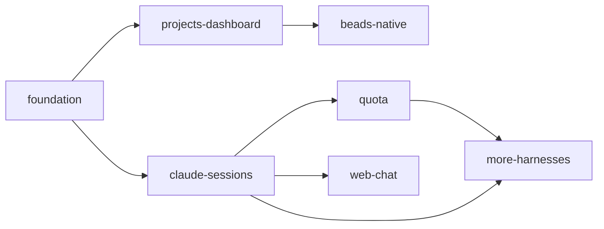

# Roadmap: gin-console v1

Date: 2026-10-12
Source: Product brief (/roadmap session, 2026-10-12)

<!-- Written by /roadmap after the PM confirms it. One "### " block per epic; an epic id never changes once written.
     Depends on: epic ids from this file. Evidence: the tech-doc file and section (for example
     ARCHITECTURE.md#Request flow) or the product brief. The dependency graph stays acyclic. -->

## Goals

- One console to monitor every configured project that uses gin-workflow: workflow stage, gates, and Beads progress.
- See agent sessions per project, read their logs, and jump to the native tool to continue them.
- See agent quota: which harness has hit its limit, which still has quota, and when it resets.

## Constraints

- Single machine: the console, all projects, and all agents run on the same host; the console reads the filesystem directly.
- Only projects listed in the console's YAML config appear.
- Read-only: the console never mutates projects, Beads, or sessions; it shows commands or deep links instead.
- Access only via Tailscale (bind to `127.0.0.1` behind `tailscale serve`); no public exposure, no separate login.
- One account per harness.
- Stack: React (TypeScript) frontend, FastAPI backend.
- Assumptions: polling every 5–10 s is fresh enough; solo developer with agents, no hard deadline.

## Strategy

Vertical slices by value: each epic ships a usable screen end to end.
Milestone 1 = foundation, projects-dashboard, claude-sessions, quota (Claude sessions only; Claude + Codex quota).
Beads viewing starts by deep-linking to Scotty (read-only) and later moves natively into the console so Scotty can be retired.
Web chat is deferred and optional: Claude Code Remote Control, the desktop app, and SSH + tmux already cover continuing a session.
Dropped on 2026-11-12: More harnesses and Web chat are no longer planned.

## Order

more-harnesses and web-chat were dropped on 2026-11-12.

## Epics

### Foundation
Epic: gin-console-rm-foundation
Goal: A runnable FastAPI + React app that reads the configured project list and is reachable only via Tailscale.
Scope: FastAPI backend and React + TS (Vite) frontend, with FastAPI serving the built frontend; YAML project registry (name, path, Scotty project id); default bind `127.0.0.1` behind `tailscale serve`; health endpoint; ruff, mypy, eslint, tsc, pytest, vitest wired into `verify.checks`.
Out of scope: Authentication; any data collectors.
Depends on:
Evidence: Product brief; decisions: single machine, configured projects only, Tailscale-only access.
Risks: Binding the wrong interface exposes the console publicly; default to localhost and check at startup.

### Projects dashboard
Epic: gin-console-rm-projects-dashboard
Goal: One screen showing every configured project with its gin-workflow state and a Beads summary.
Scope: Per project, read-only `gin-workflow state --format json` and `bd list/ready --json`, cached and polled every 5–10 s; show stage, gates, open/in_progress/blocked/ready counts, active epics; deep links to Scotty (`/p/<project>?bead=<id>`) running with `SCOTTY_READ_ONLY=1`.
Out of scope: Bead search/filter UI (stays in Scotty for now); any writes.
Depends on: gin-console-rm-foundation
Evidence: Product brief (monitor all projects); decision on Beads viewing (option A: Scotty deep links); ~/scotty README.
Risks: Subprocess cost per poll times project count (cache and throttle); `bd`/`gin-workflow` JSON format changes; project list duplicated in the console config and the Scotty registry.

### Claude sessions
Epic: gin-console-rm-claude-sessions
Goal: List Claude sessions per project, read their logs read-only, and jump to the native tool to continue.
Scope: Map project paths to `~/.claude/projects/<encoded>`, including worktree directories (`.planning/worktrees/...`); parse `.jsonl` transcripts; detect live sessions (mtime, process); log viewer with collapsible tool calls; copy `claude --resume <id>` or a Remote Control link.
Out of scope: Web chat; Codex and Antigravity sessions.
Depends on: gin-console-rm-foundation
Evidence: Product brief (manage sessions, view chat logs); decisions: Claude only first, no built-in chat.
Risks: Undocumented `.jsonl` format may change; very large transcripts (page or stream); worktree path encoding.

### Quota
Epic: gin-console-rm-quota
Goal: Show whether Claude and Codex still have quota or have hit their limit, and when it resets.
Scope: Codex: read `rate_limits` (used percent, reset time) from the latest events in `~/.codex/sessions`; Claude: sum tokens from `.jsonl` over 5-hour and weekly windows against a plan limit set in config, and flag "limited" when transcripts show rate-limit errors; label Claude numbers as estimates in the UI.
Out of scope: Antigravity; multiple accounts; unofficial usage endpoints.
Depends on: gin-console-rm-foundation, gin-console-rm-claude-sessions
Evidence: Product brief (quota monitoring); decisions: one account per harness, Claude + Codex first.
Risks: Claude estimate may diverge from real limits (no official source); Codex session format may change.

### More harnesses
Epic: gin-console-rm-more-harnesses
Status: Dropped on 2026-11-12 by the PM; the epic bead is closed without implementation.
Goal: Sessions and logs for Codex and Antigravity, plus Antigravity quota.
Scope: Session parsers for Codex (`~/.codex/sessions`) and Antigravity (`~/.gemini/antigravity`); Antigravity quota; per-harness resume commands.
Out of scope: opencode.
Depends on: gin-console-rm-claude-sessions, gin-console-rm-quota
Evidence: Decisions: other harnesses after Claude; Antigravity quota deferred.
Risks: Antigravity storage and quota format unknown; needs an investigation spike first.

### Native Beads view, retire Scotty
Epic: gin-console-rm-beads-native
Goal: View, search, and filter beads natively in the console, port the best of Scotty, then retire Scotty.
Scope: List, Board, and Focus views; search; filter by status, label, priority, lane; bead detail and dependencies; live refresh; agree a Scotty parity list before retirement; replace Scotty deep links with internal routes.
Out of scope: Editing beads (console stays read-only).
Depends on: gin-console-rm-projects-dashboard
Evidence: Decision on Beads viewing (option C as the future plan); ~/scotty README.
Risks: Scope creep from copying all of Scotty; bounded by the agreed parity list.

### Web chat (optional)
Epic: gin-console-rm-web-chat
Status: Dropped on 2026-11-12 by the PM; the epic bead is closed without implementation.
Goal: Continue chatting with agents from the web UI, only if still needed after Milestone 1.
Scope: Choose between tmux + xterm.js and headless resume when the epic starts.
Out of scope: Everything else until the epic is picked up.
Depends on: gin-console-rm-claude-sessions
Evidence: Decision: built-in chat deferred to an optional final epic.
Risks: Two processes writing to one live session; overlaps Claude Code Remote Control; re-evaluate before starting.
