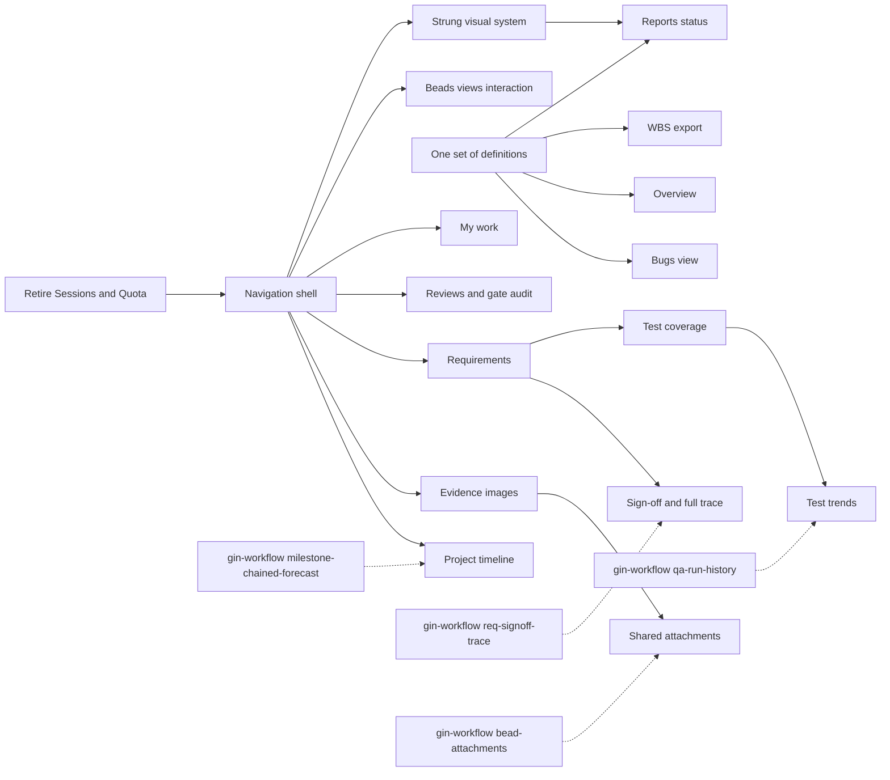

# Roadmap: gin-console v2

Date: 2026-11-21
Source: Product brief from the UX review of 2026-11-21 (team lead, PM, member and newcomer walkthroughs; direction preview; data survey of gin-workflow and gin-qa), /roadmap session 2026-11-21. Roadmap v1 (2026-10-12) moves to docs/roadmap-v1.md; all its epics are closed.

<!-- Written by /roadmap after the PM confirms it. One "### " block per epic; an epic id never changes once written.
     Depends on: epic ids from this file. Evidence: the tech-doc file and section (for example
     03-ARCHITECTURE.md#Request flow) or the product brief. The dependency graph stays acyclic.
     The milestone headings and the Milestone:, Points: and Estimate: lines are written by /roadmap --milestone
     or by a plain /roadmap with a milestone plan; older files without them stay valid.
     A plain /roadmap without a milestone plan omits them and lists its epics under Unassigned.
     gin milestone list reads two Constraints lines: Deadline: (YYYY-MM-DD, the project deadline) and the whole
     number that starts AI capacity: (the default lanes, streams of work that each run one epic at a time);
     it also reads Days per point: (working days per story point, used until closed epics give a measured value).
     The way-of-working section is written by /roadmap from the skill's references/way-of-working.md and kept on re-runs;
     Spec ready by: and Integration point: are written by /roadmap --milestone or by a plain /roadmap with a milestone plan.
     Older files without them stay valid.
     Summary, Outcome:, Demo:, Features:, Legacy:, and Legacy coverage are written per the skill's references/manager-view.md;
     Outcome: and Demo: need a milestone; Legacy coverage needs 13-CAPABILITIES.md. Older files without them stay valid. -->

## Goals

- Every number means the same thing on every page, so a lead or PM can trust it.
- Moving between pages keeps your project, your place and your way back.
- A PM can report milestone and project status, and export a WBS, without leaving the console.
- Lead, Dev, QA and BA each get one view that answers their daily question.
- One identity colour, a real type scale, and one way to draw state and progress.
- Sessions and Quota are retired (decision 2026-11-21).

## Summary

| Milestone | Period | Outcome | Demo | Epics |
|---|---|---|---|---|
| Trust and wayfinding | 2026-11-23 to 2026-12-17 | The console keeps your project and place across pages, numbers mean the same everywhere, Sessions and Quota are gone, and the new look is in place. | Pick a project once and move through Beads, Milestones and Reports without losing it; open an epic from a milestone and return by its breadcrumb; the blocked count matches on Projects, Beads and Reports. | Retire Sessions and Quota; Navigation shell; One set of definitions; Strung visual system; Beads views interaction |
| PM reporting | 2026-12-18 to 2026-12-29 | A PM reports a milestone's status and hands over a WBS from the console. | Open the Checkout v2 status report, read its verdict and risks, copy the summary, download the WBS in Excel. | Reports status and one scope; WBS export and summary |
| Lead and Dev daily work | 2026-12-30 to 2027-01-12 | A lead starts the day on one overview across projects; a developer sees what to do next and copies the command to start it. | The overview lists blocked work with its owner across projects; My work shows next up; a bead page copies its claim command; an epic shows its review findings and gate history. | Overview for leads; My work and the next step; Reviews and gate audit |
| QA and BA | 2027-01-13 to 2027-01-28 | BA and QA see requirements, sign-off, test coverage, bugs and bug screenshots. | The requirements matrix of one capability; a milestone's release readiness checklist; a bug's screenshots in the lightbox. | Requirements and traceability; Test coverage and release readiness; Bugs view; Evidence images from local files |
| Unassigned | | | | Project timeline; Requirement sign-off and full trace; Test trends; Shared bead attachments |

## Constraints

- AI capacity: 1 (one developer with AI agents, one epic at a time; the tracks of an epic run in parallel worktrees)
- Deadline:
- Days per point: 0.5 (assumed)
- Single machine and Tailscale only; no public exposure, no separate login.
- Read-only: export is a download of data the console already reads. Exceptions: `bd dolt pull` (ADR 0003), and the attachment store fetch of Shared bead attachments (new ADR).
- The console runs installed CLIs (`gin`, `gin-qa`, `bd`) per project and never imports gin-workflow.
- Linux, macOS and native Windows keep working.

## Way of working

- Foundation: Trust and wayfinding is the foundation milestone (shell, definitions, tokens). CI, pre-commit and pre-push checks already exist; no auth or feature flags are needed.
- Spec cadence: every epic runs /discuss and gets a confirmed spec before /plan; the specs of milestone N+1 are confirmed during milestone N; Spec ready by is the milestone start.
- Build: backend first (a `source.py` per external source returning pydantic models, tested with fixtures and fakes), then the UI; the models and API JSON are the contract. External commands are injected into `create_app`.
- Integration: no feature flags (internal, read-only, single-user tool). Each epic deploys to the Tailscale build when its tracks merge. External dependencies are checked by hand before an epic starts, because bd 1.0.5 does not enforce them: `bd -C ../gin-workflow list --label provides:<capability> --all`.
- Quality: gin-qa cases per REQ; Claude validates UI changes with Playwright on the Tailscale build; Exit criteria: checks green, the epic's TCs passed, no open bug bead on the epic.
- Load: 1 lane times the working days of the milestone.

## Strategy

Foundation first, then by role. Trust and wayfinding comes first because every later view reuses the shell, the definitions and the tokens. Then PM reporting (the clearest gap), then the daily views for leads and developers, then QA and BA, which join specs, beads and cases. Epics that wait on gin-workflow stay under Unassigned until their capability ships, then move into a milestone with /roadmap --milestone. gin-workflow runs its epics independently: gin-workflow-6yoq (milestone-chained-forecast), gin-workflow-s6fv (bead-attachments), gin-workflow-g2gx (qa-run-history), gin-workflow-ch2v (req-signoff-trace), and gin-workflow-04wv (usage-collect-on-close, no console epic waits on it; One set of definitions shows its batch command once it ships).

## Order

## Milestone: Trust and wayfinding

Outcome: The console keeps your project and place across pages, numbers mean the same everywhere, Sessions and Quota are gone, and the new look is in place.
Demo: Pick a project once and move through Beads, Milestones and Reports without losing it; open an epic from a milestone and return by its breadcrumb; the blocked count matches on Projects, Beads and Reports.
Result:
Spec ready by: 2026-11-23
Integration point: 2026-12-10
- Integrates: gin-console-rm-retire-sessions-quota, gin-console-rm-nav-shell, gin-console-rm-definitions, gin-console-rm-strung, gin-console-rm-beads-views
- Flags on: none (no feature flags)
- E2E scope: project switching across pages, breadcrumbs and Back, filters as chips, one click rule in the Beads views, blocked and done counts across pages, theme and tokens on every page
- Exit criteria: checks green, the epics' TCs passed on the Tailscale build, no open bug bead on these epics

### Retire Sessions and Quota
Epic: gin-console-rm-retire-sessions-quota
Milestone: gin-console-6bd
Points: 3 (2 pages and 2 backend contexts removed, low)
Estimate: 2 (assumed)
Kind: technical
Complexity: low (deletions in both stacks)
Goal: Remove two pages nobody reaches and the roadmap no longer needs.
Scope: Delete the Sessions and Quota pages and routes, their backend contexts, sources, fakes and tests, and their config keys (ignored with a warning if still present); update README, the living specs and the roadmap goals.
Out of scope: AI cost in Reports, which read ai_usage (removed later by gin-console-5c4, decision 2026-11-21).
Features: Remove the Sessions page; remove the Quota page
Capabilities: sessions, quota, config, ui
Legacy: none
Depends on:
Evidence: Product brief (UX review 2026-11-21: no navigation entry for Sessions or Quota; PM decision to retire both)
Risks: Config files in use still carry quota keys; loading must not fail on them.

### Navigation shell
Epic: gin-console-rm-nav-shell
Milestone: gin-console-6bd
Points: 8 (5 pages, project context, breadcrumbs, titles, not-found page, scroll restore, filter bar, sub-navigation, medium)
Estimate: 4 (assumed)
Kind: capability
Complexity: medium (every page reads its own project parameter today)
Goal: The console remembers where you are and how you got there.
Scope: A project switcher at the top of the sidebar, remembered and carried in every link, with a favorite project pinned by a star; breadcrumbs by name that follow the page you came from; the nav item of the origin stays highlighted; a page title per page; a real not-found page and an unknown-project notice; scroll and the last opened row restored on Back; a skip link. The one-line filter bar, the click rule and the search shortcut moved to Beads views interaction (decision 2026-11-21). Sub-navigation rule: a page whose sections answer different questions lists them as sidebar sub-items with their own address and headline value; below 1024px they become a scrollable tab strip; views of the same data stay a segmented control; an epic or milestone page keeps its own tabs.
Out of scope: New pages.
Features: Project switcher with a favorite; breadcrumbs by name; page titles; not-found page; return to your place; skip link; sidebar sub-navigation
Capabilities: ui
Legacy: none
Depends on: gin-console-rm-retire-sessions-quota
Evidence: Product brief (UX review 2026-11-21: project resets on every nav click, id breadcrumbs, every tab titled gin-console, filters take 300px)
Risks: Many pages parse the project themselves; move them to one shared hook first.

### One set of definitions
Epic: gin-console-rm-definitions
Milestone: gin-console-6bd
Points: 13 (8 stories, 12 new and 20 changed REQs across 5 pages and 2 APIs, shared rules module, tooltip and legend, medium)
Estimate: 7 (assumed)
Kind: capability
Complexity: medium (definitions shared by backend and frontend)
Goal: Blocked, done, progress and assignee mean one thing everywhere.
Scope: Blocked is status blocked or open with an open blocker, on Projects, Beads, Reports and the Gantt; done is closed everywhere; epic progress counts all children whatever Show closed says; Assignee shows the real assignee or Unassigned, never the owner; one identity for an email and its handle, plus a Me filter; one milestone status for the milestone page and its bead; one date format; a legend and real tooltips for size, points, prep, lanes and link counts; plain labels in PM views.
Out of scope: Visual tokens; AI usage coverage (gin-workflow-wkwb retired `gin usage`; gin-console-5c4 removes Data coverage from Reports, decision 2026-11-21).
Features: One meaning for blocked, done and progress; real assignee and a Me filter; legend and tooltips; plain labels; one date format
Capabilities: beads, server, reports, milestone-ui, ui
Legacy: none
Depends on:
Evidence: Product brief (UX review 2026-11-21: blocked 19, 17 and 0 for one scope; Assignee shows the owner; one person listed twice; Data coverage lists 80, 233 and 182 beads as not collected in gin-console, qwikfone and gin-workflow, 70 of gin-console's already counted in their epic, most of the others older than the 30-day log retention)
Risks: Changed definitions move numbers people know; show each definition next to its number.

### Strung visual system
Epic: gin-console-rm-strung
Milestone: gin-console-6bd
Points: 13 (every page, palette, type scale, 2 new components, high: touches all screens)
Estimate: 7 (assumed)
Kind: capability
Complexity: high (touches every screen)
Goal: One identity colour, a real type scale and one way to draw state and progress.
Scope: Light and dark palette (amethyst identity; jade done and ready; lapis in progress; amber blocked and late; hematite deferred; carnelian bugs); type scale 12, 13, 14, 16, 20, 28, 40 with tabular numbers; the typeface decided in discuss (Recursive or Geist); state marks (hollow, half, full, knot, dashed); the strand drawing that replaces progress bars, closed-of-total texts and Gantt pills; one verdict per Gantt row instead of stacked warnings; no all-caps labels, no middle-dot strings, no underlined navigation; fewer chips per row.
Out of scope: Layout changes beyond the shell.
Features: New palette; type scale; state marks; progress strand; calmer warnings
Capabilities: ui
Legacy: none
Depends on: gin-console-rm-nav-shell
Evidence: Product brief (direction preview of 2026-11-21; UX review: flat 12/14/20 type scale, no identity colour, teal means both ready and closed)
Risks: Land tokens first, then components page by page; Recursive with all axes is about 300 KB, so subset it or keep Geist.

### Beads views interaction
Epic: gin-console-rm-beads-views
Milestone: gin-console-6bd
Points: 8 (11 filter controls into one line with chips, one click rule over 4 views, a details panel for Board and Focus, medium)
Estimate: 3
Kind: capability
Complexity: medium (one selection shared by four views; the filter bar is duplicated in the mobile sheet)
Goal: The Beads page is quick to scan and to act on: its filters fit one line and a click does the same thing in every view.
Scope: A one-line filter bar (search, status, assignee, milestone and "More filters (n)" holding the rest) where default filters, such as the current milestone, show as removable chips, with "Clear filters" defined for the default milestone; one click rule in List, Board, Focus and Graph (a click on a row or card selects it and opens the details panel from 1024px, below that it opens the bead page; the title, Enter on a selected item or a double click opens the bead page); a details panel for Board and Focus; a visible "/" hint on the search box. It applies to the Beads page and the Beads tab of a milestone page.
Out of scope: Visual tokens (Strung visual system); the shared navigation (Navigation shell).
Features: One-line filters with chips; one click rule; details panel for Board and Focus; visible search shortcut
Capabilities: ui
Legacy: none
Depends on: gin-console-rm-nav-shell
Evidence: Product brief (UX review 2026-11-21: filters take about 300px, each view clicks differently); split from the discuss of gin-console-rm-nav-shell (decision 2026-11-21)
Risks: Many tests pin the current filter layout and the default milestone rule of REQ-UI-104.

## Milestone: PM reporting

Outcome: A PM reports a milestone's status and hands over a WBS from the console.
Demo: Open the Checkout v2 status report, read its verdict and risks, copy the summary, download the WBS in Excel.
Result:
Spec ready by: 2026-12-18
Integration point: 2026-12-25
- Integrates: gin-console-rm-reports-status, gin-console-rm-wbs-export
- Flags on: none (no feature flags)
- E2E scope: status report of a milestone, scope picker across report sections, copy summary, WBS download in three formats
- Exit criteria: checks green, the epics' TCs passed on the Tailscale build, no open bug bead on these epics

### Reports status and one scope
Epic: gin-console-rm-reports-status
Milestone: gin-console-k0c
Points: 8 (1 new section with 4 panels, a shared scope, team KPI v2, medium)
Estimate: 4 (assumed)
Kind: capability
Complexity: medium (new aggregates: burn-up and scope changes)
Goal: A PM gets a milestone status report on one screen.
Scope: Report sections get their own addresses (status, team, delivery, velocity, rework) as sidebar sub-items with their headline value, tabs below 1024px; Quality is renamed Rework. A new default Status section: a one-sentence verdict that reconciles bead pace and epic estimates; KPIs with change since last week; a burn-up of done against scope; changes since kickoff; risks (blocked chains with owners, unestimated epics, specs not confirmed); an epic table with verdict, strand, planned and forecast dates and owner. One scope (milestone or date range) for every section, kept when switching. Team KPI v2: points delivered, estimate accuracy per member, trend across milestones, a note when unassigned work makes per-member numbers unreliable.
Out of scope: Reports across projects.
Features: Milestone status report; burn-up; scope changes; risks; epic verdicts; week-on-week change; team KPI v2; report sections in the sidebar
Capabilities: reports
Legacy: none
Depends on: gin-console-rm-definitions, gin-console-rm-strung
Evidence: Product brief (PM walkthrough 2026-11-21: no verdict, no burn-up, scope differs per tab, no export)
Risks: Per-person KPIs invite gaming; lead with team numbers and show member numbers as context.

### WBS export and summary
Epic: gin-console-rm-wbs-export
Milestone: gin-console-k0c
Points: 5 (1 export in 3 formats and a copyable summary, medium: new spreadsheet dependency)
Estimate: 3 (assumed)
Kind: capability
Complexity: medium (new backend dependency for Excel files)
Goal: Hand a PM a work breakdown and a status summary for their own reports.
Scope: A WBS download for a project or a milestone, in Excel with rows grouped by level, CSV, or Markdown; WBS numbers (1, 1.1, 1.1.1); columns WBS, id, name, type, status, owner, points, estimate, planned start and end, forecast end, percent done, depends on as WBS numbers; Export WBS on the milestone page; Copy summary on Reports (verdict, KPIs, risks, epic table as Markdown).
Out of scope: MS Project files, PDF.
Features: WBS export (Excel, CSV, Markdown); copy status summary
Capabilities: reports, milestone-ui
Legacy: none
Depends on: gin-console-rm-definitions
Evidence: Product brief (PM request 2026-11-21: export a WBS for reports)
Risks: Tasks carry no estimates or dates in gin-workflow, so task rows show status, owner and percent only; project-wide dates need Project timeline.

## Milestone: Lead and Dev daily work

Outcome: A lead starts the day on one overview across projects; a developer sees what to do next and copies the command to start it.
Demo: The overview lists blocked work with its owner across projects; My work shows next up; a bead page copies its claim command; an epic shows its review findings and gate history.
Result:
Spec ready by: 2026-12-30
Integration point: 2027-01-07
- Integrates: gin-console-rm-overview, gin-console-rm-my-work, gin-console-rm-review-audit
- Flags on: none (no feature flags)
- E2E scope: overview across projects, My work sections, next command on a bead, jump to a bead, review findings and gate history on an epic, phone layout of My work
- Exit criteria: checks green, the epics' TCs passed on the Tailscale build, no open bug bead on these epics

### Overview for leads
Epic: gin-console-rm-overview
Milestone: gin-console-qi7
Points: 8 (1 new home page across projects, 5 attention lists, workload per member, medium: load time)
Estimate: 4 (assumed)
Kind: capability
Complexity: medium (cross-project load time)
Goal: One morning page across every project: what needs me now.
Scope: Needs attention (blocked work with blocker and owner, work in progress longer than a set number of days, failing gates, open waivers, unassigned ready work); one milestone verdict per project; work in progress per member across projects. Whether it replaces Projects as the home page is decided in discuss.
Out of scope: Notifications.
Features: Morning overview across projects; workload per member
Capabilities: ui, beads
Legacy: none
Depends on: gin-console-rm-definitions
Evidence: Product brief (team lead walkthrough 2026-11-21: no cross-project view, blockers buried)
Risks: gin state takes about 2.6 s per project; read beads from the light endpoint and gin state in the background.

### My work and the next step
Epic: gin-console-rm-my-work
Milestone: gin-console-qi7
Points: 5 (4 My work sections, next command, jump palette, phone cards, medium)
Estimate: 3 (assumed)
Kind: capability
Complexity: medium (the next command depends on workflow stage rules)
Goal: A developer knows what to do next and has the command to start it.
Scope: My Tasks becomes My work: next up (ready, assigned to me or unclaimed in my areas), in progress, waiting on me (beads I block), in review; every bead page shows its next command (claim, execute, review) with Copy, above View in graph; the blocker in the bead header and on cards; cards instead of a table on phones; a jump palette (Ctrl or Cmd+K) by id or title.
Out of scope: Running commands from the console.
Features: My work; next command on a bead; blocker on cards; jump to a bead; phone cards
Capabilities: ui, beads
Legacy: none
Depends on: gin-console-rm-nav-shell
Evidence: Product brief (member walkthrough 2026-11-21: no claim command, no next signal, 91px task column on phones)
Risks: Read the next command from gin state remedies instead of re-deriving workflow rules.

### Reviews and gate audit
Epic: gin-console-rm-review-audit
Milestone: gin-console-qi7
Points: 3 (2 local sources on 2 pages, low)
Estimate: 2 (assumed)
Kind: capability
Complexity: low (two local file formats)
Goal: A lead sees review health and who signed or waived what.
Scope: Findings across beads from the review ledgers (severity, status, deferrals, follow-up beads) where ledgers exist; gate events (approvals, waivers, shipped) on the epic page and in the overview.
Out of scope: Projects without ledgers show no review counts (ai_usage was retired, gin-console-5c4).
Features: Review findings; gate history
Capabilities: beads
Legacy: none
Depends on: gin-console-rm-nav-shell
Evidence: Product brief (data survey 2026-11-21: review.json ledgers and events.jsonl are not read)
Risks: The gate event log is local and gitignored, so another machine has a different history; say so in the UI.

## Milestone: QA and BA

Outcome: BA and QA see requirements, sign-off, test coverage, bugs and bug screenshots.
Demo: The requirements matrix of one capability; a milestone's release readiness checklist; a bug's screenshots in the lightbox.
Result:
Spec ready by: 2027-01-13
Integration point: 2027-01-25
- Integrates: gin-console-rm-requirements, gin-console-rm-test-coverage, gin-console-rm-bugs-view, gin-console-rm-evidence-images
- Flags on: none (no feature flags)
- E2E scope: requirements matrix, readiness checklist, coverage by capability, bugs by source, bug screenshots and lightbox
- Exit criteria: checks green, the epics' TCs passed on the Tailscale build, no open bug bead on these epics

### Requirements and traceability
Epic: gin-console-rm-requirements
Milestone: gin-console-9ge
Points: 8 (1 new page, a join of specs, beads and cases, high: three sources)
Estimate: 4 (assumed)
Kind: capability
Complexity: high (joins three sources)
Goal: A BA sees every requirement, its sign-off, the work that builds it and the tests that prove it.
Scope: A requirements catalog from `gin specs reqs --format json`; the console joins requirements to beads through req labels and to cases through `gin-qa cases export` into one matrix (covered, building, untested, failing); spec sign-off per epic; confirmed mockups; a read-only view of a change folder (proposal, spec delta, design, plan, tests).
Out of scope: Editing specs.
Features: Requirements catalog; traceability matrix; spec sign-off per epic; confirmed mockups; change folder view
Capabilities: requirements (new)
Legacy: none
Depends on: gin-console-rm-nav-shell
Evidence: Product brief (data survey 2026-11-21: gin specs reqs and gin-qa cases export print JSON; nothing joins them)
Risks: Until Requirement sign-off and full trace, sign-off is per epic and only open changes have a trace; the view says so.

### Test coverage and release readiness
Epic: gin-console-rm-test-coverage
Milestone: gin-console-9ge
Points: 5 (1 page, latest e2e evidence, readiness checklist, medium)
Estimate: 3 (assumed)
Kind: capability
Complexity: medium (e2e evidence folders)
Goal: QA and the lead see whether a milestone can ship.
Scope: Cases by capability, type and effective result (passed, failed, not run, outdated); failed cases with their bug; the latest e2e run per case with step screenshots; a readiness checklist per milestone (every requirement covered, every case run since its requirement changed, no open P0 or P1 bugs, gates passed).
Out of scope: Running tests.
Features: Test coverage; latest e2e run with screenshots; release readiness checklist
Capabilities: qa (new)
Legacy: none
Depends on: gin-console-rm-requirements
Evidence: Product brief (data survey 2026-11-21: 472 cases in gin-console, 331 not run)
Risks: Projects without gin-qa (qwikfone) show an empty state that says why.

### Bugs view
Epic: gin-console-rm-bugs-view
Milestone: gin-console-9ge
Points: 3 (1 page from bug beads, low)
Estimate: 2 (assumed)
Kind: capability
Complexity: low (bug beads already loaded)
Goal: See where bugs come from and how long they stay open.
Scope: Bugs per epic and capability through discovered-from; found by QA versus found later; open age; trend per week.
Out of scope: Filing bugs.
Features: Bugs by source; open age; found by QA versus later
Capabilities: qa (new)
Legacy: none
Depends on: gin-console-rm-definitions
Evidence: Product brief (QA perspective 2026-11-21)
Risks: Older bugs lack the discovered-from link; group them as source unknown.

### Evidence images from local files
Epic: gin-console-rm-evidence-images
Milestone: gin-console-9ge
Points: 3 (1 endpoint with path checks, a gallery and a lightbox, low)
Estimate: 2 (assumed)
Kind: capability
Complexity: low (path safety)
Goal: Show a bug's screenshots now, when the console host has the files.
Scope: The Evidence paths a bug lists show as images when the file exists inside the project root on the console host, served only from inside the root (image types by magic bytes, a size limit, nosniff); inline in the description, an Evidence panel with numbered step thumbnails, a lightbox (arrow keys, Escape, open original), a picture count on cards; external image addresses in descriptions stop loading.
Out of scope: Files from other machines (Shared bead attachments).
Features: Screenshots in bug evidence; lightbox
Capabilities: beads
Legacy: none
Depends on: gin-console-rm-nav-shell
Evidence: Product brief (bug gin-console-3kd lists a local screenshot nobody else can see)
Risks: Paths outside the project root and symlinks must be refused.

## Unassigned

Waiting on a gin-workflow capability; each moves into a milestone with /roadmap --milestone once `bd -C ../gin-workflow list --label provides:<capability> --all` shows it shipped.

### Project timeline
Epic: gin-console-rm-project-timeline
Points: 5 (1 new view over a new gin-workflow field, medium)
Estimate: 3 (assumed)
Kind: capability
Complexity: medium (new time axis over chained forecasts)
Goal: See every milestone and epic of a project on one time axis with the project finish.
Scope: The Milestones page gets Timeline and List views; milestones with their window and forecast overrun, their epics, and epics outside any milestone; zoom by weeks, months or quarters; a today line; the project finish in the header.
Out of scope: Every project on one timeline.
Features: Project timeline
Capabilities: milestone-ui
Legacy: none
Depends on: gin-console-rm-nav-shell, external:gin-workflow:milestone-chained-forecast
Evidence: Product brief (PM request 2026-11-21; gin-workflow-6yoq)
Risks: Starts only when gin-workflow ships the capability (decision 2026-11-21: no stitched interim).

### Requirement sign-off and full trace
Epic: gin-console-rm-req-signoff
Points: 2 (swap the console's own join for a CLI call, low)
Estimate: 1 (assumed)
Kind: capability
Complexity: low (a new JSON contract)
Goal: Sign-off per requirement and a trace over archived changes in the requirements view.
Scope: Read sign-off per requirement and `gin specs trace --all --format json`; replace the console's own requirement, bead and case join with it.
Out of scope: Editing sign-off.
Features: Sign-off per requirement; trace for archived changes
Capabilities: requirements (new)
Legacy: none
Depends on: gin-console-rm-requirements, external:gin-workflow:req-signoff-trace
Evidence: Product brief (data survey 2026-11-21; gin-workflow-ch2v)
Risks: The JSON contract is new; record it in the change design.

### Test trends
Epic: gin-console-rm-test-trends
Points: 3 (1 chart and 2 lists from a new CLI, low)
Estimate: 2 (assumed)
Kind: capability
Complexity: low (one new source)
Goal: Pass rate over runs, flaky cases and time from failure to fix.
Scope: Read `gin-qa runs export --format json`; a trend chart per capability; flaky cases that flip between passed and failed; the median time from a failed run to the next pass.
Out of scope: Running tests.
Features: Pass-rate trend; flaky cases; time to fix
Capabilities: qa (new)
Legacy: none
Depends on: gin-console-rm-test-coverage, external:gin-workflow:qa-run-history
Evidence: Product brief (data survey 2026-11-21: manual runs overwrite the case; gin-workflow-g2gx)
Risks: History starts when gin-workflow ships it; older runs are not recovered.

### Shared bead attachments
Epic: gin-console-rm-shared-attachments
Points: 3 (store fetch, 1 endpoint, a new ADR, medium)
Estimate: 2 (assumed)
Kind: capability
Complexity: medium (a second read-only exception)
Goal: Everyone on the team sees screenshots, whoever took them.
Scope: Read the attachments of a bead and resolve attachment references in its description; fetch the shared attachment store on refresh and on schedule (a second exception to read-only, recorded in a new ADR); serve each attachment after checking its hash, type and size, with immutable caching; reuse the gallery and lightbox of Evidence images from local files.
Out of scope: Uploading from the console.
Features: Shared screenshots for the team
Capabilities: beads
Legacy: none
Depends on: gin-console-rm-evidence-images, external:gin-workflow:bead-attachments
Evidence: Product brief (PM request 2026-11-21; gin-workflow-s6fv)
Risks: Screenshots can show customer data; the store keeps the repository's access and the console never exposes store credentials to the browser.
