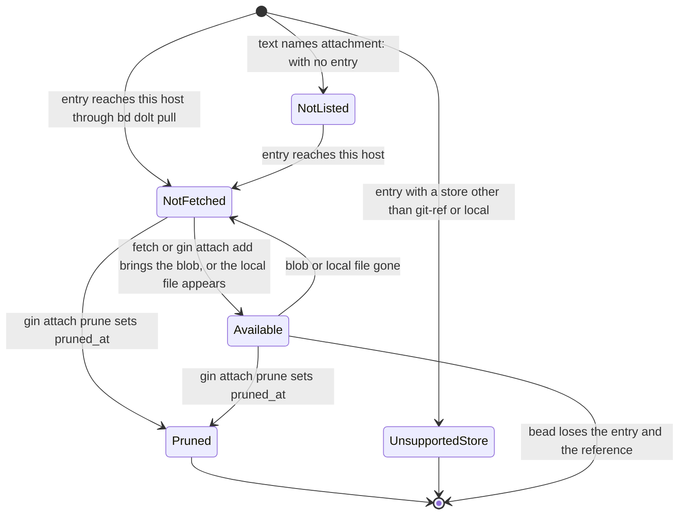

# Attachment on this host

An attachment of a bead as the console sees it (REQ-BEADS-031): worked out from the bead's `metadata.attachments` entry in `.beads/issues.jsonl` and from the blobs of `refs/gin/attachments` and `refs/gin-console/attachments`, again for each export snapshot. Its state is the `reason` of the image, `null` when available.

