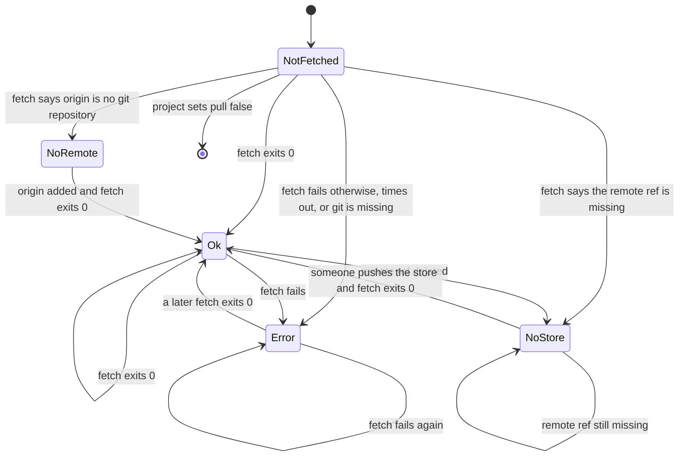

# Attachment fetch status

The result of a project's last fetch of the shared attachment store, kept in the server's memory per project and returned as `attachments_fetch` by `GET /api/projects/beads` (REQ-BEADS-033). It is lost when the server restarts.

