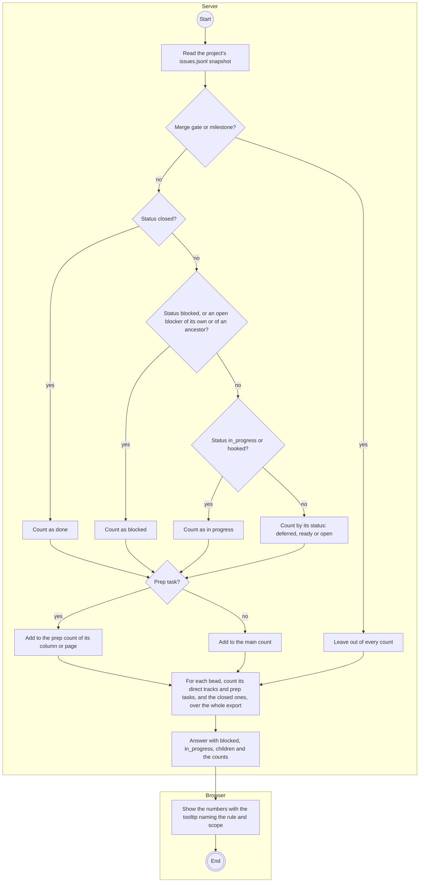

# Bead counts

How one bead is classed and counted for the blocked, in-progress and done numbers of the Board and Focus columns, the Team figures and the Gantt rows, and how a bead's child counts are built (REQ-BEADS-007, REQ-BEADS-021, REQ-BEADS-022, REQ-SERVER-006, REQ-REPORTS-010, REQ-UI-031, REQ-UI-033, REQ-UI-130). The rules live in one backend module; the pages only render the result.

