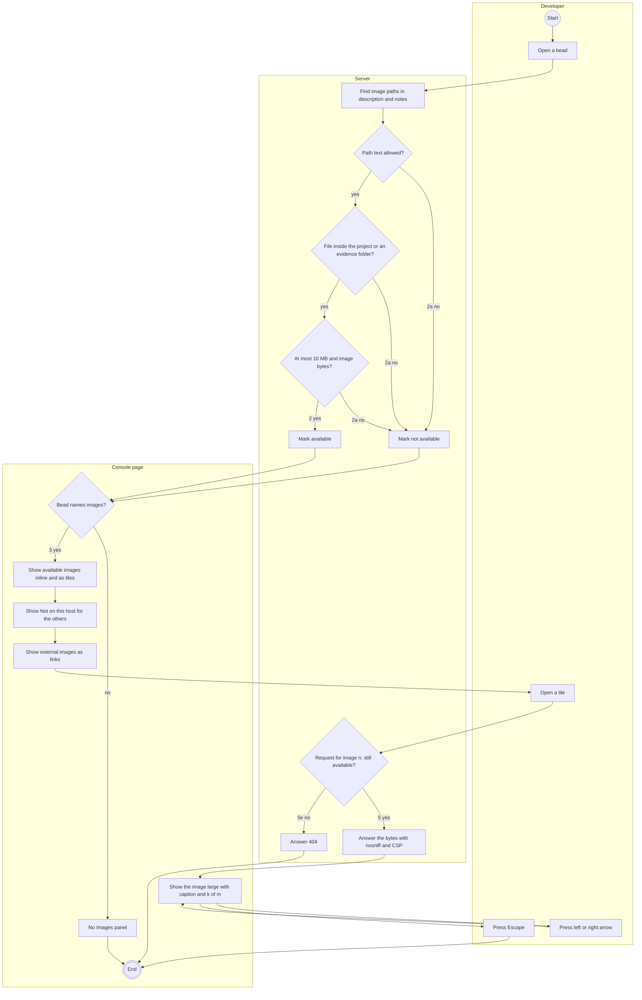

# Bead images

Use case: see-bug-screenshots

How the console finds the images a bead names, decides which it may serve, and shows them in the description, the Images panel and the lightbox (REQ-BEADS-026 to REQ-BEADS-030, REQ-UI-028, REQ-CONFIG-008).

