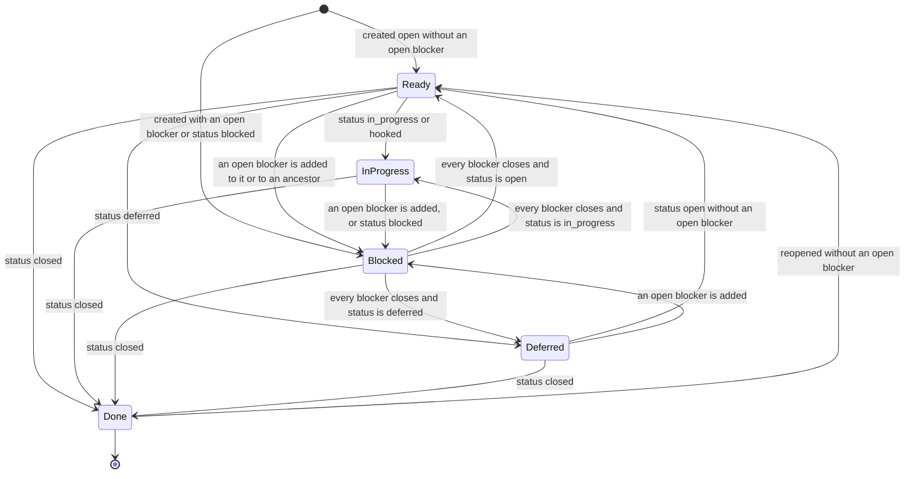

# Bead state as shown

The state the console shows for a bead that is not a milestone (state mark, Board and Focus column, Graph node), worked out from its `status` and its `blocked` flag (REQ-BEADS-007); it is not stored. The first rule that holds wins, in the order Done, Blocked, Deferred, Ready, In progress (REQ-BEADS-021, REQ-UI-031, REQ-UI-033). A milestone bead shows its milestone status instead (REQ-MILESTONE-UI-022).

