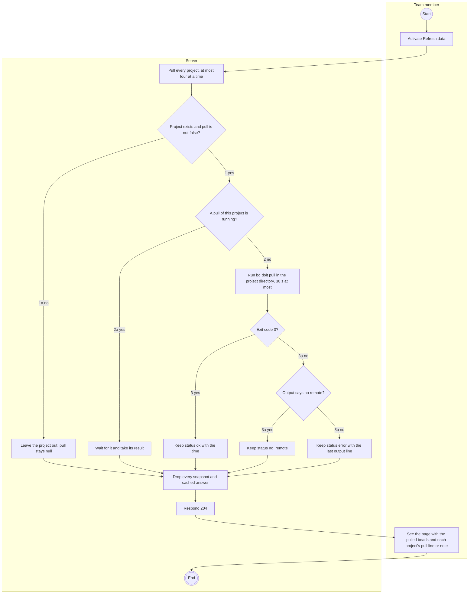

# Beads pull

Use case: refresh-pulls-beads

How "Refresh data" and the scheduled pull bring a project's Beads from its Dolt remote into the console (REQ-BEADS-016, REQ-BEADS-017, REQ-BEADS-012, REQ-BEADS-018). The scheduled pull starts at "Pull every project" when its interval has passed, and logs failed projects instead of reloading a page.

