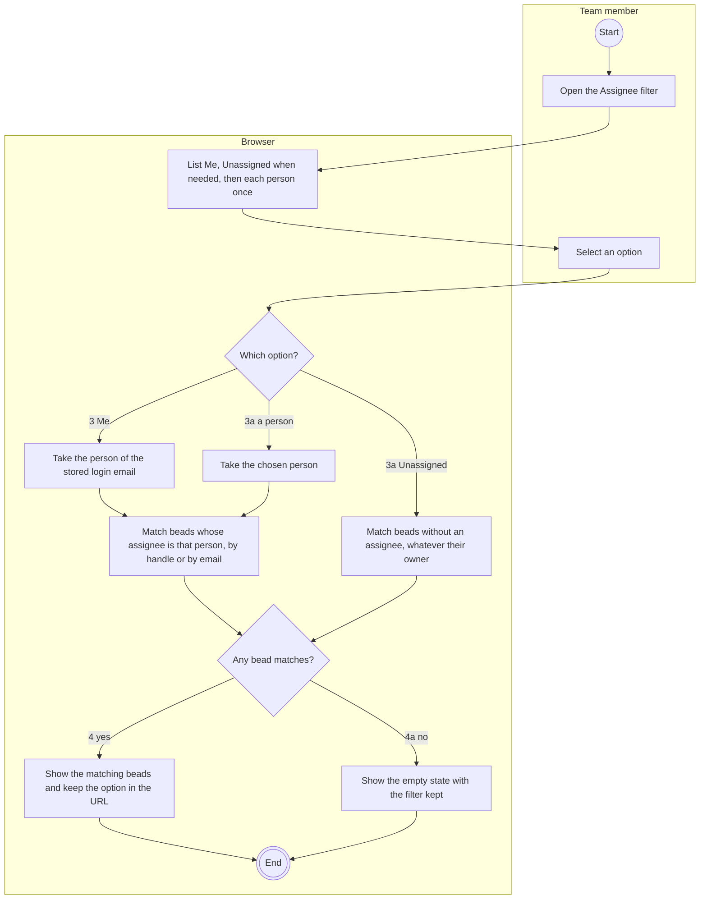

# Me filter

How the Assignee filter of the Beads page and of a milestone's Beads tab matches beads, with Me and one entry per person (REQ-BEADS-023, REQ-BEADS-024, REQ-UI-082).

Use case: filter-my-beads

