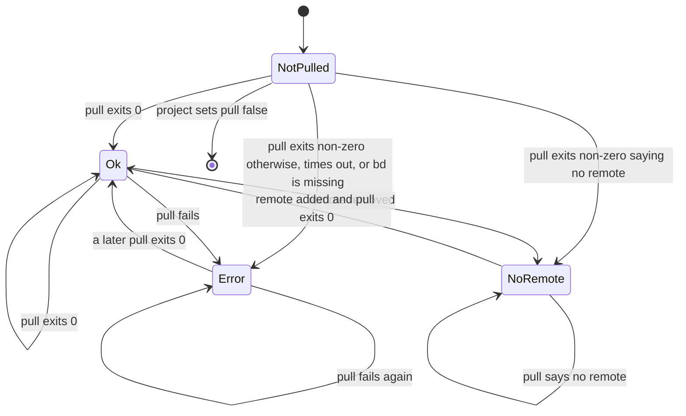

# Pull status

The result of a project's last pull, kept in the server's memory per project and returned as `pull` by `GET /api/projects` and `GET /api/projects/beads` (REQ-BEADS-016). It is lost when the server restarts.

