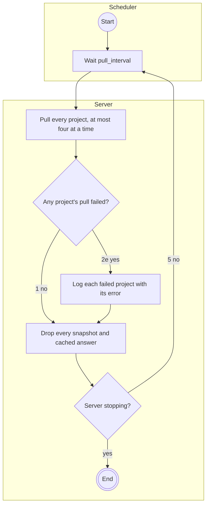

# Scheduled pull

Use case: scheduled-beads-pull

How the server pulls every project on `beads.pull_interval` without a refresh (REQ-BEADS-017, REQ-BEADS-016). Each project's pull is classified as in the Beads pull diagram.

