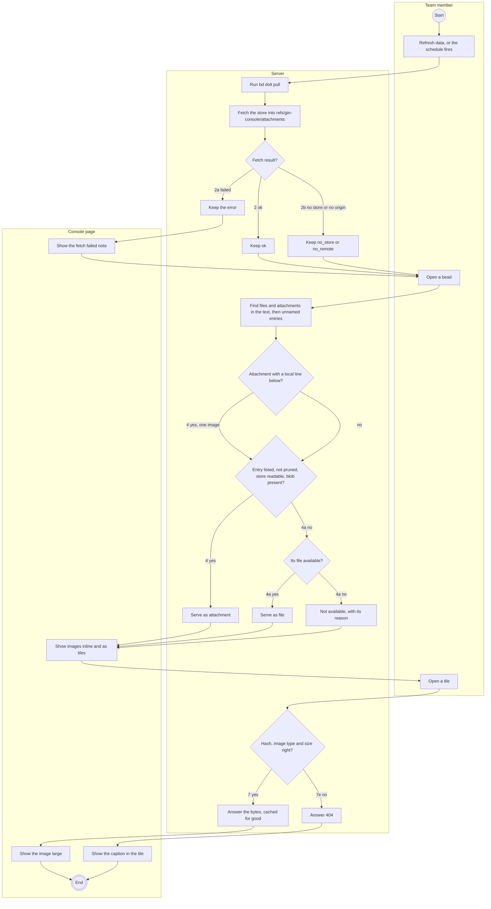

# Shared attachments

Use case: see-shared-screenshots

How the console fetches the shared attachment store, decides which attachments of a bead it may show, and serves them (REQ-BEADS-026, REQ-BEADS-027, REQ-BEADS-029, REQ-BEADS-031 to REQ-BEADS-034, REQ-UI-028).

