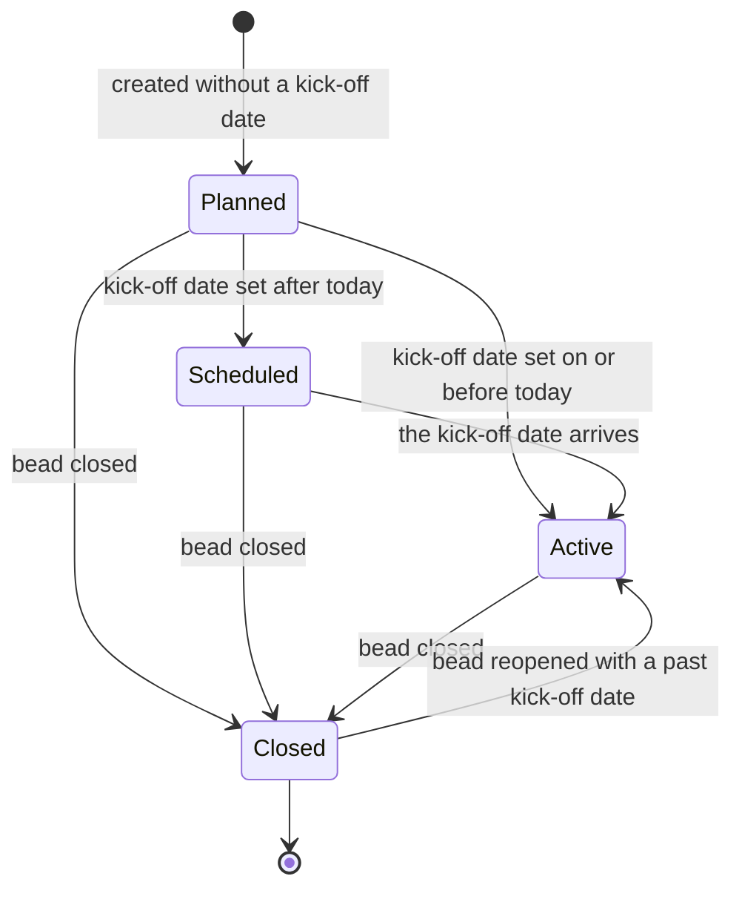

# Milestone status

The status of a milestone, worked out from its bead (closed, `metadata.kickoff`) the same way by gin-workflow and by `GET /api/beads/milestones` (REQ-BEADS-015), and shown with one icon and word wherever a milestone appears (REQ-MILESTONE-UI-022). Late is not a status: it is a mark added to Active, Scheduled or Planned when REQ-MILESTONE-UI-023 holds, and to Closed as "<n> d late".

