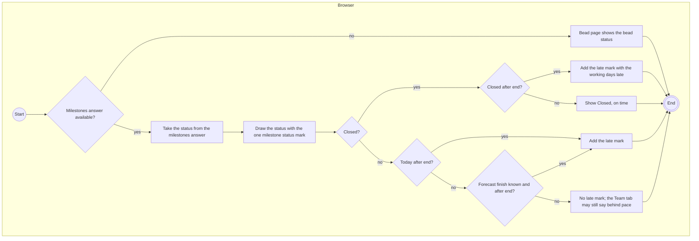

# Milestone status and late mark

How a page shows a milestone's status and whether it is late: the Milestones list, the milestone card of a bead page or epic Overview, the header of a milestone bead's page, and the Team tab (REQ-MILESTONE-UI-022, REQ-MILESTONE-UI-023, REQ-UI-095, REQ-REPORTS-012).

