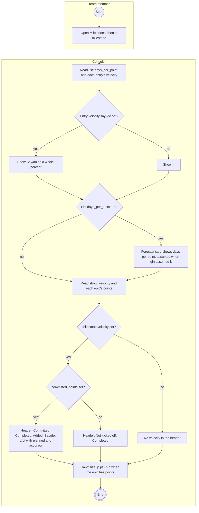

# Milestone velocity

How the Milestones list and the milestone page show story points and velocity from `gin milestone list/show --json` (REQ-MILESTONE-UI-001, REQ-MILESTONE-UI-008, REQ-MILESTONE-UI-013, REQ-MILESTONE-UI-016, REQ-MILESTONE-UI-021).

