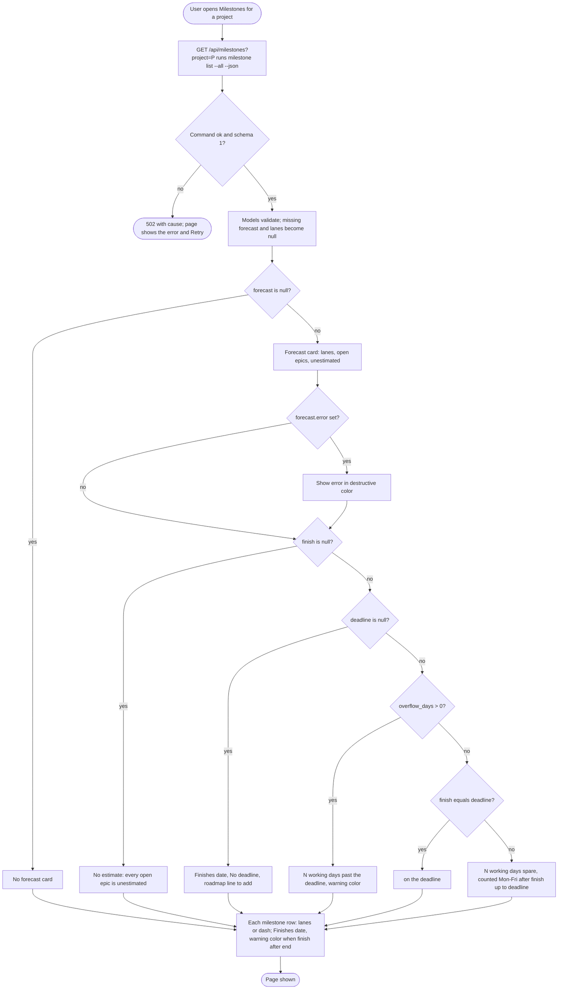

# Milestones forecast

How the Milestones page turns `gin-workflow milestone list --json` into the forecast card and the per-milestone lanes and finish (REQ-MILESTONE-UI-016, REQ-MILESTONE-UI-001, REQ-MILESTONE-UI-008).

