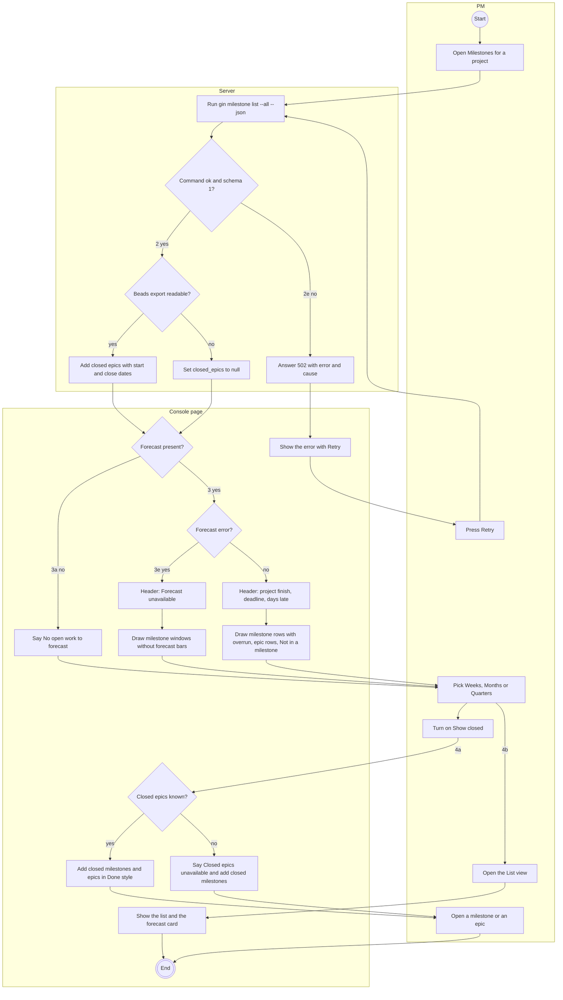

# Project timeline

Use case: see-project-timeline

How the Milestones page turns `gin milestone list --all --json` and the closed epics of the Beads export into the header finish line and the Timeline (REQ-MILESTONE-UI-033 to REQ-MILESTONE-UI-038).

