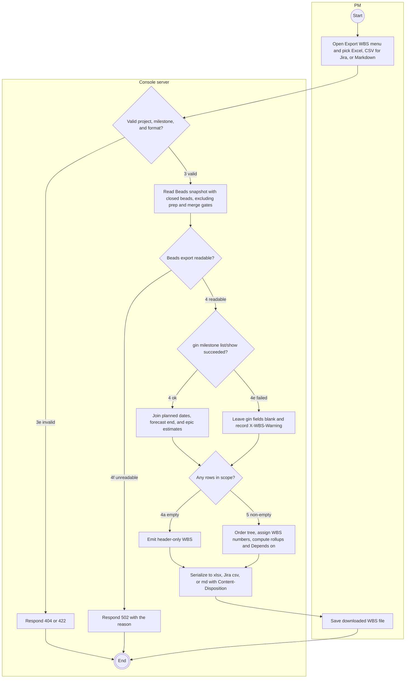

# WBS export

Use case: export-wbs

How gin-console exports a milestone or project work breakdown as Excel, CSV for Jira, or Markdown, including fallback when `gin` is unavailable (REQ-MILESTONE-UI-026 to REQ-MILESTONE-UI-032).

