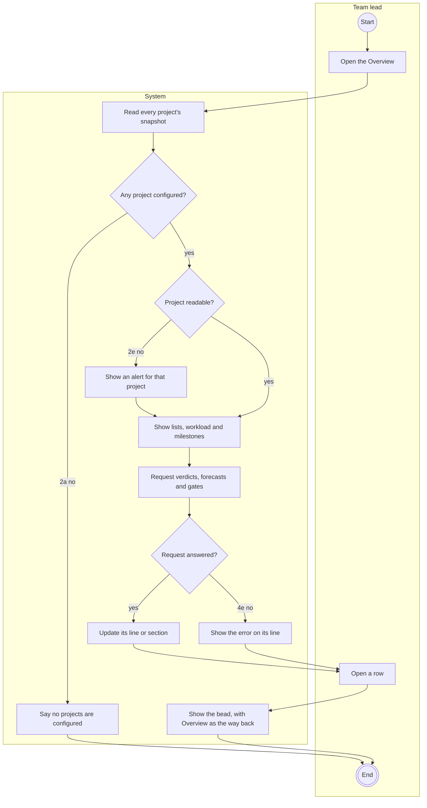

# Overview page

Use case: review-what-needs-me

How the Overview page shows the lists of every project first, then adds verdicts, gates and waivers (REQ-OVERVIEW-001, REQ-OVERVIEW-007, REQ-OVERVIEW-008, REQ-OVERVIEW-010).

