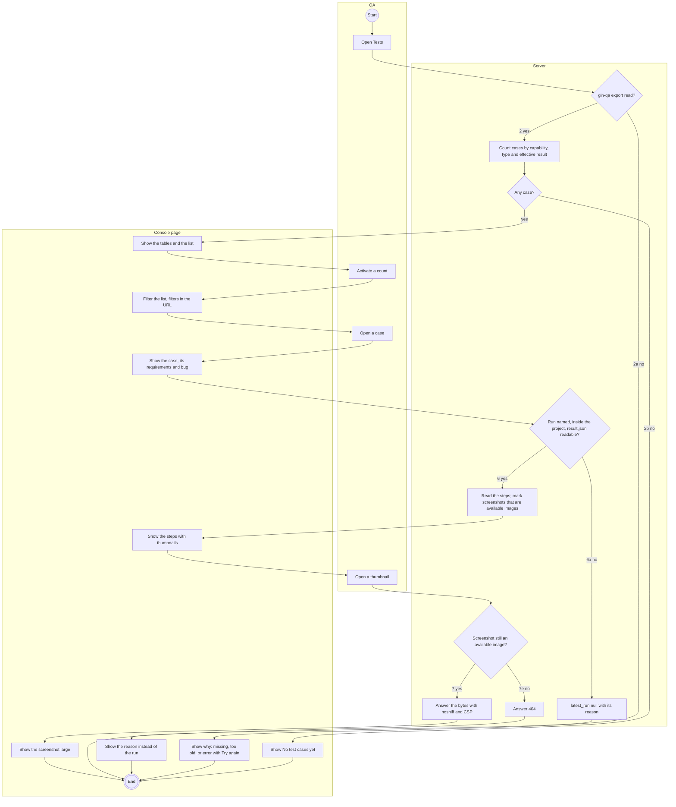

# Cases and latest run

Use case: review-test-results

How the console lists the cases of a project and shows the latest e2e run of one case with its step screenshots (REQ-QA-001 to REQ-QA-006, REQ-QA-010, REQ-QA-011, REQ-QA-013).

