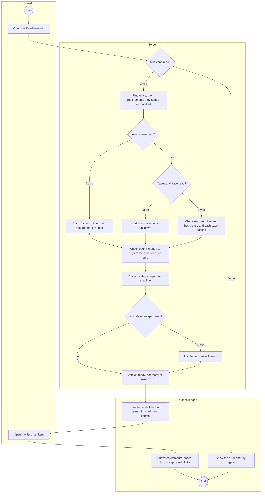

# Release readiness

Use case: check-release-readiness

How the console works out the readiness checklist of a milestone from its epics, their requirements, the cases, the open bugs and the gates (REQ-QA-007 to REQ-QA-009, REQ-QA-012).

