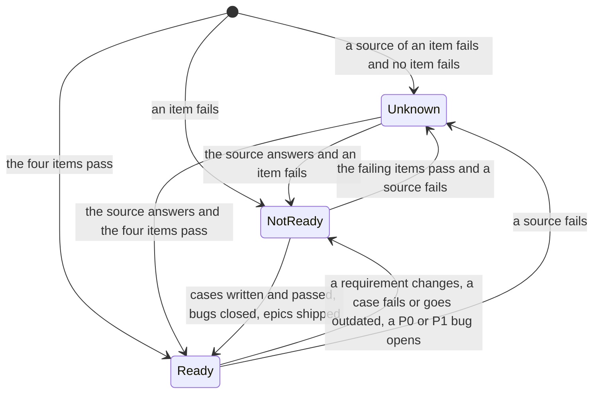

# Readiness verdict

The verdict of a milestone's readiness checklist (REQ-QA-008), worked out on each request of `GET /api/qa/readiness/{project}/{milestone}` from its four items; it is never stored.

