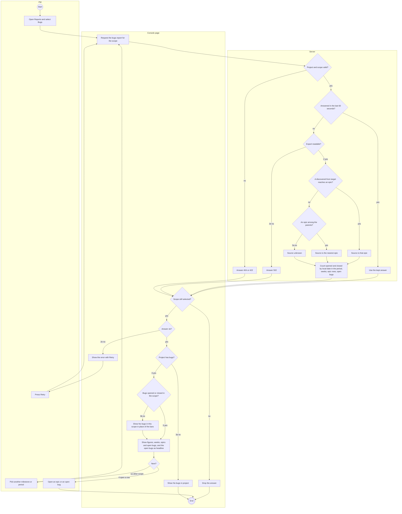

# Bugs section

Use case: see-where-bugs-come-from

How the Bugs section turns the bug beads of one project's `bd export` snapshot into figures, weeks, epic rows and open bugs for the selected scope (REQ-REPORTS-039 to REQ-REPORTS-044).

