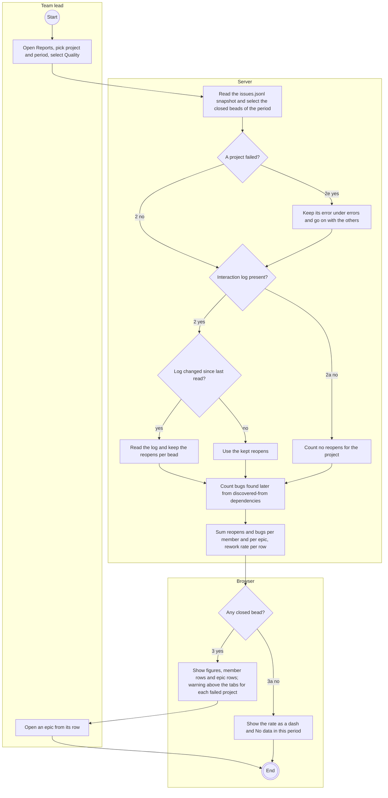

# Rework

How the Quality tab and the Team figures count rework from Beads, with no AI usage data (REQ-REPORTS-005, REQ-REPORTS-009, REQ-REPORTS-010, REQ-REPORTS-019, REQ-UI-091).

Use case: review-rework

