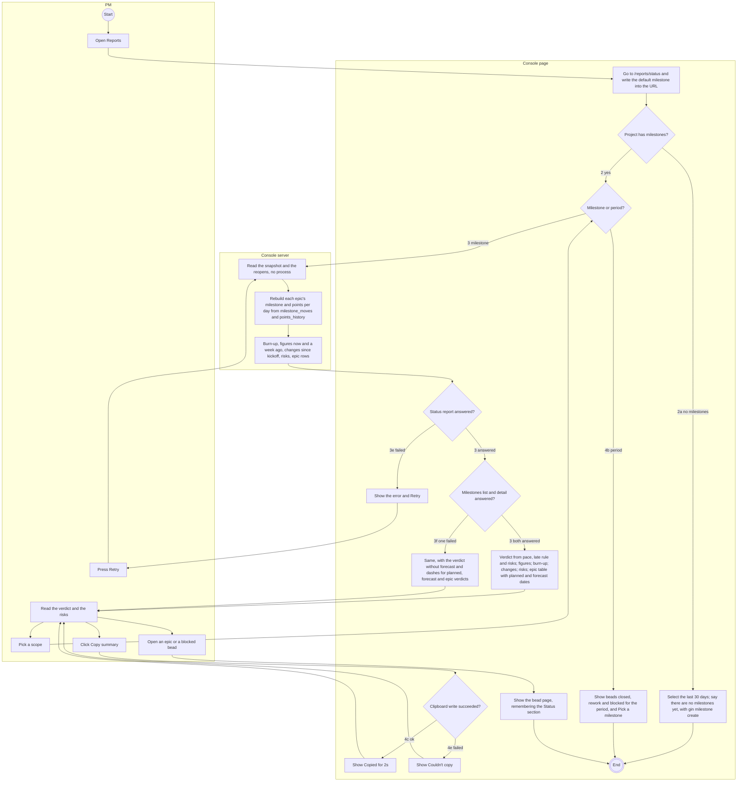

# Status section

Use case: review-milestone-status

How the Status section turns one project's `bd export` snapshot, the Milestones list and the milestone's detail into a verdict, figures, a burn-up, changes, risks and an epic table (REQ-REPORTS-020 to REQ-REPORTS-033).

