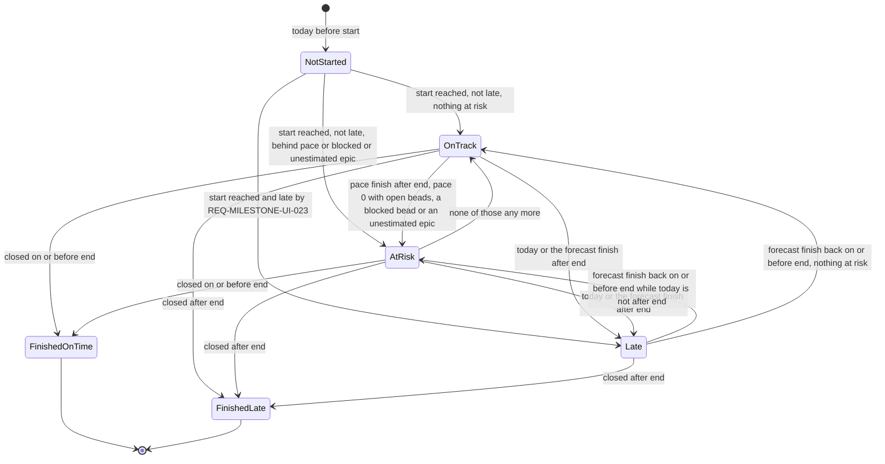

# Status verdict

The verdict the Status section gives a milestone (REQ-REPORTS-027). It is not stored: the frontend works it out from the status report, the Milestones list and today, so a milestone moves between these states as days pass and beads change.

