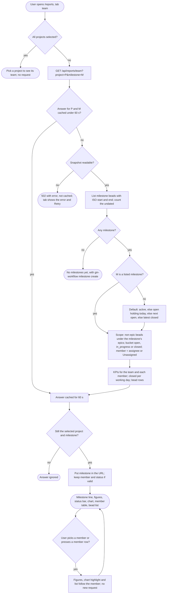

# Team tab

How the Team tab of the Reports page turns one project's `bd export` snapshot into a milestone's scope, KPIs and bead list, and which state it shows (REQ-REPORTS-008 to REQ-REPORTS-017).

