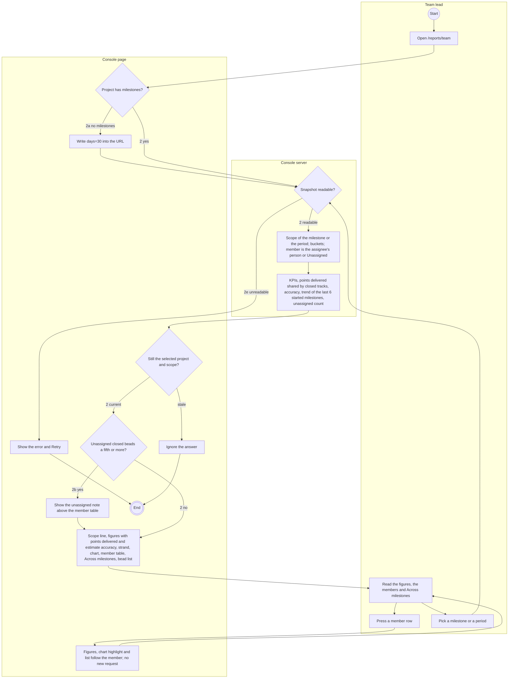

# Team tab

Use case: review-team-in-milestone

How the Team section of the Reports page turns one project's `bd export` snapshot into the scope, KPIs, trend and bead list of a milestone or a period, and which state it shows (REQ-REPORTS-008 to REQ-REPORTS-017, REQ-REPORTS-033 to REQ-REPORTS-036).

