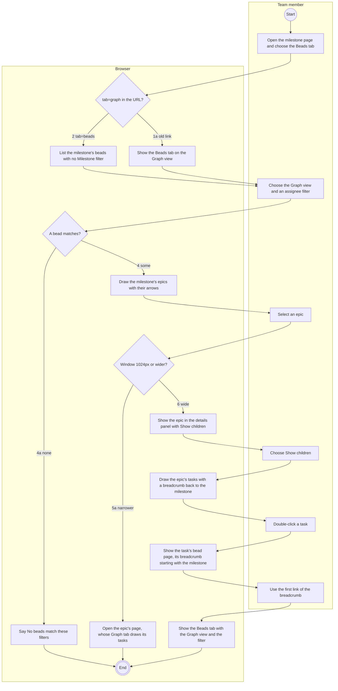

# Browse a milestone's beads

Use case: browse-milestone-beads

How a team member reads a milestone's beads on its Beads tab, goes down into an epic with "Show children" and comes back from a bead page (REQ-MILESTONE-UI-018, REQ-UI-106, REQ-UI-147, REQ-UI-149, REQ-UI-072).

