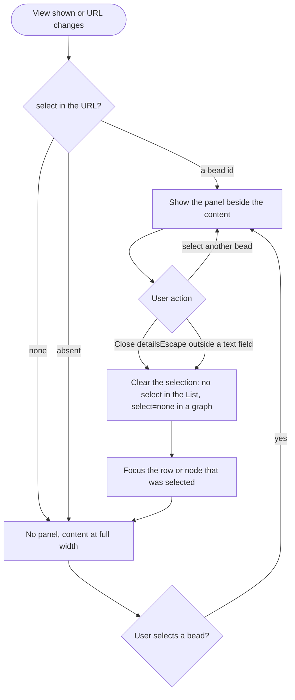

# Details panel

When the List view, the Graph view (on the Beads page and on the Graph tab of an epic page) and the Lanes view show the details panel, from 1024px (REQ-UI-045, REQ-UI-051, REQ-UI-052, REQ-UI-106, REQ-UI-119).

