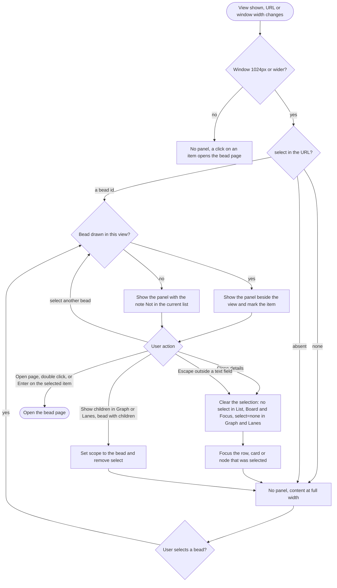

# Details panel

When the List, Board, Focus, Graph and Lanes views show the details panel, on the Beads page, the Beads tab of a milestone page and the Graph and Lanes tabs of an epic page (REQ-UI-045, REQ-UI-051, REQ-UI-052, REQ-UI-106, REQ-UI-119, REQ-UI-147, REQ-UI-148, REQ-UI-149).

