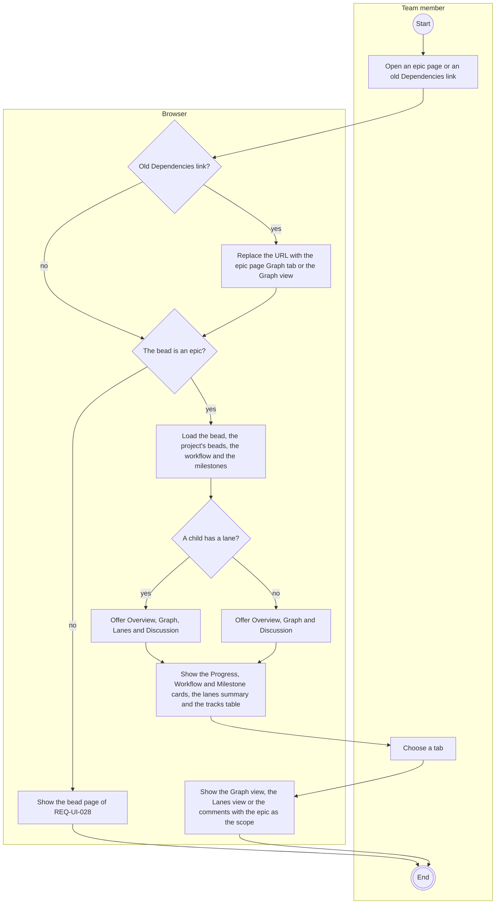

# Epic page

Use case: follow-epic-lanes

How the page of an epic shows its tabs and loads the data of the Overview (REQ-UI-119 to REQ-UI-121), and how an old Dependencies link is redirected (REQ-UI-075).

