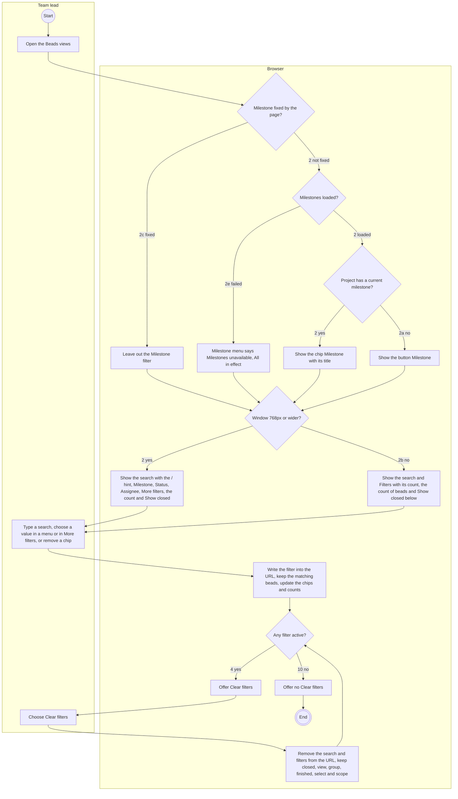

# Filter bar

Use case: narrow-the-beads-list

How the bead filter bar shows its filters by window width, and how a filter, a chip's "×" and "Clear filters" change the URL (REQ-UI-142 to REQ-UI-146, REQ-UI-084, REQ-UI-104).

