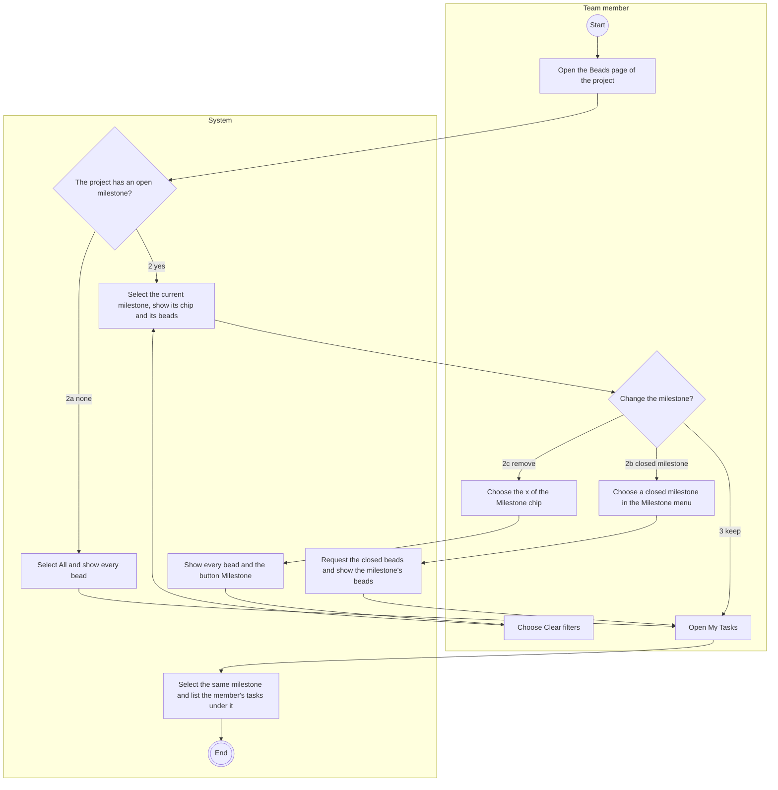

# Filter beads by milestone

Use case: filter-by-milestone

How the Beads page and My Tasks narrow to the project's current milestone, and how a team member chooses another milestone or removes the filter (REQ-UI-104, REQ-UI-105, REQ-UI-143, REQ-UI-144, REQ-BEADS-015).

