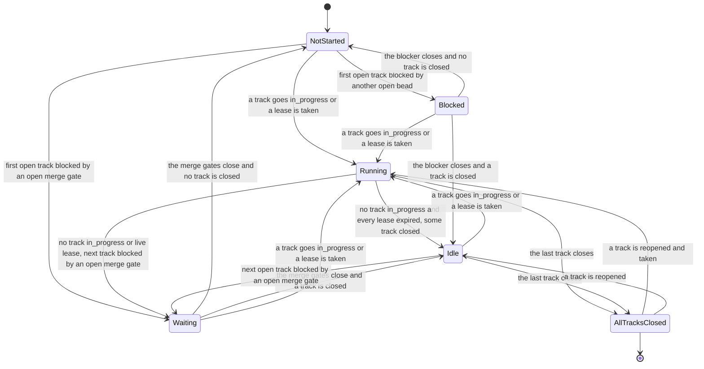

# Lane state

The state of one lane of an epic in the Lanes view header (REQ-UI-112), worked out in the browser from the lane's tracks, their `claim` leases, their blockers and the merge gates that block them; it is not stored. The first rule that holds wins, in the order All tracks closed, Running, Waiting, Blocked, Not started, Idle.

