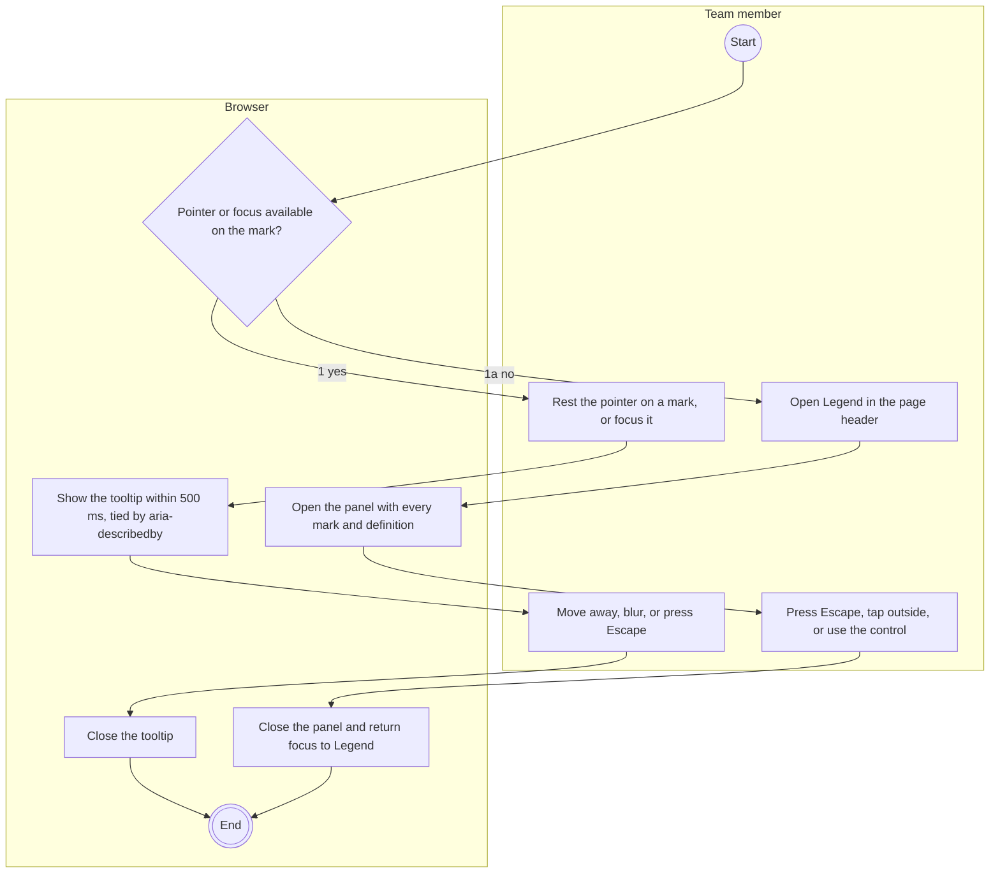

# Legend and tooltips

How a reader gets the meaning of a mark or a count: a tooltip on hover or focus, or the Legend panel on a click or tap (REQ-UI-132, REQ-UI-133).

Use case: read-a-definition

