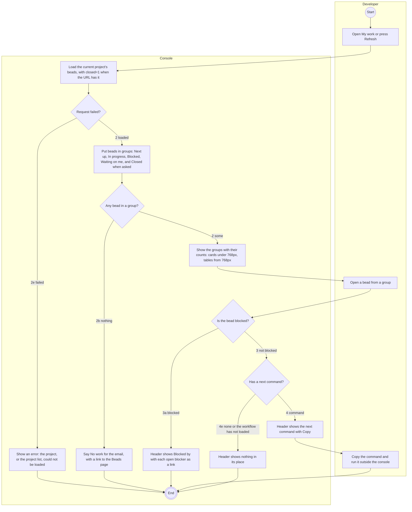

# My work

How the My work page (at `/my-tasks`) groups the beads of the current project for the signed-in email, and what the developer does with a bead (REQ-UI-100, REQ-UI-101, REQ-UI-102, REQ-UI-150, REQ-UI-151, REQ-UI-152, REQ-UI-153, REQ-BEADS-025).

Use case: pick-next-work

