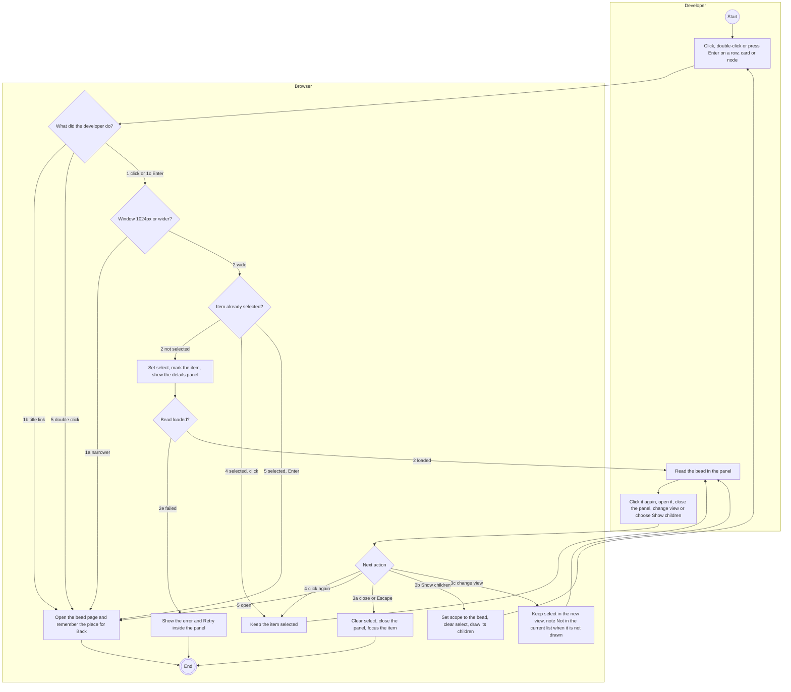

# Select and open a bead

Use case: select-and-open-a-bead

How a click, a double click, `Enter` and Escape act on a row, card or node in the List, Board, Focus, Graph and Lanes views (REQ-UI-147, REQ-UI-148, REQ-UI-149).

