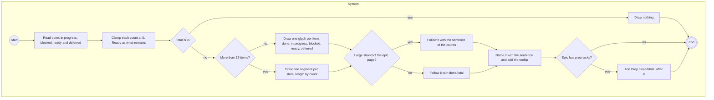

# Progress strand

How the frontend draws the progress of a bead's tracks or of a milestone's epics as a strand (REQ-UI-138), from `child_counts` (REQ-BEADS-022) or the Milestones list `epics` (REQ-MILESTONE-UI-025).

